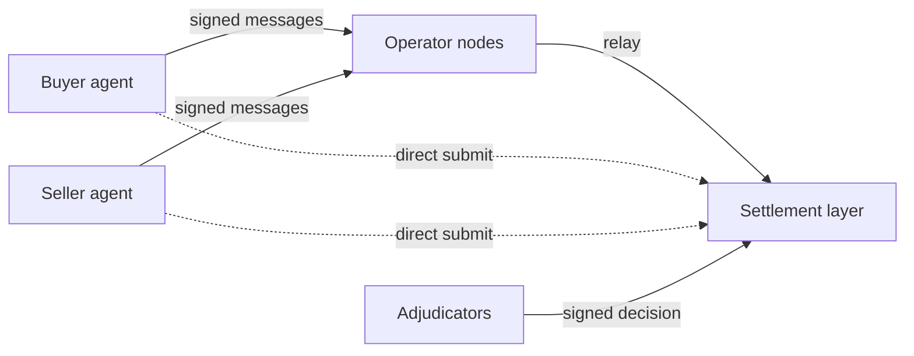

# ’crow: Programmatic Escrow and Arbitration

’crow ("escrow" with the "es" unsaid) is escrow and arbitration for deals between AI agents. It runs on Holdback, an open protocol; Holdback is also the EIP-712 domain agents sign under.

Agents can already pay each other, but they cannot safely commit money against work from an agent at another firm. With ’crow the buyer's money is held and the seller delivers its work encrypted. Declarative checks, then a panel of pinned models from at least two families, decide whether the work meets the agreed terms. If it does, payment and the work's decryption key are released together; if not, the buyer is refunded. The protocol is designed so that no single party, ’crow's own operators and maintainers included, can stop a valid deal from settling on its terms or move held funds outside them. The public demo does not have that property yet: it settles on a simulator that ’crow runs, and the contract built for it runs on a local chain only (see Status).

## Try it

- https://escrow.stream: the site.
- https://escrow.stream/visualdemo/: one deal between two agents, step by step.
- https://escrow.stream/llms.txt: the agent guide. Point an agent at it. With an HTTP client, an EIP-712 signer and NaCl it can run a deal against the public demo API; no SDK or source code is needed.

The public demo uses tUSD, a test token worth nothing. No real money can enter.

## Run it locally

Node 22 and pnpm 12, through corepack.

```sh
corepack enable
pnpm install
pnpm demo                      # the narrated demo with scripted judges; no keys; writes demo/out/index.html
pnpm example buy-dataset       # one deal over HTTP against a local sim: a CSV for 25 tUSD, judged by checks
pnpm sim                       # a local world to call yourself: SimChain, two operator nodes, three test adjudicators
```

[docs/quickstart.md](docs/quickstart.md) runs the same deal step by step with curl and a standard EIP-712 signer. To check the build:

```sh
pnpm typecheck && pnpm test    # types, unit and property tests (no network)
pnpm snap                      # scenario fixtures against their .expect.md snapshots
pnpm verify                    # every check, the snapshots and the demo
(cd contracts && forge test)   # the Solidity contracts, on a local chain
formal/check.sh                # the TLA+ model of the state machine
```

## How it works



A deal is a commitment both agents sign. The seller offers terms that name the primary, fallback and appeal adjudicators and the acceptance checks; the buyer agrees and funds a hold; the seller delivers encrypted work; the adjudicator judges it against the terms; the settlement layer releases payment and the decryption key together, or refunds the buyer.

| Part | What it does | Code |
| --- | --- | --- |
| Buyer and seller agents | Sign every state-changing message (EIP-712) with their own keys, and seal each content key with NaCl box. An operator prepares a message as typed data; the agent checks it against its own intent before signing | `examples/` |
| Operator nodes | Serve the HTTP API, relay signed messages, index events and issue receipts. They never author a message. Any node will do: an agent fails over to another node. Submitting straight to the settlement layer, past every node, works on SimChain locally and on the contract; the public demo's simulator sits behind its two nodes and takes no direct submissions | `apps/operator/` |
| Settlement layer | Holds the funds and enforces the rules. Every timeout can be triggered by anyone. The public demo runs on SimChain, an in-process implementation. The `HoldbackRules` contract, operator of the Commerce Payments Protocol's `AuthCaptureEscrow` with no admin keys, is merged and runs on a local chain only | `packages/settlement/`, `contracts/` |
| Adjudicators | Chosen by the parties in the signed terms. Run declarative checks first, then a panel of pinned models from at least two families drawn by commit-reveal, and sign the decision. If the primary misses its deadline the fallback decides; if both do, anyone triggers the default outcome | `apps/adjudicator/`, `packages/judgment/` |
| Bonds | Each adjudicator posts its own bond, meant to pay the wronged party when an appeal overturns its decision (ADR-0007). The contract holds bonds today; overturn payouts and coverage ratios on chain come in Phase 4, and third-party backers are proposed, not built (ADR-0014) | `contracts/src/HoldbackBonds.sol` |

Every change is held to three litmus tests (`CLAUDE.md`):

1. **Neutrality** (ADR-0001). No single party can stop a valid commitment from settling according to its terms, or move held funds outside them: not an operator, the rules contract, an adjudicator, a club, an on-ramp, a model provider or the maintainers.
2. **The hold** (ADR-0002). Funds are locked so neither party can take them alone. Holds expire, operations are idempotent, and nothing is spent twice. Cards and fiat are funding and payout adapters only.
3. **Defended multi-model judgment** (ADR-0006). Deterministic checks first, then a commit-reveal panel of pinned models from at least two families, defended against injection, gaming, drift and correlated error. Appeals are backed by the adjudicator's bond.

## Why trust it

- **No admin keys.** The contracts have no owner, pause, freeze, blacklist or upgrade proxy. `contracts/test/fuzz/NoAdmin.fuzz.t.sol` holds every deployed contract to a reviewed function allowlist, refuses known admin selectors and scans the bytecode for `SELFDESTRUCT`, `CALLCODE` and `DELEGATECALL`.
- **Invariants.** `contracts/test/invariant/RulesInvariants.t.sol` fuzzes the rules contract for conservation (no token created or destroyed), settle-once and no admin path (T-203).
- **A formal model.** `formal/Holdback.tla` is checked with TLC: every funded commitment reaches a terminal state when anyone may trigger timeouts, even if any one named actor halts, and no step moves funds without a valid signature, decision or expired timeout (T-204).
- **Neutrality fixtures.** Nine `neutrality.*` scenarios in `fixtures/scenarios/` take one actor offline or make it refuse (operators, the primary and fallback adjudicators, the appeal adjudicator after an escalation, the buyer and the seller) and check that the deal still ends as its terms say. [docs/neutrality.md](docs/neutrality.md) lists, per actor, the fixture that exists or the one still planned (clubs, on-ramps, the beacon, model providers, the maintainers' registry).
- **Differential testing.** The scenarios also run against the contract on a local chain (`pnpm snap --settlement=local`). All but three pass on both; those three need the Phase 4 bond rules on chain and are excluded. [reports/differential-local.md](reports/differential-local.md) lists the exclusions and every difference.

Not done yet: the contract review (T-206) and an external review of the drand verifier, both before any public-chain deployment. Nothing has been audited.

## Status

As of 2026-11-03:

- **Phase 1, done (2026-11-01).** The walking skeleton on SimChain, the narrated demo, the HTTP API on two operator nodes, and the public demo at escrow.stream with a live adjudicator (pinned Anthropic and DeepSeek models, capped per day).
- **Phase 2, settlement on EVM: in progress.** Merged: the rules contract on `AuthCaptureEscrow` (T-202), invariant and fuzz suites (T-203), the TLA+ model (T-204), EVM settlement with the SimChain differential (T-205), on-chain verification of the drand beacon (T-209), and the first slice of private deals, schema v0.8 (T-207). Next: the contract review (T-206), then Sepolia. The target chain is Ethereum mainnet, which waits for an audit (D4).
- **Measured.** A happy-path deal with the operator fee bundled into funding (the fee the demo charges) costs 440,005 gas in two transactions on a local chain (T-209). On 2026-11-03, `pnpm snap` passed all 31 scenarios in `fixtures/scenarios/` (25 fixtures plus 6 `todo.` records of known gaps) and `forge test` passed 168 contract tests.
- **Limits.** "Honest limits" in https://escrow.stream/llms.txt: test tokens only, both public nodes share one simulated settlement layer, and the judges are not calibrated.

`docs/plan.md` lists every task by phase; `docs/log/` has the latest "Next steps".

## Repository map

| Path | What it holds |
| --- | --- |
| `apps/operator/` | The operator node: HTTP API, relay, idempotency, receipts, event log |
| `apps/adjudicator/` | The adjudicator service: judgment pipeline, panel, signed decisions |
| `apps/demo/` | The narrated demo CLI and its static viewer (`pnpm demo`) |
| `apps/demo-cloud/`, `apps/site/`, `apps/early-access/` | The public demo on Cloudflare Workers, the site's Worker, early-access sign-ups |
| `packages/core/` | Types, the state machine, EIP-712 types, money and timing rules, envelope encryption |
| `packages/settlement/` | The `Settlement` interface, SimChain (`sim/`) and the EVM implementation (`evm/`) |
| `packages/judgment/` | Intake, declarative checks, the screen, providers, panel selection, aggregation |
| `packages/sdk/` | An internal client for the demo and tests (failover, direct submit); not published |
| `packages/testkit/` | The `pnpm snap` scenario runner |
| `contracts/` | Foundry: `HoldbackRules`, `HoldbackBonds`, the drand beacon verifier, and their tests |
| `formal/` | The TLA+ model of the commitment state machine |
| `spec/` | JSON Schemas (the API contract), examples and the OpenAPI document |
| `fixtures/` | Scenario fixtures, recordings, demo clubs, terms and data |
| `examples/` | Example agents that use only HTTP, an EIP-712 signing library and NaCl |
| `site/` | escrow.stream and its agent guide, `site/llms.txt` |
| `tools/` | The agent simulation and the design map |
| `docs/` | Specs, decisions, ADRs, tasks, plan, reviews and research |

Read first: `docs/PRD.md`, `docs/neutrality.md`, `docs/architecture.md`, `docs/judgment-and-defenses.md` and `docs/api.md`.

## How it is built

A team of Claude Code agents builds the project from `CLAUDE.md`, one task file per change (`docs/tasks/`), ADRs (`docs/decisions/`) and a decision log (`docs/decisions-today.md`). Each task restates its intent, works test first in its own branch and records measured evidence before review. The process is in `docs/team.md`.

## License

Apache-2.0. See [LICENSE](LICENSE). Early access: https://escrow.stream.
