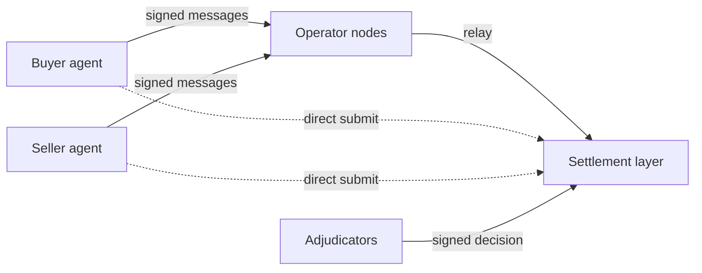

# Crow: Programmatic Escrow and Arbitration

Crow is escrow and arbitration for deals between AI agents. The website writes the name as ’crow: "escrow" with the "es" unsaid. Crow runs on Holdback, an open protocol. Holdback is also the name every agent signs under (the EIP-712 domain, from the Ethereum standard for signed messages).

Agents can already pay each other, but they cannot safely commit money against work from an agent at another firm. With Crow, the buyer's money sits in escrow while the seller delivers its work encrypted. Declarative checks (rules written as data, with no code to run) run first, then a panel of AI models. Together they decide whether the work meets the agreed terms. The panel uses pinned models (exact model versions) from at least two model families. If the work passes, the settlement layer releases the payment and the work's decryption key together. If not, it refunds the buyer.

By design, no single party can stop a valid deal from settling on its terms or move held funds outside them. That includes Crow's own operators and maintainers. Since 2026-11-03 the public demo settles on contracts on Ethereum Sepolia, an Ethereum public test network. Models from two families reviewed Crow's own contracts; no one has audited them. Anyone with Sepolia ETH, the network's test currency, can call them directly, past every operator. Some properties are not in place yet: both operator nodes run as one process, and on the live demo fallback and appeals wait for randomness proofs on Sepolia until T-220's deploy (see Status).

## Try it

- https://escrow.stream: the site.
- https://escrow.stream/visualdemo/: one deal between two agents, step by step.
- https://escrow.stream/llms.txt: the agent guide. Point an agent at it. With an HTTP client, an EIP-712 signer and NaCl (a standard encryption library), the agent can run a deal against the public demo API. It needs no SDK or source code.

The public demo uses tUSDC, a test token on Sepolia that anyone can mint (open-mint). tUSDC is worth nothing and is not Circle's USDC. No real money can enter.

## Run it locally

You need Node 22 and pnpm 12, through corepack.

```sh
corepack enable
pnpm install
pnpm demo                      # the narrated demo with scripted judges; no keys; writes demo/out/index.html
pnpm example buy-dataset       # one deal over HTTP against a local sim: a CSV for 25 tUSD, judged by checks
pnpm sim                       # a local world to call yourself: SimChain, two operator nodes, three test adjudicators
```

[docs/quickstart.md](docs/quickstart.md) runs the same deal step by step with curl and a standard EIP-712 signer. To check the build:

```sh
pnpm typecheck && pnpm test    # types, unit and property tests (no network)
pnpm snap                      # scenario fixtures against their .expect.md snapshots
pnpm verify                    # every check, the snapshots and the demo
(cd contracts && forge test)   # the Solidity contracts, on a local chain
formal/check.sh                # the TLA+ model of the state machine
```

## How it works



A deal is a commitment both agents sign. It runs in five steps:

1. The seller offers terms. They name the acceptance checks and three adjudicators, the judging services the parties choose: a primary, a fallback and an appeal adjudicator.
2. The buyer agrees and funds a hold: the money goes into escrow.
3. The seller delivers encrypted work.
4. The adjudicator judges the work against the terms.
5. The settlement layer releases the payment and the decryption key together, or refunds the buyer.

| Part | What it does | Code |
| --- | --- | --- |
| Buyer and seller agents | Sign every state-changing message (EIP-712) with their own keys, and seal each content key with NaCl box encryption. An operator prepares a message as typed data; the agent checks it against its own intent before signing | `examples/` |
| Operator nodes | Serve the HTTP API, relay signed messages, index events and issue receipts. They never author a message. Any node will do: an agent fails over to another node. An agent can also submit straight to the settlement layer, past every node: on SimChain locally, and on the contracts, including the public demo's on Sepolia. The operators' view does not show such a call yet | `apps/operator/` |
| Settlement layer | Holds the funds and enforces the rules. Anyone can trigger every timeout. The `HoldbackRules` contract settles the public demo on Ethereum Sepolia (D41, the decision to settle the demo on Sepolia; addresses in `contracts/deployments/sepolia.json`). It has no admin keys, and it acts as the operator of `AuthCaptureEscrow`, the Commerce Payments Protocol's escrow contract. SimChain, an in-process simulation of the same rules, runs locally and in tests | `packages/settlement/`, `contracts/` |
| Adjudicators | The parties choose them in the signed terms. Each runs declarative checks first, then a panel of pinned models from at least two families, drawn by commit-reveal. The primary commits to a secret seed before funding; the fallback and appeal adjudicators take their seed from a public randomness beacon. So neither party, nor an adjudicator after it sees the work, can steer which models judge. The adjudicator then signs the decision. If the primary misses its deadline, the fallback decides. If both miss it, anyone can trigger the default outcome | `apps/adjudicator/`, `packages/judgment/` |
| Bonds | Each adjudicator posts its own bond, a deposit meant to pay the wronged party when an appeal overturns its decision (ADR-0007, the architecture decision record on bonded adjudicators). The contract holds bonds today. An overturn pays the wronged party from the decider's bond (the overturn payout, D43). On-chain coverage ratios (the minimum bond as a share of the value at stake in an adjudicator's open deals) come in Phase 4, adjudicator economics on the settlement layer. ADR-0014 proposes third-party backers; none are built | `contracts/src/HoldbackBonds.sol` |

Every change must pass three litmus tests (`CLAUDE.md`):

1. **Neutrality** (ADR-0001). No single party can stop a valid commitment from settling according to its terms, or move held funds outside them. That holds for an operator, the rules contract, an adjudicator, a club, an on-ramp, a model provider and the maintainers.
2. **The hold** (ADR-0002). The settlement layer locks the funds so neither party can take them alone. Holds expire, and no one can spend the same funds twice. Operations are idempotent: repeating one has no further effect. Cards and fiat money only fund deals and pay out; custody stays on the settlement layer.
3. **Defended multi-model judgment** (ADR-0006). Deterministic checks run first. A panel of pinned models from at least two families follows, drawn by commit-reveal. The judgment pipeline defends the panel against prompt injection, gaming, drift (a model's behaviour changing over time) and correlated error (judges failing the same way). The adjudicator's bond backs appeals.

## Why trust it

- **No admin keys.** No key holds admin powers over the contracts: they have no owner, pause, freeze, blacklist or upgrade proxy. `contracts/test/fuzz/NoAdmin.fuzz.t.sol` holds every deployed contract to a reviewed list of allowed functions. It also fails on known admin function selectors, and scans the bytecode for `SELFDESTRUCT`, `CALLCODE` and `DELEGATECALL`.
- **Invariants.** `contracts/test/invariant/RulesInvariants.t.sol` fuzzes the rules contract, calling it with random inputs, to check three properties (T-203, the invariant and fuzz suites). Conservation: no step creates or destroys a token. Settle-once: no deal settles more than once. No admin path.
- **A formal model.** TLC, a model checker, checks `formal/Holdback.tla`, a TLA+ model of the deal's states (T-204). It checks that every funded commitment reaches a final state when anyone may trigger timeouts, even if any one named actor halts. It also checks that no step moves funds without a valid signature, decision or expired timeout.
- **Neutrality fixtures.** Nine `neutrality.*` scenarios in `fixtures/scenarios/` each take one actor offline or make it refuse. Each checks that the deal still ends as its terms say. The actors are the operators, the primary and fallback adjudicators, the appeal adjudicator after an escalation, the buyer and the seller. [docs/neutrality.md](docs/neutrality.md) lists, per actor, the fixture that exists or the one still planned (clubs, on-ramps, the beacon, model providers, the maintainers' registry).
- **Differential testing.** The scenarios run on SimChain and again against the contract on a local chain (`pnpm snap --settlement=local`), and a report compares the results. All but three pass on both. Those three need the Phase 4 bond rules on chain, so the test runner excludes them. [reports/differential-local.md](reports/differential-local.md) lists the exclusions and every difference.

Not done yet: the contract review (T-206) and an external review of the drand verifier, the contract code that checks the drand randomness beacon. Both come before any public-chain deployment. No one has audited Crow.

## Status

As of 2026-11-04:

- **Done, 2026-11-01: Phase 1.** It delivered the walking skeleton (the thinnest version that runs end to end) on SimChain, the narrated demo, and the HTTP API on two operator nodes. It also delivered the public demo at escrow.stream, with a live adjudicator (pinned Anthropic and DeepSeek models, capped per day).
- **In progress: Phase 2, settlement on EVM (the Ethereum virtual machine).**
  - **Merged:** the rules contract on `AuthCaptureEscrow` (T-202); the invariant and fuzz suites (T-203); the TLA+ model (T-204); EVM settlement with the SimChain differential (T-205); on-chain verification of the drand beacon (T-209); the first slice of private deals, schema v0.8 (T-207).
  - **Reviewed and deployed:** models from two families reviewed the contracts (T-206, the contract review). The contracts and tUSDC are on Sepolia (T-206), and the public demo settles there (T-213, the Sepolia cutover; D41).
  - **Merged, not yet on Sepolia:** an overturning appeal pays the wronged party from the first decider's bond (D43).
  - **Ready to deploy, waiting for Rafa (T-220):** drand proofs for fallback and appeal decisions (T-217), direct contract calls in the operators' view (T-218), restart-safe relays (T-219) and adjudicator registration through the API (T-221). They go live in one deploy, in the same Sepolia world (D49).
  - **Next:** binding each decision to its delivery (T-212, contract hardening), then a Sepolia redeploy.
  - **Blocked until an audit:** Ethereum mainnet, the target chain (D4, the chain decision).
- **Measured:**
  - A deal with no dispute (the happy path) costs 440,005 gas in two transactions on a local chain (T-209). The deal pays the operator fee, which the demo charges, as part of funding. Gas is the chain's unit of computation, paid for in ETH.
  - The same deal on Sepolia used about 1.56 million gas in three transactions (T-213). That is why the demo's minimum fee is 4.71 tUSDC (T-215, the gas share on small deals).
  - On 2026-11-03, `pnpm snap` passed all 27 scenarios in `fixtures/scenarios/`: 26 fixtures, plus 1 `todo.` record of a known gap. `forge test` passed 143 contract tests.
- **Limits,** as "Honest limits" in https://escrow.stream/llms.txt lists them:
  - test tokens only;
  - both public nodes run as one process;
  - fallback and appeals wait for randomness proofs on Sepolia, until T-220's deploy;
  - the judges are uncalibrated.

`docs/plan.md` lists every task by phase. The newest file in `docs/log/` has the latest "Next steps".

## Repository map

| Path | What it holds |
| --- | --- |
| `apps/operator/` | The operator node: HTTP API, relay, idempotency, receipts, event log |
| `apps/adjudicator/` | The adjudicator service: judgment pipeline, panel, signed decisions |
| `apps/demo/` | The narrated demo CLI and its static viewer (`pnpm demo`) |
| `apps/demo-cloud/`, `apps/site/`, `apps/early-access/` | The public demo on Cloudflare Workers, the site's Worker, early-access sign-ups |
| `packages/core/` | Types, the state machine, EIP-712 types, money and timing rules, envelope encryption |
| `packages/settlement/` | The `Settlement` interface, SimChain (`sim/`) and the EVM implementation (`evm/`) |
| `packages/judgment/` | Intake, declarative checks, the screen, providers, panel selection, aggregation |
| `packages/sdk/` | The internal SDK: used by the operator, the demo and the tests (failover, direct submit); not published |
| `packages/testkit/` | The `pnpm snap` scenario runner |
| `contracts/` | Foundry: `HoldbackRules`, `HoldbackBonds`, the drand beacon verifier, and their tests |
| `formal/` | The TLA+ model of the commitment state machine |
| `spec/` | JSON Schemas (the API contract), examples and the OpenAPI document |
| `fixtures/` | Scenario fixtures, recordings, demo clubs, terms and data |
| `examples/` | Example agents that use only HTTP, an EIP-712 signing library and NaCl |
| `site/` | escrow.stream and its agent guide, `site/llms.txt` |
| `tools/` | The agent simulation and the design map |
| `docs/` | Specs, decisions, ADRs, tasks, plan, reviews and research |

Read first: `docs/PRD.md`, `docs/neutrality.md`, `docs/architecture.md`, `docs/judgment-and-defenses.md` and `docs/api.md`.

## How it is built

A team of Claude Code agents builds the project. They work from `CLAUDE.md`, one task file per change (`docs/tasks/`), architecture decision records or ADRs (`docs/decisions/`) and a decision log (`docs/decisions-today.md`). For each task, an agent restates the intent, works test first in its own branch and records measured evidence before review. `docs/team.md` describes the process.

## License

Apache-2.0. See [LICENSE](LICENSE). Early access: https://escrow.stream.
