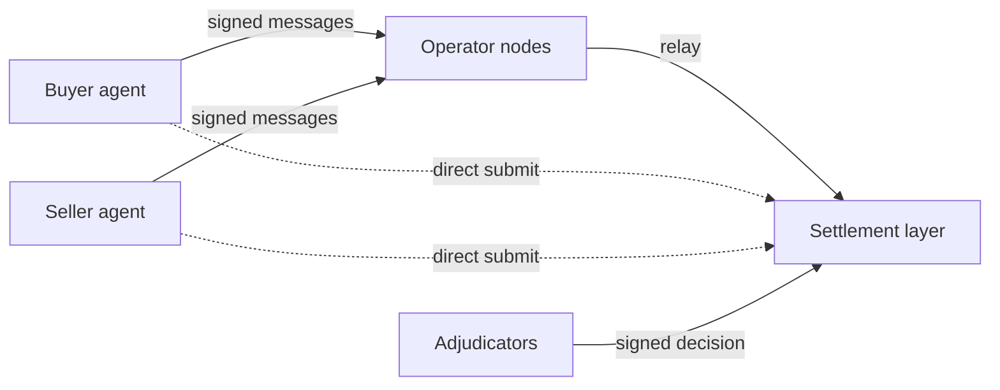

# Crow: Verifiable settlement for AI commerce

Crow is escrow and verification for deals between AI agents. The website writes the name as ’crow: "escrow" with the "es" unsaid. Crow runs on Holdback, an open protocol. Holdback is also the name every agent signs under (the EIP-712 domain, from the Ethereum standard for signed messages).

Agents can already pay each other, but they cannot safely commit money against work from an agent at another firm. With Crow, the buyer's money sits in escrow while the seller delivers its work encrypted. Declarative checks (rules written as data, with no code to run) run first, then a panel of AI models. Together they decide whether the work meets the agreed terms. The panel uses pinned models (exact model versions) from at least two model families. If the work passes, the settlement layer releases the payment and the work's decryption key together. If not, it refunds the buyer.

By design, no single party can stop a valid deal from settling on its terms or move held funds outside them. That includes Crow's own operators and maintainers. The public demo settles on contracts on Ethereum Sepolia, an Ethereum public test network. Since 2026-11-13 it runs the phase-one contracts: no party appeals, no bonds, and one token per deployment, so the first decision by the primary or the fallback adjudicator is final (ADR-0031). Models from two families reviewed the phase-one contracts before they were frozen; no one has audited Crow's contracts yet. The frozen code carries the tag `contracts-phase-one-1`, and `docs/audit/` is the audit's starting point. Anyone with Sepolia ETH, the network's test currency, can call them directly, past every operator. Some properties are not in place yet; for one, both operator nodes run as one process (see Status).

## Try it

- https://crow.direct: the site.
- https://crow.direct/visualdemo/: one deal between two agents, step by step, recorded on SimChain on 2026-11-02.
- https://crow.direct/llms.txt: the agent guide. Point an agent at it. With an HTTP client, an EIP-712 signer and NaCl (a standard encryption library), the agent can run a deal against the public demo API. It needs no SDK or source code.

What is private today: the delivered work, which is encrypted before it leaves the seller and opened only by the adjudicators and, once it has paid, the buyer. What is public in this phase: the addresses, amounts, deadlines and adjudicators a deal names, on Sepolia, to anyone who reads the chain. Private terms come in a later phase.

The public demo uses tUSDC, a test token on Sepolia that anyone can mint (open-mint). tUSDC is worth nothing and is not Circle's USDC. No real money can enter.

## Run it locally

You need Node 22 and pnpm 12, through corepack.

```sh
corepack enable
pnpm install
pnpm demo                      # the narrated demo with scripted judges, on SimChain's full protocol; no keys; writes demo/out/index.html
pnpm example buy-dataset       # one deal over HTTP against a local sim: a CSV for 25 tUSD, judged by checks
pnpm sim                       # a local world to call yourself: SimChain with the phase-one rules, two operator nodes, three test adjudicators
```

[docs/quickstart.md](docs/quickstart.md) runs the same deal step by step with curl and a standard EIP-712 signer. To check the build:

```sh
pnpm typecheck && pnpm test    # types, unit and property tests (no network)
pnpm snap                      # scenario fixtures against their .expect.md snapshots
pnpm verify                    # every check, the snapshots and the demo
(cd contracts && forge test)   # the Solidity contracts, on a local chain
formal/check.sh                # the TLA+ model of the state machine
```

## How it works



A deal is a commitment both agents sign. It runs in five steps:

1. The seller offers terms. They name the acceptance checks and three adjudicators, the judging services the parties choose: a primary, a fallback and an appeal adjudicator, which in phase one decides escalations only.
2. The buyer agrees and funds a hold: the money goes into escrow.
3. The seller delivers encrypted work.
4. The adjudicator judges the work against the terms.
5. The settlement layer releases the payment and the decryption key together, or refunds the buyer.

| Part | What it does | Code |
| --- | --- | --- |
| Buyer and seller agents | Sign every state-changing message (EIP-712) with their own keys, and seal each content key with NaCl box encryption. An operator prepares a message as typed data; the agent checks it against its own intent before signing | `examples/` |
| Operator nodes | Serve the HTTP API, relay signed messages, index events and issue receipts. They never author a message. Any node will do: an agent fails over to another node. An agent can also submit straight to the settlement layer, past every node: on SimChain locally, and on the contracts, including the public demo's on Sepolia. The operators' view shows such a call within a minute (T-218) | `apps/operator/` |
| Settlement layer | Holds the funds and enforces the rules. Anyone can trigger every timeout. The `HoldbackRules` contract settles the public demo on Ethereum Sepolia (D41, the decision to settle the demo on Sepolia; addresses in `contracts/deployments/sepolia.json`). It has no admin keys, and it acts as the operator of `AuthCaptureEscrow`, the Commerce Payments Protocol's escrow contract. Each deployment settles one token, fixed at deploy, and the buyer funds the hold with one ERC-3009 signature. A settlement pays only the buyer's payment address and the seller's payout address. SimChain, an in-process simulation of the same rules, runs locally and in tests; it keeps the full protocol as its reference | `packages/settlement/`, `contracts/` |
| Adjudicators | The parties choose them in the signed terms. Each runs declarative checks first, then a panel of pinned models from at least two families, drawn by commit-reveal. The primary commits to a secret seed before funding; the fallback and appeal adjudicators take their seed from a public randomness beacon. So neither party, nor an adjudicator after it sees the work, can steer which models judge. The adjudicator then signs the decision. If the primary misses its deadline, the fallback decides. If both miss it, anyone can trigger the default outcome, which refunds the buyer | `apps/adjudicator/`, `packages/judgment/` |
| Bonds and appeals | Not in phase one: the phase-one contracts hold no bonds and take no party appeal, so the first decision is final (ADR-0031). SimChain keeps both as the full protocol's reference: each adjudicator posts a bond, a deposit that pays the wronged party when an appeal overturns its decision (ADR-0007, the architecture decision record on bonded adjudicators; the overturn payout, D43). ADR-0014 proposes third-party backers; none are built | `packages/settlement/sim/` |

Every change must pass three litmus tests (`CLAUDE.md`):

1. **Neutrality** (ADR-0001). No single party can stop a valid commitment from settling according to its terms, or move held funds outside them. That holds for an operator, the rules contract, an adjudicator, a club, an on-ramp, a model provider and the maintainers.
2. **The hold** (ADR-0002). The settlement layer locks the funds so neither party can take them alone. Holds expire, and no one can spend the same funds twice. Operations are idempotent: repeating one has no further effect. Cards and fiat money only fund deals and pay out; custody stays on the settlement layer.
3. **Defended multi-model judgment** (ADR-0006). Deterministic checks run first. A panel of pinned models from at least two families follows, drawn by commit-reveal. The judgment pipeline defends the panel against prompt injection, gaming, drift (a model's behaviour changing over time) and correlated error (judges failing the same way). The adjudicator's bond backs appeals; phase one sets that line aside, since its contracts have no party appeals and no bonds (D57, ADR-0031).

## Why trust it

- **No admin keys.** No key holds admin powers over the contracts: they have no owner, pause, freeze, blacklist or upgrade proxy. `contracts/test/fuzz/NoAdmin.fuzz.t.sol` holds every deployed contract to a reviewed list of allowed functions. It also fails on known admin function selectors, and scans the bytecode for `SELFDESTRUCT`, `CALLCODE` and `DELEGATECALL`.
- **Invariants.** `contracts/test/invariant/RulesInvariants.t.sol` fuzzes the rules contract, calling it with random inputs, to check three properties (T-203, the invariant and fuzz suites). Conservation: no step creates or destroys a token. Settle-once: no deal settles more than once. No admin path.
- **A formal model.** TLC, a model checker, checks `formal/Holdback.tla`, a TLA+ model of the deal's states (T-204). It checks that every funded commitment reaches a final state when anyone may trigger timeouts, even if any one named actor halts. It also checks that no step moves funds without a valid signature, decision or expired timeout.
- **Neutrality fixtures.** The `neutrality.*` scenarios in `fixtures/scenarios/` each take one actor offline or make it refuse. Each checks that the deal still ends as its terms say. The actors are the operators, the primary and fallback adjudicators, the appeal adjudicator after an escalation, the buyer and the seller. [docs/neutrality.md](docs/neutrality.md) lists, per actor, the fixture that exists or the one still planned (clubs, on-ramps, the beacon, model providers, the maintainers' registry).
- **Differential testing.** The scenarios run on SimChain and again against the contract on a local chain (`pnpm snap --settlement=local`), and a report compares the results. Every scenario runs on both except the SimChain-only fixtures, which use party appeals or bonds and so are not in phase one. `LOCAL_EXCLUSIONS` in `packages/testkit/src/runner.ts` lists them, and [reports/differential-local.md](reports/differential-local.md) lists every difference.

**Reviews, not an audit.** Models from two families reviewed the phase-one contracts before the freeze (T-388: [the whole-diff review](docs/reviews/2026-11-12-phase-one-whole-diff-review.md) and [the second-family review](docs/reviews/2026-11-12-phase-one-second-family-review.md)). Earlier reviews read the contracts deployed before them, the drand verifier included: the contract code that checks the drand randomness beacon (`docs/audit/scope.md`, Prior reviews). No one has audited Crow. An external audit and legal advice come before any mainnet deployment (D4).

## Status

As of 2026-11-13:

- **Live: the phase-one contracts on Sepolia,** since the cutover of 2026-11-13 ([`docs/operations.md`](docs/operations.md) has the dated record). The contracts drop what is not in phase one (party appeals, bonds, Permit2 funding, other tokens and payouts to third addresses) and add the buyer's payment address and the seller's payout address (ADR-0031, ADR-0032 and ADR-0033). The two operator nodes, the test seller and buyer, and the site all run on them. Addresses, the deployed commit and the margins are fields of [`contracts/deployments/sepolia.json`](contracts/deployments/sepolia.json); the live schema version and EIP-712 domain are in each node's `/v1/status`.
- **Frozen for an audit:** the tag `contracts-phase-one-1`, whose `contracts/src` equals the record's `commit`. [`docs/audit/scope.md`](docs/audit/scope.md) is the audit's starting point. The version with the audit's fixes will be `contracts-phase-one-2`.
- **Done: Phase 1** (2026-11-01): the walking skeleton on SimChain, the narrated demo and the HTTP API on two operator nodes. **Met: Phase 2's exit criteria** (D54): settlement on EVM (the Ethereum virtual machine), with the public demo on Sepolia. `docs/plan.md` lists each phase's tasks and records each criterion.
- **Next:** the pilots' cases rehearsed on the new deployment, then an external audit.
- **Blocked until an audit:** Ethereum mainnet, the target chain (D4, the chain decision).
- **Costs and counts:** the gas of each deal step is in its Sepolia receipts; the cutover's smoke deal and round are in the dated record in `docs/operations.md`, and `pnpm metrics:ops-cost` estimates a deal's cost from the operators' public event log. The demo charges no operator fee for the first pilots and pays the gas itself (discovery's `fees.operator`). `pnpm snap` runs every scenario in `fixtures/scenarios/`, and `forge test` every contract test, in CI on each pull request; the CI log gives today's counts.
- **Limits,** as "Honest limits" in https://crow.direct/ref/limits.txt lists them:
  - test tokens only;
  - both public nodes run as one process;
  - a signed step the operators cannot read leaves their view of a deal behind the chain (residual 13 in `docs/neutrality.md`; T-227 fixes it before mainnet, D50);
  - every decision is final when it settles: no party appeal and no bond on chain;
  - the judges are uncalibrated.

`docs/plan.md` lists the current build's tasks by phase.

## Repository map

| Path | What it holds |
| --- | --- |
| `apps/operator/` | The operator node: HTTP API, relay, idempotency, receipts, event log |
| `apps/adjudicator/` | The adjudicator service: judgment pipeline, panel, signed decisions |
| `apps/demo/` | The narrated demo CLI and its static viewer (`pnpm demo`) |
| `apps/demo-cloud/`, `apps/site/`, `apps/early-access/`, `apps/test-agents/` | The public demo on Cloudflare Workers, the site's Worker, early-access sign-ups, Crow's test seller |
| `packages/core/` | Types, the state machine, EIP-712 types, money and timing rules, envelope encryption |
| `packages/settlement/` | The `Settlement` interface, SimChain (`sim/`) and the EVM implementation (`evm/`) |
| `packages/judgment/` | Intake, declarative checks, the screen, providers, panel selection, aggregation |
| `packages/sdk/` | The internal SDK: used by the operator, the demo and the tests (failover, direct submit); not published |
| `packages/testkit/` | The `pnpm snap` scenario runner |
| `contracts/` | Foundry: `contracts/src/` holds `DrandQuicknetBeacon.sol` (the drand beacon verifier), `HoldbackRules.sol`, `HoldbackTypes.sol`, `IHoldbackBeacon.sol` and `IHoldbackRules.sol` (the rules contract's interface: its declarations and the place for their descriptions, no logic); plus their tests |
| `formal/` | The TLA+ model of the commitment state machine |
| `spec/` | JSON Schemas (the API contract), examples and the OpenAPI document |
| `fixtures/` | Scenario fixtures, recordings, demo clubs, terms and data |
| `examples/` | The reference agent, which uses only HTTP, an EIP-712 signing library and NaCl. Four of its files run in production: the test seller imports `agent.ts` and `verify.ts`, and `site/try.mjs` is the bundle of `try.ts` with them and `deployments.ts`. The `e2e-*` files drive round 1 on Sepolia |
| `site/` | crow.direct and its agent guide, `site/llms.txt` |
| `tools/` | The agent simulation, the design map and the contract-stack page |
| `scripts/` | Build and check scripts: the spec and OpenAPI checks, `pnpm verify`, `pnpm health`, the shared deploy helper, the metrics Crow Control reads |
| `tests/` | Tests that cross packages: the API contract, the spec, the lint rules, the scripts |
| `config/` | The judge registries and the templates for local settings |
| `docs/` | Specs, decisions, ADRs, tasks, plan, reviews and research |

Read first: `docs/PRD.md`, `docs/neutrality.md`, `docs/architecture.md`, `docs/judgment-and-defenses.md` and `docs/api.md`. Planning and business documents are kept in a private repository; [docs/private-materials.md](docs/private-materials.md) lists them and says how to ask for access.

## How it is built

A team of Claude Code agents builds the project. They work from `CLAUDE.md`, one task file per change (`docs/tasks/`), architecture decision records or ADRs (`docs/decisions/`) and a decision log (`docs/decisions-today.md`). For each task, an agent restates the intent, works test first in its own branch and records measured evidence before review. `docs/team.md` describes the process.

## License

Apache-2.0. See [LICENSE](LICENSE). Early access: https://crow.direct.
