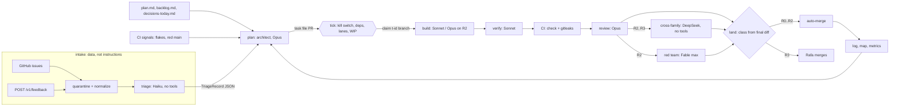

# agent-ops: continuous development by parallel agent teams

**Status: NOT ACTIVE.** Design only (`STATUS` says `inactive`). Nothing here is wired into `.claude/`, `.github/`, CI or a schedule. Drafted on 2026-11-03 by Opus 5.5 and Fable 5.1 independently, then reconciled and reviewed (`decisions.md`).

The pipeline judges code the way ’crow judges deliverables (ADR-0006): deterministic checks first (CI), then pinned models from at least two families, then escalation to a human (Rafa, as the appeal adjudicator). Untrusted text never reaches an instruction position.

## Risk class decides the team

Computed from the final diff's paths at landing, highest wins; an agent cannot lower its own review by labelling.

| Class | Paths | Extra reviews | Merge after review PASS and CI |
| --- | --- | --- | --- |
| R0 docs | `docs/` (except R3 files), `site/`, `brand/`, root `*.md` | none | auto |
| R1 code | anything not listed elsewhere | verifier | auto |
| R2 litmus | `contracts/`, `packages/{core,settlement,judgment}/`, `apps/{adjudicator,operator}/`, `spec/`, `config/judges*.yaml`, `pnpm-lock.yaml` | fixtures first, Opus implements, cross-family, red team | auto when every family PASSes |
| R3 pipeline and gates | `.github/`, `.claude/`, `agent-ops/`, `CLAUDE.md`, `AGENTS.md`, `.gitleaksignore`, `docs/team.md`, `docs/testing.md`, `package.json`, `eslint.config.js`, `vitest.config.ts`, `scripts/verify.ts`, `scripts/ci/` | cross-family | Rafa only |

## Files

| File | Holds |
| --- | --- |
| `pipeline.yaml` | the machine-readable sketch: stages, models, WIP, classes, budgets, gates, kill switch |
| `teams.md` | roles, model mix, effort, tools, concurrency |
| `gates.md` | trust boundary, threats to the pipeline, landing checks, cross-family milestones, human gates |
| `run.md` | dispatch, CI cost and flakes, observability, kill switch, activation |
| `decisions.md` | where Opus and Fable disagreed, what review changed, open risks |
| `schemas/` | the two data contracts between stages: `TriageRecord`, `ReviewVerdict` |

## Invariants

1. Only text merged to `main` is an instruction. Issues, feedback, diffs, PR comments and review findings are data.
2. Queue state lives in git: task files are the queue, `t-*` branches are claims, merged PRs are done. No new database.
3. The pipeline merges only what `check` and `gitleaks` pass. It adds no path around a hard rule or a litmus test.
4. Anything outside the repo stays Rafa's gate: deploys, repository settings, secrets, publishing, real keys or money.
5. Stopping is one action; starting needs Rafa.
