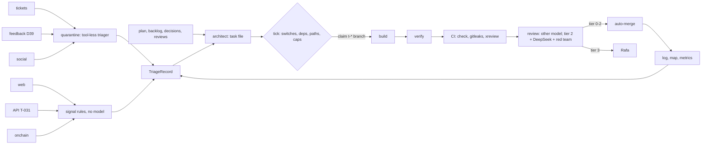

# agent-ops

**Status: inactive.** This is a design only.

- `STATUS` says `inactive`, and the repository variable `AGENT_OPS` is unset.
- No `scripts/ops/` exists, `.claude/settings.json` has no `hooks` key (measured), and nothing in `.claude/` or `.github/` reads this directory.

It describes continuous development of this repository by parallel agent teams:

1. Four input lanes feed triage: tickets, agent feedback, the roadmap and usage telemetry.
2. Triage produces task files.
3. A stateless tick dispatches each task to an isolated session.
4. The work passes deterministic checks, then review by a model that is not its author, and at milestones a second model family.
5. It merges under the existing ruleset.

This applies the product's own judgment rule to its code: deterministic checks first, then two model families, and untrusted input never in an instruction position.

| File | Contents |
| --- | --- |
| [pipeline.md](pipeline.md) | stages, the four input lanes, the quarantine, telemetry, dispatch, concurrency |
| [teams.md](teams.md) | roles, the model for each, tools, work-in-progress caps, budgets |
| [gates.md](gates.md) | risk tiers, threats and gates, cross-family milestones, CI cost and flakes |
| [ops.yaml](ops.yaml) | the same design in machine-readable form |
| [schemas/](schemas/) | the two data contracts between stages: `TriageRecord`, `ReviewVerdict` |
| [reconcile.md](reconcile.md) | where the designs from Opus 5.5, Fable 5.1 and the earlier PR 108 differed, and what was chosen |
| [flow.html](flow.html) | source of the graph and animation, published at https://claude.ai/artifact/SFr3VwBWeyQ8uuTMsqS5a2 (private to Rafa until he shares it) |
| `STATUS` | `inactive` |

`docs/team.md` stays the live process. After activation it links here, and its Rules and checks table remains the only one.

## Invariants

- **Only text merged to `main` is an instruction.** Everything else is data.
- **The queue lives in git.** Task files are the queue, `t-*` branches are claims, and merged PRs mark work done. There is no new database.
- **Readiness is computed by a script, not decided by a model.**
- **No author reviews its own model's work.** A second family checks money, judgment, schema and control-plane changes.
- **Telemetry is aggregate and private.** Figures never enter the public repo.
- **Rafa holds the control plane and everything outside the repo.** Stopping takes one action; starting needs Rafa.

## Kill switch

The switches fail closed: one that cannot be read counts as off. The authoritative switch, `AGENT_OPS`, lives outside the repo, because a switch inside the repo is writable by the agents it stops.

| Level | Effect | How | Who |
| --- | --- | --- | --- |
| pause | no new claims; sessions in flight finish their step and hand off | create `reports/agent-ops/HALT` (instant, no PR), or set `AGENT_OPS` to anything but `on`, or an alarm fires | anyone; Rafa; automatic |
| stop | every session stops, auto-merge is disarmed on every agent PR, and the claims are deleted | `scripts/ops/stop.mjs` | Rafa |
| sever | no agent can push or spend | revoke the fleet identity; set provider spend caps to 0 | Rafa |

**Known gap:** a session in bypass mode does not re-check the switch mid-task, so in the worst case one more push lands after a stop.

## Observability

- **Per PR:** a footer the lander checks, with the model ID per role, the sessions, reruns, each family's verdict, the tier and the budget used.
- **Per tick:** one line in `reports/agent-ops/metrics.jsonl` (git-ignored): what was ready, claimed, launched or refused, and why.
- **Daily:** the daily-log job writes a summary to `docs/log/`:
  - lead time and first-pass PASS rate;
  - CI pass rate and reruns;
  - cross-family block, abstention and agreement rates, and canary recall;
  - hours waiting on a human gate, and spend.

  Product telemetry figures stay out of it (D39).
- **Alarms that pause dispatch until Rafa clears them:**
  - `main` red for 30 minutes;
  - a cross-family block rate above 50% in a day;
  - spend at the daily cap;
  - any `gitleaks` hit on an agent branch.

## Activation

Each step is a separate decision for Rafa, since each reaches outside the repo or changes the control plane.

1. **Environment:** a sandboxed environment with the scoped tokens in `config/keys-dev-env.template`, and a GitHub App as the fleet's identity. Nothing runs on Rafa's Mac.
2. **Review keys and settings:** a spend-capped DeepSeek key as an Actions secret; `xreview` added to the ruleset's required checks; code-owner review on tier 3.
3. **Preconditions:** T-034, T-035 and T-036 merged, and a Known flakes list in `docs/testing.md`.
4. **Settings changes:** the reviewer and verifier lose Write and Edit, and the P6 deny list is added to `.claude/settings.json`.
5. **Proposed code:** the schemas wired into the triage harness; a test that feeds every `attack.*` payload to triage and expects no URL, no instruction-shaped field and no leaked canary; `tests/agent-ops-inactive.test.ts`.
6. **Telemetry sources:** T-031, T-032, Web Analytics and a public-source social reader, each with its owner and retention ([pipeline.md](pipeline.md)).
7. **Shadow week:** the tick runs with `--dry-run` and prints what it would launch. Rafa dispatches by hand, the architect's task files are compared with hand-written ones, and the telemetry thresholds are calibrated.
8. **First lane:** one lane at a time, until 10 PRs merge with no revert (threshold guessed). Then 3 lanes, with the cross-family gates.
9. **Switch on:** Rafa sets `STATUS` to `active` and `AGENT_OPS` to `on`.
