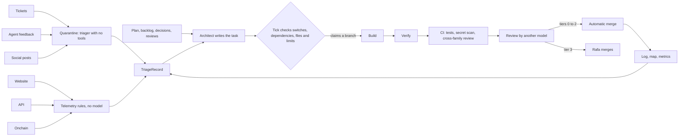

# agent-ops

**Status: not active.** This directory specifies a pipeline that does not run yet:

- `STATUS` reads `inactive`, and the repository variable `AGENT_OPS` is unset.
- The repository has no `scripts/ops/`, and `.claude/settings.json` has no hooks (measured).
- No file in `.claude/` or `.github/` reads this directory.

Agent ops lets AI agents change this repository continuously and in parallel:

1. It takes work from four sources: tickets, agent feedback, the roadmap and usage telemetry. Agent feedback includes answers to the feedback requests that the operator adds at deal milestones for agents whose owners opt in.
2. Triage turns each item into a task file.
3. A script called the tick starts each ready task in an isolated session.
4. Automated checks test each change. A model other than the author reviews it, and a model from a second AI company reviews every critical change.
5. GitHub merges the change under the existing ruleset.

The pipeline applies the product's own judgment rules to its code: automated checks run before model review, models from two families review critical work, and no model treats outside text as instructions.

| File | Contents |
| --- | --- |
| [pipeline.md](pipeline.md) | Stages, inputs, quarantine, requested feedback, telemetry, dispatch and concurrency |
| [teams.md](teams.md) | Roles, models, tools, limits and budgets |
| [gates.md](gates.md) | Risk tiers, threats, cross-family review and CI controls |
| [ops.yaml](ops.yaml) | The same specification in machine-readable form |
| [schemas/](schemas/) | The two data contracts between stages: `TriageRecord` and `ReviewVerdict` |
| [reconcile.md](reconcile.md) | The three drafts behind this design and the decisions taken where they differed |
| [flow.html](flow.html) | Source of the published page at https://claude.ai/artifact/SFr3VwBWeyQ8uuTMsqS5a2, which is private to Rafa until he shares it |
| `STATUS` | The documented state: `inactive` |

`docs/team.md` remains the live process. After activation it links here and keeps the only Rules and checks table.

## Principles

- Only text merged to `main` counts as instructions. The pipeline treats all other text as data.
- Git holds the queue. Task files are the queue, `t-*` branches are claims, and merged pull requests mark work as done.
- A script decides when a task is ready. No model makes that decision.
- A model never reviews work that the same model wrote. A second model family reviews changes to money, judgment, schemas and the pipeline.
- Telemetry holds aggregates only, and the figures stay out of the public repository.
- Rafa controls the pipeline's own rules and every action outside the repository. One action stops the pipeline, and only Rafa can start it.

## Kill switch

Both switches fail closed: the tick treats a switch it cannot read as off. The authoritative switch, `AGENT_OPS`, is a repository setting, so the agents it controls cannot change it.

| Level | Effect | Method | Who |
| --- | --- | --- | --- |
| Pause | The tick starts no new tasks. Running sessions finish their current step and hand off. | Create `reports/agent-ops/HALT`, set `AGENT_OPS` to any value other than `on`, or trigger an alarm. | Anyone, Rafa, or an alarm |
| Stop | Every session stops, the lander cancels every pending auto-merge, and the tick deletes every claim. | Run `scripts/ops/stop.mjs`. | Rafa |
| Sever | No agent can push or spend. | Revoke the agents' GitHub identity and set every provider spend cap to zero. | Rafa |

A running session does not recheck the switch, so one more push can land after a stop.

## Observability

- The lander checks a footer on every pull request. The footer lists the model for each role, the sessions, the reruns, each family's verdict, the tier and the budget used.
- The tick writes one line per run to `reports/agent-ops/metrics.jsonl` (git-ignored). The line lists the tasks that were ready, claimed, started or refused, with the reason for each refusal.
- The daily-log job writes a summary to `docs/log/`:
  - lead time and first-pass approval rate;
  - CI pass rate and reruns;
  - cross-family block, abstention and agreement rates, and canary recall;
  - hours spent waiting on Rafa, and spend.

  The summary contains pipeline figures only. Product telemetry stays private (D39).
- Four alarms pause dispatch until Rafa clears them:
  - `main` fails for 30 minutes;
  - more than half of the cross-family reviews in a day block;
  - spending reaches the daily cap;
  - `gitleaks` finds a secret on an agent branch.

## Activation

Rafa approves each step, because each one reaches outside the repository or changes the pipeline's rules.

1. **Sandbox.** Set up a sandboxed environment with the scoped tokens in `config/keys-dev-env.template` and a GitHub App identity for the agents. Nothing runs on Rafa's laptop.
2. **Review keys.** Add a spend-capped DeepSeek key as an Actions secret. Make `xreview` a required check, and require code-owner review on tier 3 paths.
3. **Faster CI.** Merge T-034, T-035 and T-036, and create the known flakes list in `docs/testing.md`.
4. **Tool limits.** Remove Write and Edit from the reviewer and the verifier, and add the P6 deny list to `.claude/settings.json`.
5. **Quarantine tests.** Wire the schemas into the triage harness, run every `attack.*` payload through triage as a test, and add `tests/agent-ops-inactive.test.ts`.
6. **Telemetry and feedback.** Deploy T-031 and T-032, which are merged. Build the milestone feedback requests in T-043 after its ADR. Enable web analytics and a public-source social reader. [pipeline.md](pipeline.md) lists each source's owner and retention.
7. **Shadow week.** Run the tick with `--dry-run` for a week while Rafa starts tasks by hand. Compare the architect's task files with hand-written ones, and calibrate the telemetry thresholds.
8. **One lane.** Run one lane until 10 pull requests merge without a revert (threshold guessed), then run three lanes with the cross-family gates. This follows principle 1 of `docs/team.md`: verification before parallelism.
9. **Switch on.** Set `STATUS` to `active` and `AGENT_OPS` to `on`.
