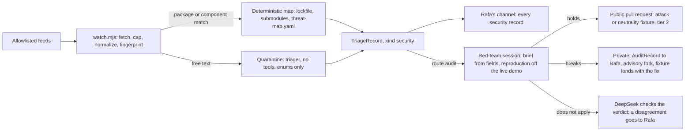

# Pipeline

Every change passes through nine stages. Each stage leaves its output in git or on GitHub, so a new session can resume any task from its task file and its `t-*` branch.

| # | Stage | Trigger | Actor | Output | Exit condition |
| --- | --- | --- | --- | --- | --- |
| 0 | Intake | The daily log runs, someone requests a run, a telemetry rule fires, a crawler probe fails, or the security watch matches an event. | `scripts/ops/intake.mjs` and `scripts/ops/signals.mjs` collect items. The crawler and the watcher write records without a model. The triager (Haiku 5.5, no tools) reads outside text in the quarantine. | A `TriageRecord` ([schema](schemas/triage-record.schema.json)) in `reports/agent-ops/intake/` | The record matches the schema. The pipeline drops and counts invalid records. |
| 1 | Triage | A record routes to a task. | The architect (Fable 5.1) reads the record. It never reads the raw text. | `docs/tasks/T-xxx-<slug>.md` | `scripts/ops/task-lint.mjs` passes and the docs pull request merges. |
| 1a | Decide | The task changes architecture, a contract or a defense. | The architect, after a Fable research pass at max effort | An entry in `docs/decisions-today.md` or a proposed ADR | The decision is recorded. Rafa can overrule it. |
| 2 | Dispatch | A task becomes ready. | `scripts/ops/tick.mjs`, run by a Haiku 5.5 session. The script decides; the model does not. | A claim: a pushed `t-<id>-<slug>` branch whose first commit sets the task's Status | GitHub accepts the push. A rejected push means another session holds the task. |
| 3 | Build | The claim succeeds. | For tier 2, the fixture-author writes failing tests first. The implementer then writes the code. | Tests, code, a passing `pnpm verify`, and a pull request | The pull request is open. |
| 4 | Verify | The pull request opens. | The verifier (Sonnet 5.5) | A verdict on each Evidence claim (confirmed, unconfirmed or contradicted) and one re-measured number | No claim is contradicted. |
| 5 | CI | Every push | GitHub Actions | `check` (including `guardrails.mjs`), `gitleaks`, `xreview` and `simulate`, the scripted tier of the usage simulation (below) | All four pass. |
| 5a | Simulate | CI passes on a pull request that touches a customer path (`simulation.customer_paths` in `ops.yaml`). | The `stager` process on the agents' VM runs model-driven simulated customers against a world built from the pull request (below). | A `SimRecord` for the head commit, in a store that builders cannot write | For tier 2, and for agent-docs pull requests once calibrated, the record reads PASS. For other pull requests the record is advisory. |
| 6 | Review | CI passes. | A reviewer that is not the author's model. Tier 2 adds the second family and the red team. The reviewer approves a tier 2 pull request only when its `SimRecord` reads PASS for the head commit it reviews. | PASS, ISSUES or BLOCKED | Every required reviewer passes within three rounds. After three rounds, Rafa decides. |
| 7 | Merge | Every review passes. | The lander (Haiku 5.5) runs `/merge-pr` for tiers 0 to 2. Rafa merges tier 3. | A merge commit. The pipeline never squashes. | The design map marks the task done from the merge (T-034 §2.9). |
| 8 | Feed back | A merge, a rejection or an out-of-scope finding | The daily-log job (Haiku 5.5) | Updates to `docs/log/`, the design map and the metrics, plus new intake items | None |

Task lint checks three conditions: the listed paths exist, no open pull request touches them, and each acceptance criterion names a command.

Rafa approves any task that comes from untrusted input and lists tier 2 or tier 3 paths before the tick can start it. This rule covers the longest injection path, from an issue to a record to a task to an agent with write access. The repository has no public issues today (measured), so the rule costs nothing yet.

Review findings outside a task's scope become new intake items. [gates.md](gates.md) defines the tiers.

## Inputs

Four input lanes feed triage.

| Lane | Source | Trust | Handling |
| --- | --- | --- | --- |
| Tickets | GitHub issues labeled `intake`, and pull request comments. The repository is public and has no issues today (measured). | Untrusted | The quarantine reads them. |
| Tickets: production crawlers | Probes of the live demo by the `crawler` process (T-063), which plays it as a visitor's agent does: a read-only pass every 30 minutes and a deal pass every 8 hours | Measured. A record holds status codes, problem types, booleans, counts and transaction hashes, never a response body. | The crawler writes records without a model. The quarantine reads the friction text of its weekly vanilla-visitor probe. See Production crawlers below. |
| Tickets: security watch | Public security events from an allowlist (T-064): dependency advisories, CVEs, exploit write-ups and post-mortems, and research on attacks against LLM judges | Untrusted | A script matches advisories and CVEs to Crow's dependencies without a model. The quarantine reads free text. Every security record goes to Rafa. See Security watch below. |
| Agent feedback | Reports sent to `POST /v1/feedback` under D39, stored in the operator's private store. Agents send reports on their own, and agents that opt in also answer feedback requests at deal milestones (see Requested feedback below). T-032 built the route (merged in PR 121, not deployed). | Untrusted. Reports can contain deal details. | The quarantine reads free text. Ratings become telemetry aggregates. The task cites `feedback:<fingerprint>` and never quotes the report. |
| Roadmap | `docs/plan.md`, `docs/backlog.md`, `docs/decisions-today.md`, `docs/decisions/`, and the "Next steps" lists in `docs/reviews/*` | Trusted. Each reached `main` through a reviewed pull request. | The architect reads them directly. |
| Telemetry | The website, social posts, the API and the chain (see Usage telemetry below) | Aggregates are measurements. Social post text is untrusted. | Telemetry rules write records without a model. The quarantine reads social post text. |

CI signals also create records. When `main` fails, a flaky test recurs or a budget runs out, the tick writes a record without a model. The usage simulation's friction reports and the founders' shape-only catalogue notes also reach triage ([Usage simulation](#usage-simulation)).

The crawlers and the security watch strengthen the Tickets lane (Rafa, 2026-11-05). Both are proposed in `docs/research/2026-11-05-simulation-and-watch.md`, and nothing runs them.

### Quarantine

The quarantine applies the product's reader defenses (threats T1 to T3 in `docs/judgment-and-defenses.md`) to outside text:

1. It normalizes the text with `packages/judgment/src/normalize.ts`.
2. The triager (Haiku 5.5) reads the text without tools. The text sits between random delimiters, and the prompt contains a canary token.
3. The triager's output must match the schema. The schema allows enums, IDs and short summaries written by the model, and it rejects URLs, handles and copied text. The quarantine drops and counts any output that fails the schema.
4. The architect reads records only. An implementer that needs the original text runs a one-shot reader, which prints the text once, fenced and capped at 4 KB.
5. Raw text never enters a task file, brief, pull request body or handoff.

The quarantine also reads three newer kinds of text:

- friction reports from simulated customers (`source: sim`, T-062) and from the crawler's vanilla-visitor probe (`source: crawler`, T-063). A model wrote them about public docs, so the quarantine treats them as untrusted;
- exploit write-ups, post-mortems and research papers from the security watch (`source: writeup` or `research`, T-064);
- CVE text that names no package or component Crow uses (`source: cve`).

For a security item, the triager returns threat IDs and a component from fixed enums, a summary of at most 300 characters and `needsRaw`. It never names a path. `agent-ops/threat-map.yaml` (proposed, T-064) turns threat IDs and components into paths, fixtures and controls without a model. Raw event text goes only to the Anthropic triager, as every quarantined text does (P11).

The crawler's own records skip the quarantine, because they hold no outside text: the crawler fills each field from an enum, a number or a hash.

### Requested feedback

The operator asks agents for feedback at key deal milestones. It asks only agents that opt in, and the default is off.

- **Opt-in.** The agent's owner decides whether to opt in, and the agent sends that choice as the header `Prefer: feedback-requests=on` (RFC 7240) on its requests. Without the header, the operator never asks. The operator stores no opt-in state.
- **Timing.** The operator asks at three points:
  - Before a milestone: the prepare responses for an offer and an agreement carry a request before the agent signs.
  - After a milestone: the response that completes a deal stage carries a request.
  - On errors: a problem response carries a request.
- **Sampling.** The operator decides whether to ask by hashing the signer key, the deal ID and the milestone, and comparing the result with the rate below. The hash makes the decision repeatable without stored state, so the operator asks at most once per deal and milestone. The rates are guesses that the shadow week calibrates.

| Milestone | When the operator asks | Rate |
| --- | --- | --- |
| Offer or agreement prepared | Before the agent signs | 10% |
| Commitment agreed, hold funded, delivery submitted, judgment returned | After the stage completes | 10% |
| Deal settled (release or refund) | After settlement | Every deal |
| Appeal filed | After the appeal | Every appeal |
| Error response | With the problem response | 25% per problem type |

- **Request.** The response body carries a `feedbackRequest` object with an ID, the milestone, an expiry 24 hours later and three fixed questions: an ease rating from 1 to 5, whether the docs answered the agent's question (yes or no), and an optional free-text comment. The request carries no deal content.
- **Answer.** The agent answers through `POST /v1/feedback` with the request ID. The D39 rules apply: the operator tells the agent that it is sharing the answer with this operator, and the agent seals any text that can contain deal details to the operator's key. An unanswered request expires and has no effect.
- **Routing.** Ratings and yes-or-no answers become telemetry aggregates per milestone. Free text enters the quarantine as untrusted feedback.
- **Rules that open a record.** A milestone's average ease rating falls below 3 over a week, or more than 30% of answers for a milestone say that the docs did not answer the question. Both thresholds are guesses.
- **Contract.** The `feedbackRequest` field and the `Prefer` header change the API contract, so they require an ADR and a schema version bump (`CLAUDE.md`, hard rules). Task T-043 (PR 131) builds this on the feedback route from T-032.

### Usage telemetry

Telemetry is the fourth input lane. The thresholds below are starting guesses, and the shadow week calibrates them (README, Activation).

| Source | Signal | Owner | Cadence | Opens a record when | Retention |
| --- | --- | --- | --- | --- | --- |
| Website | Visits to escrow.stream, and the funnel from the homepage to `llms.txt` to a first API call, measured as new signer keys per day. Cookieless analytics such as Cloudflare Web Analytics count each stage separately and never join stages per visitor. | Demo lane | Daily | A stage-to-stage conversion falls 30% below its 4-week median. | 90 days |
| Social | Public mentions of and replies about ’crow and escrow.stream, from public sources only | Rafa, because a reply is a publication | Weekly | Two or more independent posts report the same bug or docs problem. Rafa receives any security claim at once. | Counts and fingerprints for 90 days. Post text is not stored. |
| API | The aggregate metrics from T-031 (per-route rate, errors and latency, problems by type, 429s, quota, the deal funnel and first-try success), its 7-day request log, the `notices` the operator serves, and D39 reports | API lane | Hourly counts, daily rules | A problem type's share doubles against its 7-day baseline, first-try success drops 10 points, the operator returns an `internal` 500, the operator serves a deprecation notice after its date, or one feedback fingerprint appears three times. | Request log 7 days (T-031). Aggregates 90 days. Reports follow the T-032 lifecycle. |
| Onchain | Public settlement events: counts, amounts, states, timeouts, appeals and gas per deal | Settlement lane | Daily | Timeouts or appeals double against their baseline, gas per deal exceeds the recorded baseline (395,831 on the happy path, T-202, measured) by 10%, or the chain shows an event sequence that the state machine forbids. The last case opens a P0 security record. | Events are public. Aggregates 90 days. |

Telemetry follows these rules:

- It holds aggregates only. It holds no deal content, no identities, and nothing from a private deal beyond its public skeleton (D35, D39, D40, T-207).
- The figures stay in a private store, either `reports/telemetry/` (git-ignored) or the operator's KV store. A task cites `telemetry:<signal>` and describes the symptom without figures. Rafa decides whether to publish any figure (D39).
- The pipeline treats signals as data. It sends no aggregate, post text or feedback text to a non-Anthropic provider.
- T-031 (PR 118) and T-032 (PR 121) are merged but not deployed. Task T-043 (PR 131) builds the milestone feedback requests. Web analytics needs a Cloudflare setting and the social reader needs accounts, so both need Rafa's approval. The chain is a local chain until Sepolia (T-206).

### Production crawlers

The crawler (T-063) keeps playing the live demo the way a visitor's agent does. It compares what is deployed with the docs, and each operator with the other. `site/check.mjs` keeps the repository consistent before a publish; the crawler checks the deployment, for example a site from one commit against operators from another.

| Pass | Cadence | What it does |
| --- | --- | --- |
| Read-only (probes R1 to R12) | Every 30 minutes, about 40 requests, no deal | Checks the homepage, `llms.txt` and its one command, that `try.mjs` matches the command's sha256, both operators' discovery and status, the club and adjudicator records on both nodes, every problem page, the planned routes, a feedback dry run, the test seller's card against `llms.txt`, the console's gate, the rules contract's code hash and T-060's dependency status |
| Deal (D1 to D3) | Every 8 hours, one deal | Runs the one command from the live `llms.txt` verbatim in a fresh folder. It passes on Released, 3 rows decrypted and the same final state and event count on both operators. Every third pass plays a refund, and once a day the command runs without a seller, so two fresh keys play each other. |
| Weekly (D4) | Sunday 03:00 UTC, on Rafa's go-ahead | An upheld appeal, the `Prefer: feedback-requests=on` flow, a private deal, and the vanilla visitor: a stock Claude Code session given only the homepage prompt |
| After a deploy (D5) | Once | `node tools/crawler/crawl.ts --once --deals 1`, the smoke test that replaces the hand-run `deal.ts` and `try.mjs` steps in `docs/operations.md` |

The crawler plays by a visitor's rules:

- **Test tokens only.** It checks the chain with `assertRoundChain` before any write, and it refuses an operator whose status names another chain.
- **No load.** Probes run one at a time, and reads stay at one request a second per origin or less. Budgets and cadences live in `ops.yaml` under `crawler` (tier 3), so raising one is Rafa's merge.
- **Shared limits.** It takes at most 2 faucet grants an hour, where a visitor may take 10, and 3 test-seller requests a day, where the seller allows 10 per client (both limits measured). It honours `Retry-After` on every 429.
- **The relayer.** It reads the funding lane before each deal and skips the deal below T-054's floor of 0.05 Sepolia ETH. Its 4 deals a day cost about 0.0075 Sepolia ETH at 1 gwei (inferred from 1,636,242 gas per relayed deal plus a faucet mint).
- **No side effects.** It sends feedback only as a dry run (`validateOnly=true`), never submits the early-access form, never calls the contract directly and never registers an adjudicator.
- **No secret.** It makes fresh keys in memory for each probe, as `try.mjs` does, and the faucet funds them.

A failed probe becomes a TriageRecord with `source: crawler`, the probe ID, a summary from a fixed template of enums and numbers, and never a response body, because a party's text can reach the crawler through the API. The fingerprint hashes the probe, the failure class and the status or problem type, so a repeat raises a count instead of opening a new record, and three passing runs close it. A failed one command or a disagreement between the operators is P1, and a docs disagreement is P2. When T-060's dependency status shows an incident at a provider the probe depends on, the record names that incident as the likely cause at P3, so a Cloudflare outage never becomes a Crow task.

The crawler runs on the agents' VM (T-039) as a `crawler` user with a systemd timer. GitHub Actions was the alternative, but its schedules skipped two hourly runs during a GitHub incident on 2026-11-04 (measured, T-060), when the crawler matters most.

Without a mark, the crawler's 4 deals a day count as visitors in T-031's funnel. The design proposes that the operators count requests carrying `X-Holdback-Synthetic: crawler` in a `synthetic` bucket of the day line. The header changes no response, and anyone can send it to leave the funnel, which grants nothing. Rafa decides whether to add it.

### Security watch

The watcher (T-064) turns public security events into security records, and the red team tests each record that maps to Crow.

1. **Fetch.** `scripts/ops/watch.mjs` runs daily at 04:00 UTC as the `watcher` user, which holds no key of any kind. It fetches only the URLs in `agent-ops/security-watch.yaml` (tier 3), never a link inside an item. Each fetch has a 10 s timeout and a 1 MB cap. The script normalizes each item, truncates it to 4 KB and fingerprints it.
2. **Match.** For advisories and CVEs, the script decides without a model whether a package, version, submodule commit, compiler or model ID matches one of Crow's. It reads `pnpm-lock.yaml`, `contracts/lib`, `contracts/foundry.toml`, `config/judges-live.yaml` and, once T-039 writes it, the tool pins in `scripts/dev-env/setup.sh`. A match writes a `security` record with the dependency, the component, a severity from the advisory's own rating, and threat IDs from `agent-ops/threat-map.yaml`.
3. **Quarantine.** Write-ups, research and unmatched CVE text go through the quarantine above.
4. **Ticket.** Every security record goes to Rafa at once on T-055's channel, with its fingerprint, source kind, component, threat IDs and severity.
5. **Audit.** A record routed `audit` starts a red-team session (Fable 5.1 at max effort, budget USD 40, guessed). Its brief comes from the record's fields and the threat map's excerpt: the component's paths, its fixtures and the control that should hold. The session reproduces the event on SimChain, anvil or a fork of Sepolia, and never on the live demo without Rafa's go-ahead. It answers in an `AuditRecord`: whether the event applies, the reproduction, the result (holds, breaks or blocked), a severity and a claim of at most 300 characters.
6. **Outcome.**
   - **The defense holds.** A tier 2 pull request adds an `attack.*` or `neutrality.*` fixture, or a Foundry or vitest test, that names the event's fingerprint. The next regression then shows.
   - **The defense breaks.** The session pushes nothing. The AuditRecord goes to Rafa. The implementer writes the fix in GitHub's private security-advisory fork, as `SECURITY.md` promises, and the fixture lands in the same pull request as the fix. A fix task names the component and the control, never the exploit.
   - **The event does not apply.** DeepSeek checks the verdict through `xreview.mjs`, with no tools and no raw text. It also checks every event that the source rates High or Critical. A disagreement goes to Rafa.

The watchlist covers advisories for every lockfile package (`pnpm audit`, OSV and GitHub's advisory database); advisories and releases of Solady, Commerce Payments, Permit2, OpenZeppelin, Foundry and solc; Cloudflare, workerd, drand and Sepolia notices; model-provider status, security and deprecation notices; CVEs; exploit write-ups and post-mortems in escrow, payment, agent-commerce and DeFi protocols; and research on attacks against LLM judges. T-064 confirms each URL with one fetch (guessed until then).

Each week `scripts/ops/integrity.mjs` checks for drift without a model, and each drift becomes a `security` record:

- `pnpm audit` and OSV on every lockfile version;
- advisories for each `contracts/lib` submodule commit;
- a pinned GitHub Actions SHA that no longer equals its tag;
- a model ID in `config/judges-live.yaml` that its provider no longer lists;
- the deployed contracts' code hashes against `contracts/deployments/sepolia.json`;
- the drand quicknet chain hash, and changes to `.gitleaksignore`.

The fetch and the match cost nothing, the triager costs cents a day, and an audit costs up to USD 40 (all guessed). The daily log counts security records and never names them.

### Records

- Each record has one kind: bug, docs, feature, feedback, friction, deprecation, incident, flake, security or spam.
- Each record has one route: task, backlog, decision or close.
- T-061 to T-064 extend the record additively, coordinated with T-041. The schema in [schemas/](schemas/) does not have these values yet.
  - New routes: `catalogue`, a catalogue entry for the usage simulation (T-062), and `audit`, a targeted red-team audit (T-064).
  - New sources: `crawler`, `sim`, `advisory`, `writeup`, `cve`, `research` and `founder`.
  - New optional fields: `threatIds`, `component`, `dependency`, `probe`, `likelyCause` and `seenCount`.
- Triage orders work by the demo path first (the first product priority in `CLAUDE.md`), then by severity, then by age.
- A security record takes priority over all other work. It never becomes a public issue, and it goes to Rafa directly.

## Usage simulation

Before a change merges, simulated customers play deals through the public HTTP API against a world built from the pull request (Rafa, 2026-11-05). Their needs come from a catalogue that market feedback keeps current. The simulation is proposed in `docs/research/2026-11-05-simulation-and-watch.md` and tasks T-061 and T-062, and nothing runs it.

| Tier | Stage | Who runs it | Output | Blocks |
| --- | --- | --- | --- | --- |
| Scripted (T-061) | 5, CI | The `simulate` job. The harness comes from a checkout of `main`, and the world from the pull request's build. | The fourth required status, pinned to the GitHub Actions app like `check` | Yes, on any unmet expectation, for pull requests that touch customer paths |
| Model (T-062) | 5a, read in review | The `stager` process on the agents' VM, with model-driven customers in a sandbox | A `SimRecord` at `/srv/crow/sim/pr/<pr>/<head-sha>.json` | For tier 2: on an invariant violation or a completion regression. Advisory otherwise |
| Pre-deploy (T-062) | Before a deploy | The deploy wrapper's `stage <tag> <sha>`, then the crawler's probes and three must-run pairings on the Sepolia staging world | A staging record at `/srv/crow/sim/staging/<tag>.json` | Yes. The wrapper refuses a production deploy without a PASS record for the same tag and SHA. |

The scripted tier is deterministic and costs no model spend, so it runs in CI with the other automated checks. Live models are stochastic and cost money, which is why the product's judge calibration never gated CI (`docs/testing.md`). The model tier therefore blocks only on deterministic facts it surfaces, and the reviewer, not a status, carries its verdict.

### Which pull requests it covers

Tiers set the depth, and paths set the trigger. The trigger is `simulation.customer_paths` in `ops.yaml`, served by `scripts/ci/affected.mjs` (T-034) like every other path rule. `simulate` always reports, because a required check that never reports blocks every pull request.

| The pull request touches | Scripted tier | Model tier |
| --- | --- | --- |
| Docs outside the agent docs, `brand/**` | Passes at once | None |
| The agent docs: `site/llms.txt`, `docs/api.md`, `docs/quickstart.md`, the problem-page text in `site/build.mjs` | SimChain, the must-run set | The vanilla visitor and one private deal (2 pairings). Blocking once calibrated, because this is D39's bar: an agent completes a deal from `llms.txt` on its first try. |
| Tier 1 customer paths: `examples/**`, `site/**`, `apps/test-agents/**`, `apps/demo/**`, `tools/sim/catalogue.json`, `fixtures/clubs`, `fixtures/terms`, `fixtures/data` | SimChain, plus workerd when Workers code or the site changes | A 2-pairing sample, advisory |
| Tier 2 runtime paths: `apps/operator/src/**`, `apps/adjudicator/**`, `apps/demo-cloud/**`, `packages/**`, `spec/**`, `contracts/**`, `config/judges*.yaml`, `pnpm-lock.yaml` | SimChain and anvil, plus workerd for `apps/demo-cloud/**` | A 6-pairing weighted sample, blocking on invariants and regressions |
| Tier 3 control files only, or other code (scripts, tests, `packages/testkit/**`) | Passes at once | None |

### Worlds

| World | What runs | Where | Used for | Cost per run |
| --- | --- | --- | --- | --- |
| Per-PR SimChain | The demo's own World (`apps/demo-cloud`) in a Node process, two origins, scripted judges | The CI runner, or the stager's runner user on the VM | Every gated pull request | Seconds; USD 0 |
| Per-PR anvil | The same World on the pull request's contracts, one block a second | Same | Tier 2 runtime pull requests | About 2 minutes for 12 pairings (inferred from 98 s for 5 scenarios, T-216); USD 0 |
| Per-PR workerd | Both Workers under `wrangler dev --local`, as `pnpm demo-cloud:e2e` does | Same | Workers code and the site bundle | About 3 minutes (guessed); USD 0 |
| Shared Sepolia staging | `holdback-staging-op1` and `-op2` at `staging-api.escrow.stream` and `staging-api2.escrow.stream`, world `holdback-staging-sepolia-<date>`, its own relayer key, funding lane and three bonded adjudicator keys, and `crow-test-agents-staging` | Cloudflare | Before each production deploy (required) and nightly from `main`'s tag | About 0.002 Sepolia ETH per deal at 1 gwei (inferred) |

Rules for staging:

- **Test tokens only.** Every staging process refuses any chain but Sepolia and anvil through `assertRoundChain` before any write. SimChain worlds mint tUSD in process.
- **Never the public demo world.** D49 keeps `holdback-public-demo-sepolia-2026-11-04` long-lived. The staging world is a different Durable Object name on different Workers and hostnames, with a different relayer key, so no staging code can address the demo's storage. It settles on the same rules contract and token, because a staging deal is just another deal on a permissionless contract.
- **Bounded loss.** The staging funding lane holds about 0.3 Sepolia ETH (guessed). A dry lane answers `relay_refused`, and the staging run records "relayer dry", never a Crow bug.
- **No route to production.** The `stager` user's network egress is loopback and the model APIs only, through an owner-matched firewall rule in `scripts/dev-env/vm-users.sh` (T-039). A confused or adversarial simulated customer cannot reach `escrow.stream`, whatever its brief says.
- **Nothing deploys from a pull request.** Per-PR worlds are processes. The staging world deploys only from a tag, through the root-owned deploy wrapper.

### Simulated customers

`tools/sim/catalogue.json` (T-021) grows to version 2, checked by a new `tools/sim/catalogue.schema.json` under Ajv 2020-12 strict. Every free-text field follows the TriageRecord's `shortText` rule. Weights are integers in basis points that sum to 10,000. Each entry carries an `origin`.

- **Jobs.** The four existing jobs stay. Six new ones cover the homepage's 3-row purchase from the test seller, the demo's 2,000 tUSD cleaning job, a Markdown report, a CSV near the 10 MB intake cap, the smallest deal the fee allows, and a price above the mandate's cap that the operator must refuse.
- **Variants.** Size, disclosure (public, or private with a per-deal key and a `Delegation`), windows (up to a delivery date a year out, which D31 allows) and template.
- **Profiles.** The four existing ones (honest, sloppy, impatient, adversarial) and nine new ones: confused, minimal, negotiator, privacy-first, disputant, silent, multi-deal, stale-docs and settler.
- **Frameworks and families.** `claude-code` (Claude Haiku, Sonnet, Opus and Fable); `tool-loop`, an OpenAI-compatible loop over the judges' client with two tools, `http` to the world's operators and `sign` (DeepSeek and the GPT model T-040 pins); `scripted`, the code behind `try.mjs`; and `vanilla-visitor`, a stock Claude Code session with only the homepage prompt.
- **Pairings.** Each names a job and variant, a buyer and a seller, an expectation (terminal state, payee, key release, the problem types met and not met, and both operators serving the same record), a weight, and the tiers that run it. A seed from the head SHA draws the weighted sample, so a rerun draws the same pairings.
- **Must-run set,** in every sample: `homepage-visitor`, `vanilla-visitor` (model tier only), `private-honest`, `refund-failed-check`, `appeal-upheld` and `silent-seller-reclaim`.

Staging worlds run scripted judges, so a rubric outcome says nothing about judgment quality, which is Phase 3's calibration. The simulation measures the API, the docs and the protocol as an outsider meets them.

### Market feedback

The market-feedback loop turns what agents and people say and do into catalogue entries. No raw text crosses into a brief.

| Source | Path | What it can change |
| --- | --- | --- |
| Requested feedback (T-043) | Ratings through `signals.mjs`; comments through the quarantine | A low ease rating raises the weight of pairings that cross that milestone. A comment that names a need becomes an entry. |
| Free reports (T-032) and public posts | The quarantine | An entry, when the text describes a kind of work, a deal shape or a behaviour the catalogue lacks |
| Usage telemetry (T-031, T-042) | Catalogue rules in `signals.mjs` | Weights, and a profile when an error path grows |
| Founder conversations | `pnpm sim:entry` asks for shape fields only and writes an entry with `origin.source: founder` | An entry, never a customer's name, content or figures |
| The simulation's and the crawler's friction reports | The quarantine, as `source: sim` or `source: crawler` | A docs task, or an entry for a confused path worth replaying |

A record routed `catalogue` goes to the architect, who writes or edits an entry from the record's fields in its own words and opens a tier 1 pull request to `tools/sim/catalogue.json`. The reviewer checks that the entry matches the record's summary and that no run of 40 or more characters is copied from raw text. No entry needs Rafa's approval line, because the catalogue is tier 1, its schema bounds every free-text field, and a simulated party holds nothing but a per-world test key. Rafa can overrule this.

`pnpm sim:weights` runs where the telemetry store sits and proposes weights only, rounded to multiples of 500 basis points, with the must-run set fixed. The architect puts them in a monthly tier 1 pull request. An entry that no record has motivated for 90 days keeps a floor of 500 basis points. No figure leaves the private store, and Rafa decides whether even these coarse bands may be public (D39).

### Pass rules

**Scripted tier,** in CI:

- Every pairing in the sample must meet its expectation. A miss fails `simulate`.
- The expectations come from the pull request, because changing one is a reviewed change like a snapshot. `guardrails.mjs` raises a pull request that changes an `expect` to tier 2, so a second family reads it.
- Timing is advisory. A median deal time or a p95 request latency more than 50% above `main`'s baseline opens a `friction` record.
- A failed pairing reruns once, and only if the catalogue marks it flaky with an unexpired entry. The Known flakes rules apply (T-049): a fix task, a 14-day expiry, and a lane pause after more than two failures in a day.

**Model tier,** on the VM, blocking for tier 2 after the shadow period:

1. A `sim:check` invariant violation blocks: log integrity, conservation, within terms, terminal or explained, and records that match across operators. The stager opens a P0 record.
2. A completion regression blocks: completed pairings must reach the baseline's median minus the noise band (starting guess: 2 of 6 pairings). A pairing that fails reruns once with a new seed, and a second failure counts.
3. Flaky pairings are left out of the count under the rules above.
4. Friction is advisory. New friction fingerprints become `friction` records with `source: sim`.
5. Cost and time are advisory. Spending more than 30% more tokens than the baseline for the same pairings opens a `friction` record: the docs got harder.
6. A run past its budget or time ends `incomplete`, which is not a pass. The stager reruns once, and a second `incomplete` marks the pull request `needs-human`.
7. The reviewer approves a tier 2 pull request only when the SimRecord for the head commit it reviews reads PASS. A push after the run needs a new record.

The baseline is the same 6-pairing sample on `main`'s head every night and the full catalogue weekly, at `/srv/crow/sim/baseline/<main-sha>.json`. Only the stager writes there, and the comparison uses the median of the last five nightly runs.

### Budgets

Budgets are parameters (D31) in `ops.yaml` under `simulation`. All are guessed, and the shadow period measures them. A run that exceeds its budget stops and writes its record as `incomplete` (T-047's budget stop).

| Run | Wall time | Model spend | Chain spend |
| --- | --- | --- | --- |
| Scripted tier, SimChain | 2 min | USD 0 | None |
| Scripted tier, anvil and workerd | 5 min | USD 0 | None |
| Model tier, agent-docs pull request (2 pairings) | 15 min | USD 3 | None |
| Model tier, tier 2 pull request (6 pairings) | 20 min | USD 10 | None |
| Nightly baseline (6 pairings) | 20 min | USD 10 | None |
| Weekly full catalogue (about 20 pairings) | 60 min | USD 30 | None |
| Pre-deploy staging (crawler probes and 3 pairings) | 15 min | USD 0 | About 0.01 Sepolia ETH |
| Daily cap for the simulation | | USD 50, inside the pipeline's USD 300 | |

### Safety

- **No real money.** Every world runs on SimChain, anvil or Sepolia, and the staging Workers hold Sepolia-only secrets, as the demo's do.
- **No real customer data.** Jobs are invented. A founder conversation enters as a shape, never as content, a name or a figure. The catalogue schema refuses URLs and handles.
- **Aggregates only.** Weights are coarse bands, and the figures behind them stay in the private telemetry store.
- **No escape.** Each party runs as the `stager` user in its own folder. The world's files and the audit endpoint belong to the stager's runner user, mode 700. A party's capped `crow-agents` key could leak into the staging world's logs, and the workspace's spend cap bounds that loss (inferred).
- **No gaming.** The model tier reads the catalogue, the briefs and the harness from `main`, only the stager writes the baseline, and the reviewer reads the SimRecord from a store that builders cannot write (P17).

## Dispatch

`scripts/ops/tick.mjs` rebuilds its state from git and GitHub on every run and then exits. It runs after every merge to `main` and every CI completion. A 20-minute cron job runs it if no event arrives. The design uses a stateless script instead of a long-running coordinator because a coordinator session stopped at the weekly token limit on 2026-11-01 (measured, `docs/log/2026-11-01.md`).

The tick starts a task when all of these conditions hold:

- `agent-ops/STATUS` reads `active` and the repository variable `AGENT_OPS` equals `on`;
- `reports/agent-ops/HALT` does not exist;
- the task's Status is `todo`, and every task it depends on has merged;
- no `t-<id>-*` branch exists;
- no open pull request or claimed task touches the task's paths;
- the work-in-progress limits and the daily budget allow another task ([teams.md](teams.md)).

`/start-task` (T-036) builds each brief from the task file's fields.

A pushed branch serves as the claim because CI runs only on pushes to `main` and on pull requests (measured, `.github/workflows/ci.yml`). A branch push starts no CI run. A draft pull request would start a full run.

If a claimed branch receives no push for 24 hours, the tick deletes the branch and reopens the task.

## Concurrency

Each task runs in its own sandboxed cloud or VM session, with its own clone and scoped tokens.

- Rafa's machine checks every shell read against the working directories and prompts even in bypass mode (`docs/operations.md`, Working without permission prompts). Prompt floods stopped work on 2026-10-31 and 2026-11-01, and stopped a worktree run on 2026-11-03 (reported).
- A sandbox has nothing outside it to protect, so it needs no such check. It also holds no personal credentials (`config/keys-dev-env.template`).
- On a local machine, the fallback is the Agent tool's `isolation: "worktree"` with two additions:
  - `scripts/hooks/bash-guard.sh` turns each command pattern that triggers a prompt into a tool error before the permission layer sees it. The patterns are `cd` outside the root, heredoc and redirect writes, `sed -i`, interpreter one-liners, command substitution, `xargs`, `eval`, `find -exec`, `/private/tmp`, `~/` and polling loops. The agent lists files first and then passes literal paths, because the guard cannot verify paths built at run time.
  - The settings pin `TMPDIR`, `FOUNDRY_DIR` and the pnpm store under `reports/`. Whether this removes every prompt is guessed.
- The repository uses one worktree convention. Three conventions exist today (measured, velocity review).

Each shared file has one writer.

| File | Writer |
| --- | --- |
| `docs/log/*` | The daily-log job |
| `docs/decisions-today.md`, `docs/plan.md`, `docs/backlog.md` | The architect |
| `spec/openapi.json`, the design map | A generator. The pipeline regenerates these files after each merge and never merges them by hand. |
| `pnpm-lock.yaml`, `package.json`, `vitest.config.ts`, `contracts/lib/` | One infra-lane task at a time |
| `docs/team.md`, Rules and checks | Any task, by appending rows only |
| `tools/sim/catalogue.json` | The architect for entries and weights, and any task that adds a job for its own paths. Task lint allows both when the pull request touches no other single-writer file. |
| `/srv/crow/sim/baseline/` and `/srv/crow/sim/staging/` on the VM | The stager only |

Branches follow three rules:

- An agent updates its branch by merging `main` into it and never rebases (Rafa's standing rule). The design map's work feed parses merge commits.
- An agent that hits a conflict outside its task's paths stops and hands off. `/merge-pr` never resolves conflicts.
- CI cancels superseded runs with `cancel-in-progress` (T-034).

## Code paths for simulation, crawlers and the security watch

Each path exists, is planned in an earlier task, or is proposed in T-061 to T-064.

| Path | State | Role |
| --- | --- | --- |
| `tools/sim/catalogue.json`, `brief.ts`, `briefs/*.md`, `world.ts`, `audit.ts`, `check.ts`, `bin/*.ts` | Exists (T-021, T-023) | The catalogue, briefs, isolated worlds and the five invariants of `sim:check` |
| `examples/agent.ts`, `verify.ts`, `try.ts`; `site/try.mjs`, `site/check.mjs`, `site/build.mjs` | Exists | The scripted framework, the homepage command and its sha256, the problem-page list |
| `examples/e2e-round.ts`, `e2e-run.ts`, `e2e-scenarios.ts`, `e2e-chain.ts` | Exists (T-216) | Runs, deals, records, `printable()`, `assertRoundChain` and the finality re-read, which the scripted tier and the crawler reuse |
| `apps/demo-cloud/src/world.ts`, `apps/demo-cloud/scripts/dev.mjs`, `apps/demo-cloud/scripts/deal.ts` | Exists | The World in Node and under `wrangler dev`, and today's post-deploy deal |
| `apps/test-agents/**` | Exists | The test seller, deployed to staging as `crow-test-agents-staging` |
| `apps/adjudicator/src/providers/live.ts` | Exists | The OpenAI-compatible client that the `tool-loop` framework reuses |
| `apps/operator/src/problems.ts`; `contracts/deployments/sepolia.json` | Exists | The problem enum in crawler records; the expected code hash |
| `packages/judgment/src/normalize.ts`; `fixtures/scenarios/attack.*`, `neutrality.*`; `.claude/agents/red-teamer.md`; `SECURITY.md` | Exists | Item normalization; the fixture conventions; the audit role; the private fix process |
| `scripts/ci/affected.mjs` | Planned, T-034 | The path table that triggers `simulate` |
| `scripts/ops/intake.mjs`, `quarantine.mjs`, `read-raw.mjs`, `agent-ops/commands/triage.md` | Planned, T-041 | Deduplication, the quarantine and the `catalogue` route |
| `scripts/ops/signals.mjs` | Planned, T-042 | The catalogue rules |
| `scripts/ci/tiers.mjs`, `guardrails.mjs` | Planned, T-044 | The harness in tier 2 and the raise on an `expect` change |
| `scripts/ops/xreview.mjs`; `agent-ops/commands/red-team-pr.md` | Planned, T-045, T-046 | The second-family check on audits; the red-team brief pattern |
| `scripts/ops/budget.mjs`, `figures.mjs`; `scripts/ops/tick.mjs`, `brief.mjs` | Planned, T-047, T-048 | The budget stop and daily figures; dispatching the stager and audit sessions |
| `scripts/dev-env/vm-users.sh`, `deploy.sh` | Planned, T-039 | The `stager`, `crawler` and `watcher` users, the egress rule, and `deploy stage <tag> <sha>` |
| The console's dependency map; `scripts/costs/rules.mjs`; T-055's channel | Planned, T-060, T-054, T-055 | The likely-cause line; the relayer floor; where Rafa receives security records |
| `tools/sim/catalogue.schema.json`, `scripted.ts`, `stage.ts`, `sample.mjs`, `gate.mjs`, `scripted.test.ts`; `agent-ops/workflows/simulate.yml`; `tests/agent-ops/simulate.test.ts` | Proposed, T-061 | The scripted tier, the per-PR worlds, the sampler, the pass rules and the inert CI job |
| `tools/sim/stage.mjs`, `runner.ts`, `weights.mjs`, `entry.mjs`; `agent-ops/schemas/sim-record.schema.json`; `agent-ops/commands/stage-pr.md` | Proposed, T-062 | The stager, the `tool-loop` framework, weights, founder entries and the record the reviewer reads |
| `tools/crawler/crawl.ts`, `probes/*.ts`, `crawl.test.ts` | Proposed, T-063 | The crawler and its probes |
| `scripts/ops/watch.mjs`, `integrity.mjs`; `agent-ops/security-watch.yaml`, `threat-map.yaml`; `agent-ops/schemas/audit-record.schema.json`; `agent-ops/commands/security-audit.md` | Proposed, T-064 | The watcher, the integrity probes, the allowlist, the threat map and the red team's answer |
| `/srv/crow/sim/`, `/srv/crow/crawler/`, `/srv/crow/watch/`, `/srv/crow/security/` | Proposed | Private stores on the VM |
