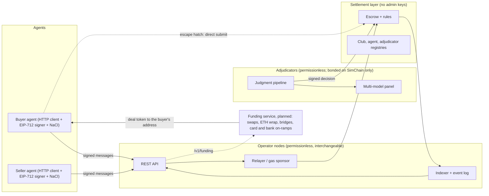
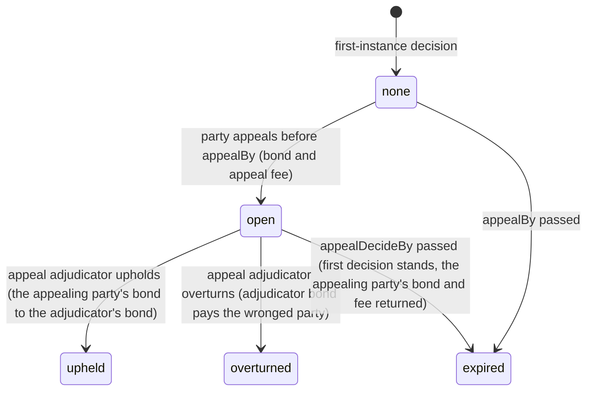

# Architecture v0.1

Reflects the ADRs and the reviews it cites. `docs/decisions-today.md` and `docs/decisions/` record every decision and ADR; this page has not been revised for each decision after D40.

Every chain deployment runs the phase-one contracts: no party appeals, no bonds, one token, and two money addresses per deal (ADR-0031, ADR-0032 and ADR-0033). SimChain keeps the full protocol, party appeals and bonds included, as its reference; a SimChain world may also run the phase-one rules (`pnpm sim` does). Text marked "SimChain only" describes the full protocol.

## Shape of the system



**Settlement layer.** Escrow plus rules, with no owner. In Phase 1 it is **SimChain**: an in-process, deterministic implementation of the same rules. From Phase 2 it is an EVM contract on a local chain and then a testnet (ADR-0003, ADR-0004); the public demo settles on Ethereum Sepolia since 2026-11-03 (D41, ADR-0028). One `Settlement` interface covers both, and the scenario fixtures run against each (differential testing), except the SimChain-only fixtures in `LOCAL_EXCLUSIONS` (`packages/testkit/src/runner.ts`), which use party appeals or bonds.

**Operator node.** Exposes the REST API, verifies and relays signed messages, sponsors gas, indexes events and serves receipts. Anyone can run one. An operator adds speed and convenience, never authority.

**Rules contract.** From Phase 2, the contract that acts as the escrow's operator in the Commerce Payments Protocol sense: the only party that can capture or void the buyer's funds. It has no admin keys and acts only on an adjudicator decision, a buyer's early acceptance or a timeout anyone can trigger. It also releases keys and supplies idempotency (ADR-0003). It holds no bonds: phase one has none (ADR-0031 §8). In Phase 1, SimChain plays this role. Do not confuse it with an operator node, which has no authority.

**Adjudicator.** Runs the judgment pipeline and signs decisions; on SimChain under the full protocol it also posts a bond. Each commitment names a primary, a fallback and an appeal adjudicator; in phase one the appeal adjudicator decides escalations only.

**Ramps.** Convert fiat to the settlement token and back. They act only before funds are held and after they are released.

**Funding service (planned, ADR-0026).** A separate service the unified API calls through `/v1/funding/*`, so a buyer agent can fund from whatever it holds: another ERC-20 (a swap), ETH (wrapped to WETH), another chain (a bridge) or fiat (a card or bank on-ramp). It delivers the deal's token to the buyer's address, and the buyer then funds the hold as usual. It never holds escrowed funds or signs for the buyer, and a buyer that already holds the token skips it. Today the routes answer 501 `not_implemented`, as every planned route does (D39), and the typed interface is `FundingService` in `apps/operator/src/registry.ts`. Each deployment settles one token, fixed when it is deployed, and every route that takes terms refuses another (ADR-0031 §2). Anyone can deploy the contracts for another token, such as one with no freeze function. The token must support ERC-3009, which funds a hold with one signature; there is no other funding path (ADR-0031 §3). The first wave of the service accepts USDC only, funded through a USD to USDC on-ramp (D42); other assets wait for Phase 6.

## Domain objects

| Object | Key fields | Schema |
| --- | --- | --- |
| Club / rulebook | id, rulebook parameters, rulebookHash | `club.schema.json` |
| Agent | address, member, scope (caps, roles, expiry), mandate | `agent.schema.json`, `mandate.schema.json` |
| Commitment | terms (deliverable, acceptance, price, timing, adjudication with registryHash and policyHash, settlement, the buyer's payment address and the seller's payout address, ADR-0033), rulebookHash, nonce, EIP-712 signatures; the adjudicator acceptance sits outside the ID | `commitment.schema.json` |
| Signed messages | Offer, Agree, AdjudicatorAcceptance, FundingAuthorization, EarlyAccept, Decision, AgentRevocation, MemberAdmission, MemberRevocation | `messages.schema.json` |
| Hold | commitmentId, token, amount, state, railRef | inside `commitment-state.schema.json` |
| Delivery | ciphertext URI, plaintext SHA-256, ciphertext SHA-256, content key encrypted to the adjudicator, attempt | `delivery.schema.json` |
| Verdict | one judge's structured output | `judge-verdict.schema.json` |
| Judgment | pipeline record, panel, decision, adjudicator signature | `judgment.schema.json` |
| Appeal (SimChain only, not in phase one) | appellant, grounds, bond | `appeal.schema.json` |
| Adjudicator | address, policy, registry version, metrics; a bond on SimChain only | `adjudicator.schema.json` |
| Event | seq, type, payload, prevHash, hash | `event.schema.json` |

## Commitment state machine

The state has two parts (ADR-0016): the **escrow state** says where the money is, and the **appeal state** says whether a first-instance decision is under appeal. On a phase-one world it always reads `none`: the first decision is final (ADR-0031 §8).

**Escrow state**

```mermaid
stateDiagram-v2
  [*] --> Offered: seller signs
  Offered --> AcceptedByAdjudicator: primary adjudicator accepts (seed commitment; bondReserved 0 on a chain)
  Offered --> Expired: offer expiry (on a chain the operators' record, no transaction)
  AcceptedByAdjudicator --> Agreed: buyer signs
  AcceptedByAdjudicator --> Expired: offer expiry (on a chain the operators' record, no transaction)
  Agreed --> Held: fund (acceptance required; on a chain agree and fund are one call, before offerExpiresAt and fundBy)
  Agreed --> Expired: fund deadline (on a chain the operators' record)
  Held --> Delivered: seller delivers (attempt ≤ max)
  Held --> Refunded: deliverBy passed (anyone: reclaim)
  Delivered --> Released: buyer accepts early
  Delivered --> Released: primary decides accept
  Delivered --> Refunded: primary decides reject
  Delivered --> Escalated: primary decides escalate
  Delivered --> FallbackJudging: judgeBy passed (anyone)
  FallbackJudging --> Released: fallback decides accept
  FallbackJudging --> Refunded: fallback decides reject
  FallbackJudging --> Escalated: fallback decides escalate
  FallbackJudging --> Defaulted: fallbackBy passed (anyone)
  Escalated --> Released: appeal adjudicator accepts
  Escalated --> Refunded: appeal adjudicator rejects
  Escalated --> Defaulted: appealDecideBy passed (anyone)
  Defaulted --> Refunded: default outcome (on a chain in the same transaction, with no compensation; SimChain under the full protocol, seller compensated from bonds)
  Held --> Settled: buyer and seller co-sign a settlement
  Delivered --> Settled: buyer and seller co-sign a settlement
  FallbackJudging --> Settled: buyer and seller co-sign a settlement
  Escalated --> Settled: buyer and seller co-sign a settlement
```



`Settled` is terminal and not appealable. A co-signed `MutualSettlement` pays any split of the price between the buyer's payment address and the seller's payout address, and chooses whether the buyer receives the content key. The fee returns to the buyer's payment address (ADR-0019, D15, ADR-0033). In `Held` it may name a delivery that was never posted and release its key, which settles late work (ADR-0031 §6b). Settle-once holds: if a settlement and a decision race, the first one applied wins.

In `guaranteed_on_decision` a decision moves the money in the same step, so there is no separate settle step. `settle_after_window` (Phase 4) adds a `Decided` escrow state that settles when the appeal state closes.

**Appeal state** (SimChain only, not in phase one: only after a first-instance decision by the primary or fallback; a decision reached through escalation is not appealable)



An overturn moves bond money, not escrow money: the escrow is already `Released` or `Refunded`.

Rules the types must enforce. Illegal states are unrepresentable (ADR-0009): a discriminated union per state, carrying only the fields valid in that state.

| Transition | Who may trigger | Guard |
| --- | --- | --- |
| Offer | Seller agent signature | Scope allows seller role and price; rulebook hash known; nonce unused |
| Accept (adjudicator) | Primary adjudicator signature | Its policy and registry hashes equal the commitment's; on a chain `bondReserved` is 0; on SimChain under the full protocol, unencumbered bond ≥ price in guaranteed mode; before offer expiry |
| Agree | Buyer agent signature over the identical terms hash | Scope allows buyer role, price and daily cap; mandate valid; member admitted under a club rulebook |
| Fund | Anyone holding the buyer's funding authorization | A valid adjudicator acceptance; balance ≥ price + fee + gas buffer; before fundBy (on a chain agree and fund are one call, before both `offerExpiresAt` and `fundBy`) |
| Deliver | Seller signature | Before deliverBy; attempt ≤ maxSubmissions; ciphertext and hashes present |
| Reclaim | Anyone | After deliverBy with no delivery |
| Accept early | Buyer signature | State Delivered. The rules contract also takes it in Held when the same call carries the seller-signed delivery (`earlyAccept`) |
| Decide | The adjudicator whose turn it is | Before its deadline; seed valid for the role (primary: preimage of the acceptance's `seedCommitment`; fallback and appeal: the beacon seed for the first round after `judgeBy` minus 1 s plus the beacon margin, or after the escalation's time plus the margin, ADR-0018 and ADR-0032; on SimChain only, after a party appeal's filing); policy and registry hashes equal the commitment's; judgment record hash included |
| Fallback / default | Anyone | After judgeBy / fallbackBy; for an escalated case, after appealDecideBy |
| Appeal (SimChain only, not in phase one) | Party signature + bond + appeal fee | Within appealWindow after a first-instance decision. Grounds: wrong outcome, missing or wrong key, policy or panel violation, mislabeled model |
| Settle | Anyone | `settle_after_window` only (Phase 4): appeal state closed |

Settlement modes (D6, ADR-0003, ADR-0007):
- **`guaranteed_on_decision`:** release or refund executes at the decision (capture or void in the same step). On a chain the decision is final, and no bond is encumbered. On SimChain only, under the full protocol, if an appeal later overturns it, the adjudicator's bond pays the wronged party the price, so each such commitment encumbers bond equal to its price until `appealDecideBy`. This is the only mode in Phase 1.
- **`settle_after_window`:** funds stay held until the appeal window closes, or the appeal is decided, then capture or void. Built in Phase 4, after its key-release design (see Two-sided hold).

Resubmission after a reject is not supported in Phase 1 (`maxSubmissions = 1`): in guaranteed mode the refund has already left escrow.

## Two-sided hold (D8)

1. The seller generates a content key `K`, encrypts the deliverable with AES-256-GCM, and uploads the ciphertext to any content-addressed store. In the prototype that is a local store or IPFS-compatible.
2. The delivery carries the ciphertext URI, the ciphertext SHA-256, the plaintext SHA-256, and `K` encrypted to the adjudicator's public key (and to the fallback and appeal adjudicators).
3. The adjudicator decrypts, verifies the plaintext hash and judges.
4. On accept in `guaranteed_on_decision`, the decision transaction carries `K` encrypted to the buyer's public key. Settlement and key release are one atomic step on the settlement layer.
5. On early acceptance, no adjudicator acts, so the delivery also carries `K` encrypted to the buyer, and the settlement layer releases it with the payment.
6. On reject, `K` is never released to the buyer.
7. The settlement layer cannot check that the released `K` decrypts the committed plaintext. On a chain no appeal can carry `K`: the buyer holds the signed decision and the judgment record as its evidence (D26). On SimChain only, a missing or wrong key is an appeal ground, and an appeal decision may carry `K` to the buyer.

In `settle_after_window`, capture happens after the appeal window, and a key published at the decision would be readable at once. That mode needs its own key-release design before Phase 4.

The buyer can verify the received plaintext against the committed plaintext hash.

Limit: the adjudicator sees the plaintext. That is acceptable because both parties name the adjudicators. Confidential-compute judging is a later option.

## Panel randomness (ADR-0018)

The primary's panel seed comes from its own commit-reveal. The fallback and appeal adjudicators take theirs from a public beacon, at a round the decider does not control: `panelSeed = keccak256(commitmentId ‖ role ‖ attempt ‖ beaconValue(round))`.

| Decider | Beacon round |
| --- | --- |
| Primary | none (reveals the preimage of `seedCommitment`) |
| Fallback | the first round after `judgeBy` minus 1 s plus the beacon margin |
| Appeal after escalation | the first round after the escalation's time plus the beacon margin |
| Appeal after a party appeal (SimChain only) | the first round after the appeal was applied |

SimChain runs a deterministic beacon, `keccak256(simSeed ‖ round)`, one round per simulated second. Phase 2 uses drand quicknet, verified on chain. The rules contract's `BEACON_MARGIN`, fixed at deploy, delays each round past the last moment a choice can be made (ADR-0032): 29 s on Sepolia and Ethereum mainnet, 0 on SimChain and the local chain. If a round cannot be proven by the deadline, the decision is refused, and the fallback or default applies.

## Privacy and disclosure (ADR-0020)

Every commitment has a public skeleton and a private body.

| Part | Contents | Who sees it |
| --- | --- | --- |
| Skeleton | Commitment ID, terms hash, payout addresses, token, price and fee, deadlines, the three adjudicators, mode, `policyHash`, `registryHash`, `rulebookHash`, outcomes and money movements, and on SimChain bond movements | Everyone, at every level. Timeouts, settle-once and, on SimChain, the coverage gate need only this |
| Body | Description, criteria, rubric, sealed checks, judgment reasons | Public at `public`; criteria and judgment record public at `judgment`; otherwise the parties and involved adjudicators, through a record key wrapped to each |
| Work | The deliverable | Never published by the protocol. Readable by whoever holds the content key |

Keys go only to those who need them. Whoever wants judgment carries the key; the seller is never the gate.

| Path | Content key and record key |
| --- | --- |
| Mutual settlement | The parties only |
| Early acceptance | The buyer, with the payment |
| Optimistic mode | The buyer at delivery. A `Dispute` carries keys for all three adjudicators |
| Guaranteed mode, primary | At delivery |
| Fallback | Released on takeover: SimChain holds the envelope in Phase 1; time-locked to the beacon round at `judgeBy` later, with T-207's private-deal slices (Phase 8) |
| Appeal | Carried by the `escalate` decision, or on SimChain only by a party appeal; time-locked to `appealBy` as a backstop later, with the same slices (Phase 8) |

Disclosure levels are a signed term: `private`, `judgment` or `public`. A rulebook sets `disclosureMin`, an adjudicator policy may require a minimum, and a co-signed `Publish` can raise the level, never lower it. Operators accept all three levels; the demo adjudicators cannot open sealed terms yet (T-207). Bond backers see aggregate signals recomputed from skeleton events, not cases.

## Finality (D20)

Two moments matter, and the read model reports both.

- **Payee finality** (`settledAt`): the money a party receives is irrevocable at the posting that pays it. Nothing in the protocol takes it back out of escrow.
- **Commitment finality** (`finalAt`): no appeal, dispute or settlement path remains, so nothing in the protocol can change who ended up with what, fees included. On a phase-one world `finalAt` is the decision's time: no appeal follows a decision (ADR-0031 §8). On SimChain only, under the full protocol, `finalAt` is reported once `appealBy` passes with no appeal, even if nobody has triggered `appeal-expiry`, because a late appeal is refused anyway.

Both fields are derived from state, terms and the clock. They are never signed, so they change no EIP-712 type.

| Path | Money moves | Irrevocable for the payee | Nothing can change any more | Work (key) |
| --- | --- | --- | --- | --- |
| Guaranteed, first-instance accept or reject | At the decision | At the decision. On SimChain only, an overturn pays from the bond, not from escrow | At the decision on a phase-one world. On SimChain under the full protocol: `appealBy` with no appeal; otherwise the appeal decision or `appealDecideBy` | Key with the payment on accept |
| Guaranteed, escalation decision | At the decision | At the decision | At the decision; not appealable | Same |
| Early accept, reclaim, default, mutual settlement | At the step | At the step | At the step; none is appealable | Early accept, and settlement with `releaseKey` |
| `settle_after_window` (Phase 4) | At window close | At window close | Same moment | Design open (ADR-0012) |
| `optimistic` (Phase 4) | Release at `disputeBy` (anyone) or at the decision | At that step | `disputeBy` with no dispute; otherwise as guaranteed | At delivery: the work is final for the seller before the money is |

On a phase-one world the first decision is final at once, with no indemnity: the signed decision and the judgment record are the parties' evidence (D26). On SimChain under the full protocol, guaranteed mode is finality with indemnity. The payee is final at the decision, and the other party's recourse until the window closes is a claim on the adjudicator's bond. A payee may act (ship, pay onward) at the posting. A payer should treat the case as closed at `finalAt`.

Protocol finality is not legal finality. Courts can still compel real-world parties (residual 5), and chargebacks on a card on-ramp sit with the ramp (ADR-0002).

## Hold and settlement postings (SimChain)

The prototype uses accounts per address and per escrow, in base units of the test token. Each adjudicator's bond is a pool with two tranches, `bond:{a}:junior` (its own stake, first loss) and `bond:{a}:senior` (backers, pro rata), plus one `reserved` counter (ADR-0014 §2a, D10). Below, `bond:{a}` means the pool: debits take junior first, then senior; the appeal-upheld credit goes to junior. Senior is empty in Phase 1.

A chain makes the same postings except the bond and appeal rows, which are SimChain only and not in phase one. In every row, `buyer` is the buyer's payment address and `seller` the seller's payout address (ADR-0033).

| Operation | Postings |
| --- | --- |
| Faucet (test only) | `external:faucet → buyer` |
| Fund | `buyer → escrow:{id}` (price + fee) |
| Release | `escrow:{id} → seller` (price); `escrow:{id} → adjudicator:{a}` (fee) |
| Refund | `escrow:{id} → buyer` (price); `escrow:{id} → adjudicator:{a}` (fee earned for judging) |
| Early acceptance | `escrow:{id} → seller` (price); `escrow:{id} → buyer` (fee; no adjudicator judged) |
| Reclaim (no delivery) | `escrow:{id} → buyer` (price + fee) |
| Mutual settlement | one posting per payout: `escrow:{id} → payouts[i].to` (`payouts[i].amount`; the payouts sum to the price, D23; on a chain each `to` is `buyer` or `seller`); `escrow:{id} → buyer` (fee); on SimChain every reservation on the commitment released; buyer key emitted only if `releaseKey` |
| Appeal bond and fee (SimChain only) | `appellant → appealbond:{id}` (bond); `appellant → appealfee:{id}` (appeal fee, rulebook parameter, held until decided; D21) |
| Appeal decided, upheld or overturned (SimChain only) | `appealfee:{id} → adjudicator:{appeal}`, plus the upheld or overturn row below |
| Appeal expired undecided (SimChain only) | `appealbond:{id} → appellant`; `appealfee:{id} → appellant`; the first decision stands |
| Overturn, guaranteed mode, wrongful accept (SimChain only) | `bond:{a} → buyer` (price); `appealbond:{id} → appellant` |
| Overturn, guaranteed mode, wrongful reject (SimChain only) | `bond:{a} → seller` (price); `appealbond:{id} → appellant` |
| Appeal upheld (SimChain only) | `appealbond:{id} → bond:{a}` |
| Default outcome | `escrow:{id} → buyer` (price + fee); on SimChain only, under the full protocol, `bond:{a} + bond:{fallback} → seller` (compensation per rulebook) |
| Default after escalation | `escrow:{id} → buyer` (price + fee); on SimChain only, under the full protocol, `bond:{appeal} → seller` (compensation per rulebook) |

`{a}` is the adjudicator whose decision settles the commitment: the primary, the fallback, or the appeal adjudicator for an escalated case. The fee goes to that adjudicator; an adjudicator that escalates earns no fee. On the Commerce Payments Protocol, the refund path is a fee-only capture followed by `void` (ADR-0003).

Invariants, property-tested:
- conservation (the token total is constant except faucet mints);
- no negative balances;
- each escrow is settled at most once;
- `junior + senior - reserved` ≥ `ceil(price × windowCoverageRatioBps / 10000)` before a new assignment, with a 100% ratio for `guaranteed_on_decision` commitments still open to appeal;
- losses are taken from junior before senior;
- encumbered bond is never counted twice (one commitment's overturn and another's default cannot draw on the same units);
- every rate is applied with `mulBps` or `splitBps` (ADR-0022): requirements round up; a split rounds the rate side down and pays the remainder to a named party (fee share: remainder to the buyer; capital charge: remainder to the adjudicator; backers: dust to junior); payouts from a bond round down and the bond keeps the dust. No posting creates or destroys a unit.

## Settlement interface

```ts
interface Settlement {
  kind: 'sim' | 'local' | 'testnet';
  submit(msg: SignedMessage): Promise<SubmitResult>;          // any party may call; validates on the settlement layer
  fund(auth: SignedFundingAuthorization): Promise<SubmitResult>;
  trigger(commitmentId: Hex, timeout: TimeoutKind): Promise<SubmitResult>; // permissionless timeouts
  state(commitmentId: Hex): Promise<CommitmentState>;
  events(fromSeq: bigint): AsyncIterable<SettlementEvent>;
  balances(addresses: Address[]): Promise<Record<Address, TokenAmount>>;
}
```

The operator API and the internal SDK call only this interface. Chain details stay in the `local` and `testnet` implementations.

## Identity and signing

- Agents, principals and adjudicators are EVM addresses: externally owned accounts, or smart accounts later.
- Signed messages are EIP-712 typed data, with domain `{name: "Holdback", version: "0.8", chainId, verifyingContract}`. SimChain uses a fixed placeholder contract address. The domain version tracks the signed encoding: it moves when an existing typed-data struct or the terms encoding changes, so a signature made under one encoding never verifies under another. Additive schema versions leave it (ADR-0023: schema 0.7 kept domain version 0.6). ADR-0029 set 0.7 with schema 0.9; schema 0.11 moves it to 0.8, because the terms now name the buyer's payment address and the seller's payout address (ADR-0033).
- Funding is gasless for agents. The buyer's payment address signs an ERC-3009 `ReceiveWithAuthorization` for price plus fee to the escrow's collector, and any relayer can submit it. There is no other funding path (ADR-0031 §3).
- A mandate is the principal's EIP-712 signature over the agent's scope: caps, roles, categories, expiry. It is checked at agree and fund.

## Events, receipts, audit

- Every settlement event is appended to a hash-chained log: `hash = keccak256(prevHash || canonicalEvent)`.
- Operators serve receipts signed by the operator key.
- Decisions carry the adjudicator's signature and the judgment record hash. The full record is published to content-addressed storage.
- `pnpm replay` rebuilds state from events and checks it against the settlement layer's state.

## Timing rules

- Fixed order, each deadline strictly before the next: `offerExpiresAt < fundBy < deliverBy < judgeBy < fallbackBy`. Core and the contract refuse any other order. `appealDecideSec` times an escalation's decision from the escalation. On SimChain only, under the full protocol, a first decision also opens `appealBy` and `appealDecideBy` after it.
- Each window has a rulebook minimum, sized for forced-inclusion delay on the target chain.
- The beacon margin sets the smallest windows a chain can decide in: 37 s for an escalation, and 44 s on Sepolia or 43 s on mainnet for the fallback (ADR-0032).
- On the Commerce Payments Protocol, `authorizationExpiry` is `fallbackBy + appealDecideSec + EXPIRY_MARGIN`, and `refundExpiry` equals it (ADR-0003).
- Prepare's defaults are `DEFAULT_TIMING` in `apps/operator/src/terms.ts`, with an appeal window of 0.
- The largest instant a deadline can take is 9999-12-31T23:59:59-23:59 (253,402,387,139 s), and `appealWindowSec` and `appealDecideSec` are at most 2^32 − 1 s. Core refuses more, and the contract refuses a later `fallbackBy` or a longer escalation window at funding (`Unrepresentable()`).
- Agents never see card hold windows. Card and Stripe funding converts to tokens before the hold, so card authorization lifetimes do not bound the escrow.

## Repository layout (proposed for T-001)

This is the layout as proposed; the repository map in `README.md` lists the paths as they are today, including `apps/demo-cloud/`, `apps/site/`, `apps/early-access/` and `apps/test-agents/`. The operator API does not use Fastify or any other web framework.

```
apps/
  operator/        REST API (Fastify), relayer, indexer
  adjudicator/     adjudicator service: pipeline + signing
  demo/            narrated CLI, transcript renderer, static viewer
packages/
  core/            types from schemas, state machine, EIP-712 types, money
  settlement/      Settlement interface; sim/ (SimChain); evm/ (contract client, Phase 2)
  judgment/        intake, checks, screen, providers, panel, aggregation
  sdk/             internal SDK for the operator, the demo and tests: operator failover + direct submit (not published; D30)
  testkit/         snap runner, deterministic clock/RNG, recorded providers, fixture helpers
contracts/         Foundry project (Phase 2)
spec/              JSON Schemas (contract) + examples
fixtures/          scenarios/, calibration/, redteam/, data/
docs/              specs, ADRs, tasks, research
.claude/           agents, commands, settings
```

## Glossary

- **Club:** a set of members who agree once on a rulebook for their agents' commitments. It works like a group purchasing or framework agreement, with buyers and sellers both as members, closer to a card scheme.
- **Rulebook:** the club's parameters: dispute procedure, minimum windows, bond and coverage ratios, sealed-check limits, default-outcome compensation. Its hash binds each commitment.
- **Member:** a firm in a club. **Principal:** the member's signing key that issues mandates.
- **Agent:** an address that signs commitments within a scope. **Mandate:** the principal's signed scope for an agent.
- **Commitment:** signed terms between a buyer agent and a seller agent: Offered, then Agreed.
- **Hold:** escrowed price plus fee (money side), and the escrowed content key (work side).
- **Delivery:** ciphertext plus hashes plus the escrowed content key.
- **Acceptance:** the decision that delivery met the terms.
- **Deterministic check:** a declarative, machine-evaluated acceptance test.
- **Rubric criterion:** a scored criterion judged by the panel. **Sealed check:** a buyer check committed by hash at agreement and revealed at judging.
- **Screen:** the injection and anomaly detection step.
- **Panel / judge / verdict:** the set of pinned models; one model call; its structured output.
- **Judgment:** the full pipeline record and decision.
- **Escalation:** sending a case to the appeal adjudicator instead of auto-deciding.
- **Appeal:** a party's bonded challenge to a decision; SimChain only, not in phase one.
- **Adjudicator:** a service that judges and signs decisions; bonded on SimChain only. **Fallback adjudicator:** decides if the primary misses its deadline.
- **Default outcome:** what anyone may trigger when no adjudicator decides in time.
- **Bond:** adjudicator capital that pays when an appeal overturns its decision, or when it misses its deadline. SimChain only in phase one (ADR-0031 §8).
- **Coverage ratio:** minimum bond as a share of open exposure. SimChain only in phase one.
- **Operator node:** a node offering the REST API, relaying and indexing, with no authority. **Escape hatch:** direct submission without any operator node.
- **Operator fee:** what an operator node publishes (`fees.operator`) and asks for relaying a buyer's funded agreement: max(min, ceil(price × bps / 10000)), capped at max, paid by the buyer's own signed transfer in the same step as the funding, outside the hold, never refunded. Only that node asks for it; direct submission is free (ADR-0023, D33).
- **Rules contract:** the escrow's operator in the Commerce Payments Protocol sense, the only party that can capture or void, constrained to decisions, early acceptance and timeouts.
- **SimChain:** the in-process simulation of the settlement rules.
- **Rail:** where custody happens. **On-ramp / off-ramp:** fiat conversion before the hold / after release.
- **Receipt:** an operator-signed record of an accepted message or a settlement event.
- **Mutual settlement:** a message buyer and seller both sign that ends a funded, undecided commitment at any split of the price between the buyer's payment address and the seller's payout address (on SimChain under the full protocol, to any address the rulebook allows), with or without releasing the content key to the buyer (ADR-0019, D23, ADR-0033).
- **Skeleton:** the public part of a commitment: IDs and hashes, payout addresses, token and amounts, deadlines, adjudicators, mode, outcomes and money movements. Anyone can act on it (ADR-0020).
- **Disclosure level:** a signed term, `private`, `judgment` or `public`, that sets which parts of the body are public. A rulebook sets the minimum; a co-signed `Publish` can raise it.
- **View key:** a key a party hands to an auditor or examiner so it can read a commitment's body without publishing it.
- **Pseudonymous identity:** a one-time signing key per commitment, linked to the agent's long-term identity only for the counterparty and involved adjudicators (ADR-0020, Phase 2).
- **Beacon:** a public source of randomness rounds that no adjudicator or party controls. It seeds fallback and appeal panels (ADR-0018). SimChain in Phase 1, drand quicknet in Phase 2.
- **Backer:** any address that deposits into an adjudicator's bond pool and earns its capital charge pro rata, behind the adjudicator's first-loss stake (ADR-0014). SimChain only in phase one.
