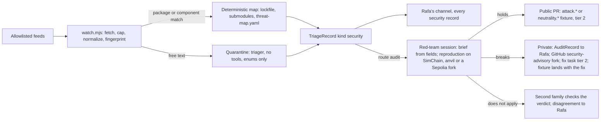

# Agent ops, two additions: usage simulation before merge, and a stronger Tickets lane

Design note, 2026-11-05, for the agent-ops pipeline (Phase 10, not active). Written by a Fable 5.1 research session at max effort from Rafa's two amendments of 2026-11-05. The note mirrors the design in `agent-ops/` (PR 112) and the published page (https://claude.ai/artifact/SFr3VwBWeyQ8uuTMsqS5a2). Nothing here runs; every piece waits for Phase 10 and for the Activation steps it adds. Each claim is labelled measured, documented, inferred or guessed.

The task files drafted with this note are now in `docs/tasks/`:

- `docs/tasks/T-061-usage-simulation-scripted-tier.md`
- `docs/tasks/T-062-usage-simulation-model-tier.md`
- `docs/tasks/T-063-production-crawlers.md`
- `docs/tasks/T-064-security-watch.md`

The design itself is recorded in `agent-ops/` (README, pipeline, gates, teams, ops.yaml and reconcile). This copy differs from the session's scratch note in three places: these file paths, and two counts that the note's own tables contradicted (the profiles in section 3.3 and the model families in the summary).

**Numbering.** Rafa asked for the T-04x range. It is full: T-040 to T-049 exist in `docs/tasks/` and `docs/plan.md`, and so do T-050 to T-060 (measured, `ls docs/tasks`, `grep -oE 'T-0[0-9]{2}' docs/plan.md`). The next free Phase 10 numbers are T-061 to T-064, and this note uses them.

## 1. Summary

1. **Usage simulation becomes a gate with two tiers.** A scripted tier runs in CI as a fourth required status, `simulate`, in stage 5 (Checks): simulated customers from a catalogue play deals through the public HTTP API against a per-PR world, and each pairing must end where its expectation says. A model tier runs on the agents' VM in stage 6 (Review): model-driven customers of several profiles, frameworks and families play a weighted sample of the catalogue against the PR's world, and the reviewer approves a tier 2 PR only when the run's record reads PASS.
2. **Staging is three per-PR worlds plus one shared Sepolia world.** Per PR: SimChain in-process (always), anvil (tier 2 runtime paths) and workerd through `wrangler dev` (Workers code). Shared: `holdback-staging-op1` and `-op2` on Sepolia with their own world name, relayer and bonds, deployed from the same tag before every production deploy and nightly from main. Test tokens only; the public demo world (D49) is never touched.
3. **The catalogue is `tools/sim/catalogue.json` extended to version 2:** more jobs and variants (sizes, disclosure, windows), thirteen profiles, nine of them new, including confused and awkward agents, four agent frameworks, models from three families (Claude, DeepSeek and a pinned GPT model), pairings with expectations and integer weights, and an origin per entry. A schema bounds its free text like the TriageRecord's.
4. **A market-feedback loop keeps it current.** Feedback requests (T-043), free reports (T-032), telemetry rules (T-042), social posts, founder conversations and the simulation's and crawlers' own friction reports become TriageRecords. A new route, `catalogue`, lets the architect turn a record into an entry in a tier 1 PR. Weights come from telemetry aggregates in coarse bands, recomputed monthly. No raw text enters the catalogue.
5. **Pass rules compare against main's baseline.** Scripted tier: expectations block, timing is advisory. Model tier: a `sim:check` invariant violation blocks; a completion-rate drop beyond the baseline's noise band blocks after one rerun; friction and cost are advisory and feed intake. Flaky pairings follow the Known flakes rules: named, 14-day expiry, a fix task.
6. **Production bug crawlers** are a `crawler` process on the VM with no secret: fresh keys per probe, funded by the faucet like a visitor. A read-only pass every 30 minutes checks the homepage, `llms.txt`, `try.mjs`, both operators, the problem pages, the test seller's card and the console's gate against each other. A deal pass every 8 hours runs the one command from `llms.txt` verbatim. Budgets live in `ops.yaml` (tier 3). Failures become TriageRecords with stable fingerprints and a likely cause from T-060's dependency status.
7. **Continuous security audits** start from a watchlist of public feeds (advisories for every lockfile package and contract library, exploit write-ups, CVEs, LLM-judge attack research). A script matches advisories to the lockfile deterministically; free text goes through the quarantine. A record that maps to Crow dispatches a red-team session (Fable 5.1, max effort) whose brief is built from record fields and a threat map. The reproduction becomes an `attack.*` or `neutrality.*` fixture: public when the defense holds, private through GitHub's security-advisory fork when it breaks. Rafa receives every security record on his channel, and a second family checks every "does not apply" verdict.

The rest of this note gives the detail, the code paths (exists, planned, proposed), the new Activation steps and seven new threat rows (P13 to P19).

## 2. What Rafa asked, and what the note read

Rafa, 2026-11-05, on the agent-ops design:

1. "we should amend to include agent / customer usage simulation, with set of diverse needs informed by continous market feedback in staging environment pre-merge"
2. "And for 'tickets' we should have agent crawlers looking for bugs in production environment, as well as continuous security audits informed by market security events"

Read for this note (all measured against the files on 2026-11-05): the artifact's text and `agent-ops/` (README, pipeline, gates, teams, ops.yaml, reconcile, both schemas, STATUS); `docs/plan.md` Phases 9 to 11; tasks T-031, T-032, T-039 to T-050, T-054, T-057, T-060, T-021, T-023, T-216, T-222; `tools/sim/` (README, catalogue, world, brief, audit, check, briefs); `examples/e2e-round.ts`, `e2e-scenarios.ts`; `apps/test-agents/src/` (catalog, keys, worker, seller); `site/try.mjs`, `site/check.mjs`; `apps/demo-cloud/src/world.ts` (faucet and lane limits), `worker.ts`, `scripts/relayer.mjs`, `scripts/deal.ts`; the attack and neutrality fixtures; `docs/neutrality.md`, `docs/judgment-and-defenses.md`, `docs/demo.md`, `docs/PRD.md`, `docs/decisions-today.md` D39 to D49, `docs/operations.md`, `docs/testing.md`, `docs/team.md`, `docs/costs.md`, `docs/backlog.md`, `SECURITY.md`, `.github/workflows/ci.yml`, `.github/dependabot.yml`, `contracts/remappings.txt`, `config/judges-live.yaml`, `.claude/agents/red-teamer.md`, and CLAUDE.md.

Facts the design rests on:

- The pipeline has nine stages (0 Intake to 8 Feed back), four input lanes (Tickets, Agent feedback, Roadmap, Telemetry) and CI signals; three required checks (`check`, `gitleaks`, `xreview`) pinned to the GitHub Actions app at activation (T-050 step 2); the reviewer's App, `crow-review`, must approve every PR from T-050 step 2 (measured, `agent-ops/pipeline.md`, T-050).
- `tools/sim` (T-021, T-023) already has a catalogue with 4 jobs, 4 profiles and 6 pairings, per-run isolated worlds, briefs, a mailbox and `sim:check`, which recomputes five invariants from the settlement record. Parties are Claude Code subagents of the Claude family only, with fake judges (measured, `tools/sim/README.md`, `catalogue.json`).
- `examples/e2e-round.test.ts` runs the round-1 driver as a separate process over HTTP against the demo's own world (`apps/demo-cloud`) on two origins: 49 s on SimChain, 98 s on anvil (measured, T-216 Evidence). `pnpm demo-cloud:e2e` runs both Workers in `wrangler dev` (workerd) and plays a deal in 8.4 s (measured, T-032 Evidence).
- The faucet grants 1,000 tUSD per address per hour, 10 grants per client IP per hour, and 600 mints a day on a chain. The operators rate-limit 120 writes and 1,200 reads a minute. A deal lane below 0.01 Sepolia ETH gets 0.03 from the funding lane (measured, `apps/demo-cloud/src/world.ts`). A relayed deal costs 1,636,242 gas plus a faucet mint of 130,000 to 240,000 gas (measured, D47, `world.ts`).
- Crow's test seller takes 3 requests per client an hour and 10 a day, 20 offers an hour and 100 a day in all, 10 in progress (measured, `apps/test-agents/src/catalog.ts`).
- Dependabot covers GitHub Actions only (measured, `.github/dependabot.yml`). The nightly CI schedule is off since 2026-11-01, and "Reliable production maintenance" is a backlog row (measured, `ci.yml`, `docs/backlog.md`).
- The contracts import Solady, Commerce Payments, Permit2 and, transitively, OpenZeppelin; solc 0.8.28 with `via_ir` on `prague` (measured, `contracts/remappings.txt`, `foundry.toml`). The workspace depends on viem, tweetnacl, @noble/curves, ajv, ajv-formats, yaml, vitest, TypeScript, ESLint and rolldown, and runs wrangler 4 through `npx` (measured, the package files).
- `SECURITY.md` already commits Crow to fixing in private and publishing a GitHub security advisory once the fix ships (measured).

## 3. Addition 1: usage simulation before merge

### 3.1 Where it sits, and what it gates

The simulation has two tiers, in two stages.

| Tier of the simulation | Stage | Who runs it | Status it produces | Blocks |
| --- | --- | --- | --- | --- |
| Scripted | 5, Checks | A CI job, `simulate`, from a trusted checkout of `main` for the harness, the PR's build for the world | The fourth required status, pinned to the GitHub Actions app like `check` | Yes, on any failed expectation, for PRs that touch customer paths |
| Model | 6, Review | The `stager` process on the VM, in a sandbox, with model-driven customers | A `SimRecord` in `/srv/crow/sim/pr/<pr>/<head-sha>.json`, which the reviewer must read before approving | Yes for tier 2, on an invariant violation or a completion regression; advisory otherwise |
| Pre-deploy | Before a deploy (T-046's slot) | The deploy wrapper's new `stage <tag> <sha>` command, then the crawler's probes and three must-run pairings against the staging world | A staging record under `/srv/crow/sim/staging/<tag>.json` | Yes: `/opt/crow/deploy` refuses a production deploy without a PASS record for the same tag and SHA |

Why stage 5 for the scripted tier: it is deterministic, costs no model spend, and the pipeline's own rule is that automated checks run before any model review. Why stage 6 for the model tier: live models are stochastic and cost money, which is why the product's calibration harness never gated CI (`docs/testing.md`). The model tier therefore blocks only on deterministic facts it surfaces (a protocol violation computed from the settlement record, or a completion count below a measured band), and the reviewer, not a status, carries its verdict. The reviewer runs on the same VM and reads the record from a store that builders cannot write, so no comment can forge it.

**Which PRs the gate covers.** Tiers set the depth, and paths set the trigger. The trigger is a path list, `simulation.customer_paths`, in `ops.yaml`, served by `scripts/ci/affected.mjs` (T-034) like every other path rule.

| The PR touches | Tier | Scripted tier | Model tier |
| --- | --- | --- | --- |
| Docs outside the agent docs, `brand/**` | 0 | Passes at once | None |
| The agent docs: `site/llms.txt`, `docs/api.md`, `docs/quickstart.md`, the problem-page text in `site/build.mjs` | 0 or 1 | SimChain, the must-run set | The vanilla visitor plus one private deal (2 pairings). Blocking once calibrated: this is D39's bar, an agent completes a deal from `llms.txt` on its first try, applied before the docs change merges |
| Customer paths at tier 1: `examples/**`, `site/**`, `apps/test-agents/**`, `tools/sim/catalogue.json`, `fixtures/clubs`, `fixtures/terms`, `fixtures/data`, `apps/demo/**` | 1 | SimChain; plus workerd when `apps/demo-cloud/**`, `apps/site/**`, `apps/test-agents/**` or `site/**` change | A 2-pairing sample, advisory |
| Tier 2 runtime paths: `apps/operator/src/**`, `apps/adjudicator/**`, `apps/demo-cloud/**`, `packages/**`, `spec/**`, `contracts/**`, `config/judges*.yaml`, `pnpm-lock.yaml` | 2 | SimChain and anvil; plus workerd for `apps/demo-cloud/**` | A 6-pairing weighted sample, blocking on invariants and regressions |
| Tier 3 control files only | 3 | Passes at once unless the PR also touches a path above | None |
| Anything else (scripts, tests, `packages/testkit/**`) | 1 | Passes at once | None |

`simulate` always reports, because a required check that never reports blocks every PR (velocity review §2.2, cited in `agent-ops/gates.md`).

### 3.2 What staging is

Both, with different jobs. Per-PR worlds give the gate; one shared Sepolia world gives the pre-deploy and nightly runs on real infrastructure.

| World | Settlement and runtime | Where it runs | Starts how | Used for | Cost per run | What it catches that the others miss |
| --- | --- | --- | --- | --- | --- | --- |
| Per-PR SimChain | The demo's own World (`apps/demo-cloud`) in a Node process, SimChain inside, two origins, scripted judges | The CI runner (scripted tier) or the stager's runner user on the VM (model tier) | `tools/sim/stage.ts --world sim` | Every gated PR | Seconds; USD 0 | API shape, docs, operator logic, the protocol as core runs it |
| Per-PR anvil | The same World on the PR's contracts from `contracts/out`, a block a second | Same | `tools/sim/stage.ts --world anvil` | Tier 2 runtime PRs | About 2 minutes for 12 pairings (inferred from 98 s for 5 scenarios); USD 0 | Core against contract divergence, gas, timing races at small scale |
| Per-PR workerd | Both Workers under `wrangler dev --local` (the Workers runtime, Durable Objects and KV emulated), as `pnpm demo-cloud:e2e` does | Same | `tools/sim/stage.ts --world workerd` | PRs that change Workers code or the site bundle | About 3 minutes (guessed); USD 0 | Startup CPU limits (the 1101 class that took the demo down after T-029), runtime API differences, bundle size |
| Shared Sepolia staging | `holdback-staging-op1` and `-op2` at `staging-api.escrow.stream` and `staging-api2.escrow.stream`, `SETTLEMENT=sepolia`, world name `holdback-staging-sepolia-<date>`, its own relayer key and funding lane, its own three adjudicator keys and bonds, plus `crow-test-agents-staging` | Cloudflare | `/opt/crow/deploy stage <tag> <sha>` (T-039's wrapper, extended), before each production deploy and nightly from main's tag | Pre-deploy (required) and nightly (continuous) | About a minute per deal; about 0.002 Sepolia ETH per deal at 1 gwei (inferred from 1,636,242 gas plus a mint) | Real block timing, the RPC providers, Cloudflare's behaviour and limits, secrets wiring, drand, the live faucet path |

Rules for staging:

- **Test tokens only.** Every staging process refuses any chain but Sepolia and anvil through `assertRoundChain` (`examples/e2e-round.ts`), before any write. SimChain worlds mint tUSD in process.
- **Never the public demo world.** D49 keeps `holdback-public-demo-sepolia-2026-11-04` long-lived for monitoring. The staging world is a different Durable Object name on different Workers and hostnames with a different relayer key, so no staging code path can address the demo's storage. It settles on the same rules contract and token, because a rules contract is permissionless and a staging deal is just another deal on it (D49: a new world only for a new rules contract). Its adjudicators are separate keys with their own 25,000 tUSDC bonds, minted from the open-mint token (about 1.12 million gas, 0.015 Sepolia ETH, measured for the demo's bonds in D49).
- **Bounded loss.** The staging funding lane holds about 0.3 Sepolia ETH (guessed) and the faucet's daily mint cap applies there too. A dry lane answers `relay_refused` and the staging run records "relayer dry", never a Crow bug.
- **No customer can reach production from staging.** The stager user's network egress is loopback plus the model APIs only (an owner-matched firewall rule in `scripts/dev-env/vm-users.sh`, T-039's script, extended). A confused or adversarial simulated customer cannot address `escrow.stream` whatever its brief says. For the Sepolia staging world the customers run as the `crawler` user from the staging hostnames, which the same rule allows and `escrow.stream` does not.

### 3.3 The simulated customers: catalogue version 2

**Where.** `tools/sim/catalogue.json`, the file T-021 made, extended in place. It fits: it already holds jobs with proposable terms, profiles with tactics, models and pairings, and `tools/sim/brief.ts` renders a brief from it. Two other catalogues exist and stay what they are: the test seller's `apps/test-agents/src/catalog.ts` is a party's own price list (D47), and `examples/e2e-scenarios.ts` is the round's fixed scenario set. A backlog row proposes that the round's constants import from the catalogue later.

**Format.** JSON, version 2, checked by a new `tools/sim/catalogue.schema.json` under Ajv 2020-12 strict, like `spec/schemas`. The schema reuses the TriageRecord's `shortText` rule for every free-text field (`title`, `seller`, `buyer`, `brief`, tactics): at most 300 characters, no URL, handle, markup or markdown link. Weights are integers in basis points that sum to 10,000 (a test checks the sum). Amounts stay base-unit strings. Each entry carries an `origin`.

```json
{
  "version": 2,
  "jobs": [{ "id": "dataset", "title": "…", "seller": "…", "buyer": "…", "terms": { "…": "…" },
             "variants": { "size": ["tiny", "small", "medium"], "disclosure": ["public", "private"], "windows": ["short", "standard", "long"] },
             "origin": { "source": "roadmap", "ref": "docs/demo.md", "date": "2026-10-31" } }],
  "profiles": [{ "id": "confused", "brief": "…", "origin": { "source": "telemetry", "ref": "api.problem_share_2x", "date": "…" } }],
  "frameworks": [{ "id": "claude-code" }, { "id": "tool-loop", "provider": "deepseek" }, { "id": "scripted" }, { "id": "vanilla-visitor" }],
  "models": ["haiku", "sonnet", "opus", "fable", "deepseek-v4-pro", "gpt-<pinned>"],
  "pairings": [{ "id": "homepage-visitor", "job": "customers-3", "variant": { "disclosure": "public" },
                 "buyer": { "framework": "scripted", "profile": "honest" }, "seller": "test-seller",
                 "expect": { "terminal": "Released", "paid": "seller", "keyToBuyer": true, "problems": [] },
                 "weightBps": 1500, "mustRun": true, "tiers": ["scripted", "model"] }]
}
```

**Jobs** (kinds of work and deal sizes). The four existing jobs stay: `dataset` (20 rows, checks-only, 40 tUSD), `translation` (rubric, 15 tUSD), `code-fix` (rubric, 30 tUSD), `research-brief` (JSON schema check plus rubric, 25 tUSD). New:

| Job | Shape | Why |
| --- | --- | --- |
| `customers-3` | The test seller's item: 3 rows for 25 tUSDC under `cols`, `rows`, `uniq`, checks-only | The homepage path every visitor takes (D47) |
| `demo-clean-2000` | The demo's cleaning job: 2,000 tUSD, deterministic checks plus a sealed check and a rubric | The job `docs/demo.md` tells the audience about; medium size |
| `markdown-report` | `text/markdown`, rubric plus `hidden_characters_max` | A second text format; the screen on Markdown |
| `large-dataset` | A CSV near the 10 MB intake cap, checks-only | The adjudicator's parse and CPU path; T-054's CPU guard |
| `tiny-dataset` | A price at the operator fee's minimum (0.01 tUSD) and the smallest judge windows the rulebook allows | Fee rounding and small deals (T-215) |
| `over-scope` | A price above the mandate's per-commitment cap | The expected refusal `scope_exceeded`; an `error.*` path through the API |

Variants multiply each job: `size` (tiny, small, medium; large is `over-scope`), `disclosure` (`public`; `private` with a per-deal key and a `Delegation`, ADR-0024), `windows` (short at the rulebook minimum, standard, long with a `deliverBy` a year out, which D31 allows), `template` (checks-only, default, rubric-only).

**Profiles** (behaviours). The four existing ones stay (honest, sloppy, impatient, adversarial with tactics per role). Nine new ones cover awkward and confused agents and the dispute paths:

| Profile | Behaviour | What it measures |
| --- | --- | --- |
| `confused` | Misreads the docs in realistic ways: an old chain ID from an example, a POST without `Idempotency-Key`, buyer and seller fields swapped, an amount as `"25.00"`, a call to a planned route, a request to the counterparty for help. Recovers from each problem response | Whether problem types and problem pages (D39) lead an agent back |
| `minimal` | Reads only the first screen of `llms.txt` and "Try it"; gives up after 10 minutes of real time | The shortest path, and where it ends |
| `negotiator` | Changes price, checks or windows two or three times by mail; proposes extreme but representable values (a deadline in 2030, a 1 s judge window) | Negotiation friction; D31's advisory warnings once an operator adds them |
| `privacy-first` | Insists on `private` disclosure, a per-deal key and a Delegation; refuses `public` | The private recipe end to end (T-207) |
| `disputant` | A buyer appeals an accept it dislikes and loses its bond (D28); a seller appeals a correct reject and loses (upheld) | The appeal path through the API, the permit (D48), the bond rules |
| `silent` | Funds and vanishes, or accepts and never delivers | Whether the counterparty finds the reclaim or default trigger in the docs |
| `multi-deal` | Opens three deals at once with one key | Faucet windows, idempotency, nonces under concurrency |
| `stale-docs` | Follows an older `llms.txt`: the 0.6 domain, v0.8 nonces | `rulebook_unknown` and signature problems, and whether the message says what to do |
| `settler` | Proposes a mutual settlement split after a borderline delivery | Scenario 10 of round 1 (D46) through an agent that reads the docs |

**Frameworks and families.** Today's parties are Claude Code subagents of one family (measured). The catalogue names four frameworks:

| Framework | How a party runs | Families |
| --- | --- | --- |
| `claude-code` | `claude -p <brief> --model <m>` with Bash, spawned by the stager script, in the party's own folder | Claude (Haiku, Sonnet, Opus, Fable) |
| `tool-loop` | `tools/sim/runner.ts`: an OpenAI-compatible tool loop over `apps/adjudicator/src/providers/live.ts`'s client, with two tools: `http` to the world's operators only, and `sign` through `examples/sign.ts` with the party's own key | DeepSeek `deepseek-v4-pro`; the GPT model T-040 pins |
| `scripted` | `examples/agent.ts` and `verify.ts`, the code behind `try.mjs`, following the profile as a fixed script (the scripted tier) | None |
| `vanilla-visitor` | A stock Claude Code session given only the homepage prompt against the staging `llms.txt`, as T-213's vanilla trial did (it measured three would-be approvals against a target of two, measured in `docs/log/2026-11-04.md`) | Claude |

Keys for the second and third families are the cross-family review keys of T-039 step 15, under their caps. Nothing private reaches them: catalogue text is public repository content, and the parties see only the staging world.

**Pairings.** Each pairing names a job and variant, a buyer and a seller (or `test-seller`, the staging instance of Crow's test seller), an expectation, a weight, whether it must run, and which tiers run it. The must-run set, in every sample:

1. `homepage-visitor`: the scripted buyer runs `try.mjs --seller` against the staging test seller, Released, 3 rows decrypted.
2. `vanilla-visitor`: a model agent completes a deal from `llms.txt` on its first try (model tier only).
3. `private-honest`: two honest agents, `disclosure: private`, Released, the key reaches the buyer, the operators serve only the settlement projection to a stranger.
4. `refund-failed-check`: the `bad-work-row-drop` shape, Refunded, no key.
5. `appeal-upheld`: a disputant loses its bond; the first decision stands.
6. `silent-seller-reclaim`: the buyer reclaims at `deliverBy`.

The weighted set draws the rest by `weightBps` with a seed from the PR's head SHA, so a rerun draws the same pairings. An expectation names the terminal state, who is paid, whether the key reached the buyer, the problem types the party must and must not meet, and that both operators serve the same record (`records-match`).

**Judges.** Staging worlds run scripted judges (`markerFake()`, as the demo-cloud tests do): deterministic and free. So a rubric outcome in the simulation says nothing about judgment quality; that is Phase 3's calibration. The simulation measures the API, the docs and the protocol as an outsider meets them. A `--live-judges` staging run is a separate, budgeted pre-deploy step on the Sepolia staging world, inside a cap of its own (`LIVE_JUDGE_CALLS_PER_DAY` on the staging Workers).

### 3.4 The market-feedback loop

The loop turns what agents and people say and do into catalogue entries, without any raw text crossing into a brief.

| Source | Trust | Path into the pipeline | What it can change |
| --- | --- | --- | --- |
| Requested feedback (T-043): ease ratings, docs-answered flags, comments | Ratings are aggregates; comments are untrusted | Ratings through `signals.mjs`; comments through the quarantine | A milestone with a low ease rating raises the weight of pairings that cross it; a comment that names a need becomes an entry |
| Free reports (T-032, D39) | Untrusted | The quarantine, as today (T-041) | An entry when the report describes a kind of work, a deal shape or a behaviour the catalogue lacks |
| Usage telemetry (T-031 day lines through T-042's export; onchain aggregates) | Aggregates are measurements | `signals.mjs` gains catalogue rules, listed below | Weights, and a profile when an error path grows |
| Public posts | Untrusted; Rafa owns the source | The quarantine (T-042) | An entry, as for reports |
| Founder conversations (Rafa, Michael) | Trusted: a founder writes it | `pnpm sim:entry`, a prompt for shape fields only (kind of work, size band, checks or rubric, disclosure, dispute behaviour, framework), which writes an entry with `origin.source: founder`; or a note to the architect in a coordinator session, recorded as a trusted `founder` record | An entry. Never a customer's name, content or figures |
| The simulation's and the crawlers' own friction reports | Model-written text over public docs: untrusted | The quarantine, as `source: sim` or `source: crawler` records of kind `friction` or `docs` | A docs task, or an entry (a confused path worth replaying) |

**Catalogue rules in `signals.mjs`** (T-042's script, thresholds in `ops.yaml` as basis points): a problem type's share doubles against its 7-day baseline, so the profile that reproduces that error path gains weight (`confused`, `stale-docs`, `negotiator`); the checks-only against rubric share, the private against public share, and the size-band distribution of funded deals move the matching variants' weights; a deliverable format with no job yet opens a `feature` record that routes to `catalogue`.

**From record to entry.** The TriageRecord gains a route, `catalogue`. The architect's triage command (T-041's `agent-ops/commands/triage.md`) handles it: it reads the record's fields only, writes or edits an entry in its own words, sets `origin` to the record's source, fingerprint and date, and opens a tier 1 PR to `tools/sim/catalogue.json`. The reviewer checks that the entry's text matches the record's summary in meaning and passes the schema, and that no run of 40 or more characters is copied from any raw text the one-shot reader printed (the quarantine test's rule). The PR merges like any tier 1 change: CI, the verifier and the reviewer.

**Who approves.** No entry needs Rafa's approval line, for four reasons, recorded here so Rafa can overrule (open question 5): the architect writes the text from a schema-constrained record, never from raw text; the catalogue schema bounds every free-text field as the TriageRecord does; a simulated party holds nothing but a per-world test key and has no network route to production; and a reviewer from another model than the architect reviews the PR. The pipeline's rule that Rafa approves untrusted input reaching tier 2 or 3 does not fire, because the catalogue is tier 1. Entries from a founder carry `origin.source: founder` and are trusted.

**Weights by frequency.** `weightBps` says how often a pairing is drawn. `pnpm sim:weights` runs where `CROW_TELEMETRY_DIR` sits (T-042's decision), reads the aggregates and the count of records behind each entry, and prints proposed weights only, rounded to multiples of 500 basis points, with the must-run set fixed. The architect puts them in a monthly tier 1 PR. No figure leaves the private store: a weight is a coarse mix for testing, and the catalogue says so. Whether even these coarse bands may be public is Rafa's call (D39; open question 3). Entries that no record has motivated in 90 days keep a floor weight of 500 basis points, so the catalogue does not forget the paths real traffic rarely takes.

### 3.5 Pass rules

**Scripted tier (CI, blocking).**

- Every pairing in the sample must meet its `expect`: terminal state, payee, key release, the problem types met and not met, `records-match` across both origins. A miss fails `simulate`.
- The harness (`tools/sim/scripted.ts`, `stage.ts`, `gate.mjs`) runs from a trusted checkout of `main`, as T-044's `gates` job does. The world is the PR's build. The catalogue's `expect` fields come from the PR, because changing an expectation is a reviewed change like a snapshot; `guardrails.mjs` raises a PR that changes an `expect` to tier 2, so a second family reads it.
- Timing is advisory: a median deal time or a p95 request latency more than 50% above main's baseline (basis points in `ops.yaml`) opens a `friction` record, never a failure.
- A failed pairing reruns once, and only if the catalogue marks it `flaky` with an unexpired entry. The flake rules copy the Known flakes list (T-049): each entry names a fix task and expires after 14 days; a flaky pairing that fails more than twice a day pauses the lane and opens a P1 record.

**Model tier (the stager, blocking for tier 2 after calibration).**

1. **An invariant violation blocks.** `sim:check` fails on any of its five invariants (log integrity, conservation, within-terms, terminal-or-explained, records-match) for any pairing. The record names the pairing and the invariant, and the stager opens a P0 record of kind `security` or `bug`. The violation may be a harness divergence from core (`check.ts` mirrors `packages/core/src/state.ts`, a known tradeoff in T-021), and the fix is then to the harness; either way the PR waits.
2. **A completion regression blocks.** Completed pairings (those that met their `expect`) must be at least the baseline's median minus the noise band. The band is a parameter in `ops.yaml` (starting guess: 2 of 6 pairings), calibrated in the shadow period from the measured spread of nightly runs on main. A pairing that fails once reruns once with a new seed; a second failure counts.
3. **Flaky pairings** are excluded from the count under the rules above.
4. **Friction is advisory.** New friction fingerprints become `friction` records to intake (source `sim`), and the record lists how many parties reported each.
5. **Cost and time are advisory.** If the PR's customers spent more than 30% more tokens than the baseline to complete the same pairings (basis points in `ops.yaml`), the record says "the docs got harder" and opens a `friction` record.
6. **Incomplete runs.** A run that exceeds its budget or time ends `incomplete`, which is not a pass; the stager reruns once; a second `incomplete` marks the PR `needs-human`, as three failed review rounds do.
7. **The record is the verdict.** The reviewer (`crow-review`) approves a tier 2 PR only when `/srv/crow/sim/pr/<pr>/<head-sha>.json` reads PASS for the head commit it reviews. A push after the run means a new record.

**Baseline.** The stager runs the same 6-pairing sample on main's head every night and the full catalogue weekly, writing `/srv/crow/sim/baseline/<main-sha>.json`. Only the stager writes there. The comparison uses the median of the last five nightly runs, so one bad night moves nothing.

**Budgets per PR** (D31 parameters in `ops.yaml`; the shadow period measures them; all guessed):

| Run | Wall time | Model spend | Chain spend |
| --- | --- | --- | --- |
| Scripted tier, SimChain | 2 min | USD 0 | None |
| Scripted tier, anvil and workerd | 5 min | USD 0 | None |
| Model tier, agent-docs PR (2 pairings) | 15 min | USD 3 | None |
| Model tier, tier 2 PR (6 pairings) | 20 min | USD 10 | None |
| Nightly baseline (6 pairings) | 20 min | USD 10 | None |
| Weekly full catalogue (about 20 pairings) | 60 min | USD 30 | None |
| Pre-deploy staging (crawler probes and 3 pairings) | 15 min | USD 0 (scripted) | About 0.01 Sepolia ETH |
| Daily cap for simulation | | USD 50, inside the pipeline's USD 300 | |

The budget stop is T-047's: a session or process that exceeds its budget stops and writes its record as `incomplete`.

### 3.6 Safety and privacy

- **No real money.** Every world is SimChain, anvil or Sepolia; `assertRoundChain` refuses the rest before any write; the staging Workers hold Sepolia-only secrets as the demo's do.
- **No real customer data.** Jobs are invented. A founder conversation enters as a shape, never as content, a name or a figure. The catalogue schema refuses URLs and handles.
- **Aggregates only.** Weights are coarse derivatives; figures stay in `CROW_TELEMETRY_DIR`. Friction reports are model-written text over public docs and still pass the quarantine before any agent with write access reads them.
- **No route to production.** The stager user's egress is loopback and the model APIs. The sim's known gap, that any party could read `world.json` and the audit endpoint, closes on the VM: each party runs in its own folder as the stager user with the world's files under the stager's runner user, mode 700, and the audit endpoint bound to a port only the stager process reads. The party's Claude Code process holds the capped `crow-agents` key in its environment, which a party could print into the staging world's logs; the loss is bounded by the workspace cap, and the exe.dev edge injection T-039 mentions would remove it (inferred).
- **Nothing deploys from a PR.** Per-PR worlds are processes. The Sepolia staging world deploys only from a tag through the root-owned wrapper.

### 3.7 Code paths

| Path | State | Role in the design |
| --- | --- | --- |
| `tools/sim/catalogue.json`, `brief.ts`, `briefs/*.md`, `world.ts`, `audit.ts`, `check.ts`, `bin/*.ts` | Exists | The catalogue, briefs, isolated worlds and the five invariants |
| `examples/agent.ts`, `verify.ts`, `try.ts`; `site/try.mjs` | Exists | The scripted framework and the homepage path |
| `examples/e2e-round.ts`, `e2e-run.ts`, `e2e-scenarios.ts`, `e2e-chain.ts`, `e2e-keys.ts` | Exists | The driver's `Run`, `Deal`, evidence records, `printable()`, `assertRoundChain`, the finality re-read: the scripted tier reuses them |
| `apps/demo-cloud/src/world.ts`, `scripts/dev.mjs`, `scripts/deal.ts` | Exists | The World in Node and under `wrangler dev`; the one-deal script |
| `apps/test-agents/**` | Exists | The test seller, deployed to staging as `crow-test-agents-staging` |
| `apps/adjudicator/src/providers/live.ts` | Exists | The OpenAI-compatible client the `tool-loop` framework reuses |
| `scripts/ci/affected.mjs` | Planned, T-034 | The path table that triggers `simulate` |
| `scripts/ops/intake.mjs`, `quarantine.mjs`, `read-raw.mjs`, `agent-ops/commands/triage.md` | Planned, T-041 | Friction reports and the `catalogue` route |
| `scripts/ops/signals.mjs` | Planned, T-042 | The catalogue rules |
| `scripts/ci/tiers.mjs`, `guardrails.mjs`, `agent-ops/workflows/ci.yml` | Planned, T-044 | The tier 2 raise on `expect` changes; the trusted-checkout job pattern |
| `scripts/ops/budget.mjs`, `figures.mjs` | Planned, T-047 | The budget stop; simulation figures in the daily log |
| `scripts/ops/tick.mjs`, `brief.mjs`; `/opt/crow/start-session` | Planned, T-048, T-039 | Dispatching the stager for a PR |
| `scripts/dev-env/vm-users.sh`, `deploy.sh` | Planned, T-039 | The `stager` and its runner; the egress rule; `deploy stage <tag> <sha>` |
| `tools/sim/catalogue.schema.json` | Proposed | The entry schema |
| `tools/sim/scripted.ts` | Proposed | The scripted tier: each profile as a fixed script over `examples/agent.ts` |
| `tools/sim/stage.ts` | Proposed | Starts a per-PR world: `--world sim`, `anvil` or `workerd`, two origins, the staging test seller in process |
| `tools/sim/runner.ts` | Proposed | The `tool-loop` framework for other families |
| `tools/sim/sample.mjs`, `gate.mjs`, `weights.mjs`, `entry.mjs` | Proposed | The weighted sampler, the pass rules against the baseline, the weight proposal, the founder entry prompt |
| `tools/sim/stage.mjs` (the stager) | Proposed | Starts the world as the runner user, spawns parties, runs `sim:check`, writes the `SimRecord` |
| `agent-ops/schemas/sim-record.schema.json` | Proposed | The record the reviewer reads |
| `agent-ops/workflows/simulate.yml` | Proposed, inert until T-050 | The CI job for the scripted tier |
| `agent-ops/commands/stage-pr.md` | Proposed, inert | The stager's procedure, for a human running it by hand |
| `tests/agent-ops/simulate.test.ts`, `tools/sim/scripted.test.ts` | Proposed | The gate's tests; the scripted tier under vitest on SimChain |
| `/srv/crow/sim/{pr,baseline,staging}/` | Proposed | The private stores on the VM |

The scripted tier is useful before Phase 10 starts: `tools/sim/scripted.test.ts` can join `pnpm test` and `pnpm verify` as the `e2e-round.test.ts` does today, with no pipeline. Only the required status waits for activation.

### 3.8 Tiers and shared files

- `tools/sim/catalogue.json` stays tier 1. The harness files that define the gate (`tools/sim/check.ts`, `scripted.ts`, `stage.ts`, `stage.mjs`, `gate.mjs`, `sample.mjs`) move to tier 2 in T-044's table, so a second family reads them; the pass rules and thresholds live in `ops.yaml` (tier 3). T-044's principle puts gate-defining files in tier 3; tier 2 is the compromise that keeps the harness fast to change, and the note flags it for Rafa (open question 10).
- `guardrails.mjs` gains two rules: a changed `expect` in the catalogue raises the PR to tier 2; a changed `simulation`, `crawler` or `security_watch` block in `ops.yaml` is tier 3 already.
- Single writer: `tools/sim/catalogue.json` has two writers, the architect (entries and weights) and any task that adds a job for its own paths; the task lint allows both when the PR touches no other single-writer file.

### 3.9 New Activation steps

Inserted into the README's list; Rafa approves each.

- **5b. Simulation harness dry runs.** The scripted tier runs in `pnpm verify` and as an advisory CI job for the rest of activation. The stager runs by hand on three tier 2 PRs and on main for five nights to measure the spread; the noise band and the budgets in `ops.yaml` are set from those numbers.
- **6b. The staging world.** Rafa creates `holdback-staging-op1` and `-op2`, `crow-test-agents-staging`, the hostnames `staging-api.escrow.stream`, `staging-api2.escrow.stream` and `staging.escrow.stream` (the site built with the staging origins), a staging relayer key through `relayer.mjs --worker holdback-staging-op1`, its funding lane with about 0.3 Sepolia ETH, and a staging `WORLD_SECRET`. The deploy wrapper gains `stage <tag> <sha>`. The first staging deploy runs from the current tag, and the crawler's probe set passes against it.
- **7b. Simulation shadow.** During the shadow week the model tier runs on every tier 2 PR and writes records that bind nothing. At the end, Rafa decides whether the reviewer's PASS precondition becomes binding (recommended) and whether the agent-docs probe blocks.
- **9b. Nightly staging.** Once the pipeline is on, the nightly tag deploy to staging and the baseline run become standing configuration, approved once, like D45's hourly console refresh.

## 4. Addition 2a: production bug crawlers

### 4.1 What they do

Crawlers keep exercising the live demo the way a visitor does and compare what they find against the docs and against each other. They are a party like any visitor's agent: fresh keys, the faucet, the public API, the one command from `llms.txt`.

**Read-only pass**, every 30 minutes, about 40 requests, no deal:

| # | Probe | Passes when | Owner lane |
| --- | --- | --- | --- |
| R1 | `GET https://escrow.stream/` | 200, the title and tagline present, the Try line's prompt ends in `/llms.txt`, no `{{` placeholder, no `localhost` | demo |
| R2 | `GET /llms.txt` | 200; the pinned domain and deployment JSON blocks parse; the one command parses into `TRY_URL`, the two versions and a sha256 | demo |
| R3 | `GET <TRY_URL>` | Its sha256 equals the command's; it imports only `viem`, `viem/accounts` and `tweetnacl`; its banner names the same versions | demo |
| R4 | Both operators: `/.well-known/holdback.json`, `/v1/status` | 200 on both; `schemaVersion` equal; `domain` equals the `llms.txt` pin; chain 11155111; `settlement.kind: chain`; three adjudicators with bonds; the operator fee as `llms.txt` states; `feedback` present once T-032 is deployed | api |
| R5 | `/v1/clubs/<id>` and `/v1/adjudicators` on both | The same rulebook hash and the same registrations (with signatures once T-221 is live) on both nodes | api |
| R6 | Problem pages | `https://escrow.stream/problems/<type>` answers 200 with `HTTP <status>` for every type in the operator's problem list, and the index exists | demo |
| R7 | Planned routes | A planned route answers 501 with a `Link`, as D39 says, and a served one does not | api |
| R8 | `POST /v1/feedback?validateOnly=true` | The dry run answers with the notice naming the operator and stores nothing | api |
| R9 | Test seller | `/agents/test-seller/health` reads `operational` with the open count; `agent.json`'s price, checks, limits and windows equal the text in `llms.txt` and the fees equal discovery's | demo |
| R10 | The console's gate | `escrow.stream/control` answers 404 (D45); `control.escrow.stream` answers with Cloudflare Access's login and serves no console markup; `join.escrow.stream` answers 200 (GET only, never a submission) | infra |
| R11 | Chain reads | The rules contract's code hash equals `contracts/deployments/sepolia.json`'s build; the funding lane's balance is read for the record (T-054's rule owns the alert) | settlement |
| R12 | Dependencies | T-060's Statuspage summaries, read for the likely-cause line | infra |

**Deal pass**, every 8 hours, one deal, serialized:

| # | Probe | Passes when |
| --- | --- | --- |
| D1 | The one command, verbatim from the live `llms.txt`, in a fresh folder: `npm install viem@<v> tweetnacl@<v>`, `curl -fsSLO <TRY_URL>`, `shasum -a 256 -c`, `node try.mjs --seller https://escrow.stream/agents/test-seller` | Released; 3 rows decrypted; three Etherscan links; both operators serve the same final state and event count; the deal time is recorded |
| D2 | Every third deal pass: `--outcome refund` | Refunded; the `rows` check failed; no key released |
| D3 | Once a day: `node try.mjs` without `--seller` | Self-play with two fresh keys and two faucet grants ends Released |
| D4 | Weekly, on Rafa's go-ahead (open question 4): an appeal upheld through the API (D48's permit path once live); the `Prefer: feedback-requests=on` flow (T-043); a `private` deal once the demo adjudicators judge it; the vanilla visitor (a stock Claude Code session with the homepage prompt against production), recording approvals and first-try success | Each ends as its docs say |
| D5 | After a deploy: `node tools/crawler/crawl.ts --once --deals 1` | The smoke that replaces the hand-run `deal.ts` and `try.mjs` steps in `docs/operations.md` |

"Disagrees with the docs" is the crawler's distinctive check. `site/check.mjs` keeps the repository consistent before a publish; the crawler checks what is deployed: the site from one commit against the operators from another (the cutover window in `docs/operations.md` where the try command fails), a `try.mjs` whose sha256 no longer matches, a seller card that drifted from `llms.txt`.

### 4.2 What they may and may not do

- **Test tokens only.** `assertRoundChain` before any write; the crawler refuses an operator whose status names another chain.
- **No load testing.** One deal per probe, probes serialized, reads at most one request a second per origin, about 40 requests a pass. Budgets are parameters in `ops.yaml` under `crawler:` (tier 3): `read_pass_min: 30`, `deal_pass_hours: 8`, `deals_per_day: 4`, `requests_per_pass: 60`, `weekly_probes`. Raising them is Rafa's merge.
- **Respect the faucet.** A visitor gets 10 grants per client IP an hour (measured); the crawler takes at most 2 an hour. It honours `Retry-After` on every 429 and never retries a deal probe within the hour. A 429 on a first call of the hour is a finding; a 429 after its own earlier calls is not.
- **Respect the relayer.** Before a deal probe the crawler reads the funding lane. Below T-054's floor (0.05 Sepolia ETH) or within an hour of a `relay_refused` answer it skips the deal and records "relayer low", which T-054 and T-055 already alert on. Its gas is about 7.5 million a day, about 0.0075 Sepolia ETH at 1 gwei and 0.0225 at 3 gwei (arithmetic from 4 deals of 1,636,242 gas plus a mint each), about a tenth of the faucet's own daily mint budget (inferred).
- **Respect the seller.** At most 3 requests per client an hour and 10 a day is the seller's cap (measured); the crawler uses 3 a day.
- **No side effects a visitor would not leave.** Feedback only as a dry run; no early-access sign-up; no appeal outside D4; no direct contract call; no adjudicator registration. The crawler never POSTs a report to `/v1/feedback`: its findings go to intake.
- **No bodies in records.** The crawler records status codes, problem types (an enum from the operator's problem list), booleans, counts, durations and transaction hashes. It never copies a response body, a seller's text or a problem's detail into a record, because a party's text can reach it through the API.

### 4.3 Identity, keys, where it runs, how often

- **Identity.** None beyond a visitor's. Fresh keys in memory per probe, as `try.mjs` makes them; the faucet funds them; the operators' relayer pays the gas, so the crawler holds no Sepolia ETH and no chain key. It sends `User-Agent: crow-crawler/<commit>` so a reader of `wrangler tail` can tell it apart; T-031 keeps no header values, so this changes no log.
- **Synthetic traffic and telemetry.** Without a mark, four crawler deals a day count as visitors in the deal funnel, first-try success and active signers (T-031). The design asks the operators to recognise one request header, `X-Holdback-Synthetic: crawler`, and count such deals under a `synthetic` object in the day line instead of `deals.*`, `signers.*` and `conversion.*`. The header changes no response, so it is an operator convention in `docs/api.md`, not a schema change (inferred; the architect confirms). Anyone can send it and so hide from the funnel; that removes a count and grants nothing, and the rate limits still apply. The crawler's own success rate then becomes a metric of its own. Rafa decides (open question 2).
- **Where.** The VM (T-039, option B) as a `crawler` user with a systemd timer, started by `vm-users.sh`. It holds no token and no key; for the weekly vanilla-visitor probe it joins `crow-claude` and uses the capped `crow-agents` key. Its records go to `/srv/crow/intake/` (T-041's folder), its run history to `/srv/crow/crawler/`. GitHub Actions was considered and rejected: its schedules run best-effort and skipped two hourly runs on 2026-11-04 during a GitHub incident (measured, T-060), which is when the crawler matters most, and its egress IPs are shared. Before the VM exists, Rafa or a deploy session runs `crawl.ts --once` by hand after a deploy.
- **How often.** Read pass every 30 minutes (48 a day, about 2,000 requests, under the account's paid Durable Object pace of about 33,000 requests a day, measured in `docs/operations.md`); deal pass every 8 hours; the weekly set on Sunday 03:00 UTC.
- **Cost.** Cloudflare requests within the paid plan's included amounts; gas as above; the vanilla visitor about USD 5 to 10 a week (guessed).

### 4.4 Records, duplicates, and the two tasks it leans on

- **Records.** A failure is a TriageRecord with `source: crawler`, `probe` (the probe ID), `kind` `bug`, `docs` or `incident`, `lane` from the probe table, `severity` P1 when the one command fails or the nodes disagree, P2 for a docs disagreement, P3 for an incident with a likely cause, `summary` from a fixed template of enums and numbers, `likelyCause` when a mapped dependency has an active incident, and `needsRaw: false`. The crawler writes records without a model, like the telemetry rules; only the vanilla visitor's friction goes through the quarantine.
- **Duplicates.** `fingerprint` is the sha256 of the probe ID, the failure class and the normalized status or problem type, so the same failure maps to one record across runs. `intake.mjs` deduplicates by fingerprint (T-041); the crawler raises a `seenCount` and `lastSeen` beside the record, and after three consecutive passes closes it as recovered. A dependency incident in the likely-cause line keeps the record at P3 with `duplicateOf` set to the incident's fingerprint, so a Cloudflare outage never becomes a Crow task.
- **T-216's driver.** The round is a milestone Rafa runs once with a funded master key, direct calls and the round's own adjudicators. The crawler reuses the driver's building blocks (`Run`, `Deal`, the records and `summary.md`, `printable()`, `assertRoundChain`, the finality re-read) and plays the visitor paths only: relayed, no master key, no direct calls, no registration, on a schedule. When the round re-runs after a fix, the crawler pauses its deal passes for the day so balances stay readable (the round's rule in T-216 Decision 12).
- **T-060's dependency status.** The crawler reads the same Statuspage summaries and the same component map. Every record carries a likely cause when one exists, and the console gains a row, "Visitor path (synthetic)", fed by the crawler's last record once Rafa wires a push from the VM to the console's storage (an Activation step; the console's hourly build fetches public URLs only).

### 4.5 Code paths and Activation

| Path | State | Role |
| --- | --- | --- |
| `site/try.mjs`, `site/check.mjs`, `site/build.mjs` (`problemPages`, `tryCommand`) | Exists | The command, the sha256, the problem-page list, the seller's stated limits |
| `apps/demo-cloud/scripts/deal.ts` | Exists | The post-deploy smoke today; D5 replaces it |
| `examples/e2e-run.ts`, `e2e-round.ts` | Exists | Records, `printable()`, `assertRoundChain`, finality |
| `apps/operator/src/problems.ts` | Exists | The problem enum the records use |
| `contracts/deployments/sepolia.json`, `contracts/script/deploy-sepolia.sh --check` | Exists | R11's expected code hash; the weekly full check |
| The console's `console.mjs` dependency map | Planned, T-060 | R12 and the likely-cause line |
| `scripts/costs/rules.mjs` (the relayer rule) | Planned, T-054 | Owns the gas alert; the crawler only reads the floor |
| `scripts/ops/intake.mjs` | Planned, T-041 | Deduplication and the records folder |
| `scripts/dev-env/vm-users.sh` | Planned, T-039 | The `crawler` user and its timer |
| `tools/crawler/crawl.ts`, `probes/*.ts`, `crawl.test.ts` | Proposed | The crawler and its probes, tested against the in-process demo world and a fixture site |
| `apps/demo-cloud/src/telemetry.ts`, `apps/operator/src/server.ts` | Proposed change (api lane, tier 2) | The `synthetic` bucket |
| `agent-ops/ops.yaml` `crawler:` | Proposed | Budgets and cadences |
| `/srv/crow/crawler/` | Proposed | Run history, counts only |

Activation steps: **5c. Crawler by hand.** `crawl.ts --once` runs after the next deploy and its record is read. **6c. Crawler timer.** Rafa approves the systemd timer under the `crawler` user, the synthetic header's deploy (if chosen), the weekly probes, and the console row's push.

## 5. Addition 2b: continuous security audits from market security events

### 5.1 The watchlist

`agent-ops/security-watch.yaml` (tier 3) lists every source as a URL, a kind and a cadence. The watcher fetches only these URLs, never a link inside an item. Each candidate below is to confirm in the task, as T-060 did for status pages (guessed until checked).

| Kind | Sources | How items map to Crow |
| --- | --- | --- |
| Dependency advisories, npm | `pnpm audit --json`; the OSV API (`querybatch`) for every package and exact version in `pnpm-lock.yaml`; GitHub's advisory database by ecosystem and package; Dependabot alerts (needs the `npm` ecosystem in `.github/dependabot.yml`, which today lists GitHub Actions only, measured) | Deterministic: the lockfile names the package and version |
| Dependency advisories, contracts and tools | GitHub security advisories and release feeds of Vectorized/solady, base/commerce-payments, Uniswap/permit2, OpenZeppelin/openzeppelin-contracts, foundry-rs/foundry and forge-std; solc's machine-readable known-bugs list (`bugs.json`, `bugs_by_version.json`) for 0.8.28; Node.js security releases | Deterministic: `contracts/lib` submodule commits, `foundry.toml`, `setup.sh`'s pins |
| Platform and runtime | Cloudflare's security advisories and the workerd and workers-sdk advisories; cloudflarestatus incidents; drand and the League of Entropy; the Sepolia hardfork and precompile notices (EIP-2537) | Deterministic by component |
| Model providers | Anthropic and DeepSeek status and security notices; model deprecation and version notices (`GET /v1/models`) | Deterministic for IDs in `config/judges-live.yaml` (threat T7, drift) |
| CVEs | NVD's API by keyword for the stack; GHSA by ecosystem | Deterministic where a package or product name matches; otherwise the quarantine |
| Exploit write-ups and post-mortems | rekt.news; DeFiHackLabs new PoCs; SEAL advisories; Immunefi, Code4rena and Sherlock published reports; Trail of Bits, OpenZeppelin and Paradigm research; escrow, payment and agent-commerce protocols: Coinbase Commerce Payments, x402, ERC-8183 discussions, Kleros, UMA, Reality.eth; the OECD AI Incidents Monitor | Free text: the quarantine maps each to a threat ID (T1 to T22, residuals 1 to 13, P1 to P19) and a component, enums only |
| LLM-judge attack classes | arXiv API queries (prompt injection, LLM-as-a-judge attacks, indirect injection, judge gaming, adversarial suffixes, encoding attacks) in cs.CR and cs.CL; NIST CAISI; OWASP GenAI; Simon Willison's prompt-injection feed; Embrace The Red; Lakera and PromptArmor research | Free text, as above; most map to T1 to T4, T15, T21, T22 |

### 5.2 From event to ticket



1. **Fetch.** `scripts/ops/watch.mjs` runs daily as the `watcher` user on the VM (no key of any kind). It fetches each allowlisted URL with a 10 s timeout and a 1 MB cap, normalizes text with `packages/judgment/src/normalize.ts`, truncates each item to 4 KB, fingerprints it, and writes new items to `/srv/crow/watch/inbox/` (kept 30 days for the one-shot reader; fingerprints kept 90 days).
2. **Match.** For advisories and CVEs the script decides, with no model, whether a package, version, submodule commit, compiler or component matches Crow's, from `pnpm-lock.yaml`, `contracts/lib`, `foundry.toml`, `scripts/dev-env/setup.sh` and `config/judges-live.yaml`. A match writes a TriageRecord `kind: security`, `source: advisory` or `cve`, with `dependency`, `component`, `pathsGuess` and `threatIds` from `agent-ops/threat-map.yaml`, and a severity from the advisory's own rating.
3. **Quarantine.** Free-text items go to T-041's triager (Haiku 5.5, no tools), whose output must match the schema: `threatIds` from the fixed enum, `component` from the fixed enum, a 300-character summary, `needsRaw`. The triager never names a path; `threat-map.yaml` turns threat IDs and components into paths and fixtures deterministically.
4. **Ticket.** Every security record goes to Rafa at once on T-055's channel, with its fingerprint, source kind, component, threat IDs and severity, and never a public issue (the pipeline's existing rule). The daily log counts security records; it never names them.
5. **Audit.** A record with `route: audit` dispatches a red-team session through the tick, as a special build in the `test` lane with no task file: the brief comes from the record's fields and the threat map's excerpt (the component's paths, its fixtures, the control that should hold). The session runs as a builder slot with its runner, reproduces on SimChain, anvil or `anvil --fork-url <sepolia-rpc>`, never against the live demo without Rafa's go-ahead, and answers in an `AuditRecord` (new schema): `eventFingerprint`, `threatIds`, `component`, `applies` (yes, no, unsure), `reproduction` (kind and path), `result` (holds, breaks, blocked), `severity`, a 300-character `claim`. Budget: tier 3's USD 40 per session (guessed; `ops.yaml`).
6. **Second family.** When `applies` is `no` or `unsure`, or the source rates the event High or Critical, `xreview.mjs` (T-045) sends the AuditRecord, the dependency match and the threat-map excerpt, with no raw text and no Crow private data, to DeepSeek with no tools, which answers in the ReviewVerdict schema. A disagreement goes to Rafa. This closes the dangerous false negative, a Claude blind spot on applicability (P10), within the 30 calls a day.

### 5.3 How a finding becomes an `attack.*` fixture

- **The defense holds.** The session writes `fixtures/scenarios/attack.<class>-<slug>.scenario.yaml` and its `.expect.md` (or a `neutrality.*` fixture for an outage class, a Foundry test for a contract class, or a vitest for a dependency path), with the event's fingerprint in the fixture's description and the commit message, and opens a tier 2 PR in the `test` lane. The fixture pins the behaviour that resisted the event, so the next regression shows. `docs/testing.md`'s rule, every new defense adds an `attack.` fixture, extends to every mapped event. Added fixtures stay tier 2; edited or deleted ones are tier 3 under `guardrails.mjs`, as today.
- **The defense breaks.** Nothing is pushed. The session keeps its branch in `/srv/crow/security/<fingerprint>/` (mode 700, the `builder` slot's and Rafa's), and the AuditRecord goes to Rafa's channel. Rafa opens a draft GitHub security advisory with a temporary private fork, the path `SECURITY.md` already promises, or chooses the founders' private repository. The architect writes a tier 2 fix task from the AuditRecord's fields with `Origin: security (<fingerprint>)`, naming the component and the control, never the exploit. The implementer works in the private fork; the fixture lands in the same PR as the fix, so no public commit ever demonstrates an unfixed exploit; the advisory publishes when the fix is deployed. A fix that needs a contract redeploy or a Worker deploy waits for Rafa, as every deploy does.
- **The event does not apply.** The AuditRecord says why, in 300 characters, and the second family checks it. The record closes.
- **A dependency has a fixed version.** The audit asks whether Crow reaches the vulnerable code; the bump is its own tier 2 task (the lockfile), which Dependabot can open once its `npm` ecosystem is on.

### 5.4 Cadence and cost

| Piece | Cadence | Cost (guessed) |
| --- | --- | --- |
| `watch.mjs` fetch and deterministic match | Daily, 04:00 UTC | USD 0; about 30 fetches |
| Triager over free-text items | Daily, on new items | About 30 items of 3,000 tokens: cents a day on Haiku |
| Targeted audit | On each record that maps to Crow: 0 to 3 a week expected | Up to USD 40 a session, so up to USD 120 a week |
| Second-family applicability check | Per audit, 1 call | Within the 30 calls a day |
| `integrity.mjs`: configuration integrity | Weekly | USD 0 |
| Monthly sweep | Monthly, with T-046's canaries | Part of T-046's budget |

`scripts/ops/integrity.mjs` is the deterministic companion: `pnpm audit --json` with zero high or critical findings; every lockfile version against OSV; each `contracts/lib` submodule commit against its upstream advisories; every pinned GitHub Actions SHA still equals its tag (a moved tag is a supply-chain signal); every model ID in `config/judges-live.yaml` still listed by its provider; the deployed contracts' code hashes against `contracts/deployments/sepolia.json` (`deploy-sepolia.sh --check`, read-only); the drand quicknet chain hash and public key unchanged; `.gitleaksignore` unchanged since its last review. Each drift is a `security` record.

### 5.5 Safety and privacy

- **Public in, records out.** The watcher reads public URLs only, from an allowlist Rafa merges. Items never carry Crow data. What leaves the quarantine is enums, fingerprints and short summaries.
- **What goes to which provider.** Raw event text goes to the Anthropic triager only, as every quarantined text does (P11). The second family sees AuditRecords and public dependency facts, never raw text, never deal or telemetry data.
- **No real money, no production attacks.** Reproductions run on SimChain, anvil or a Sepolia fork. A live reproduction on the Sepolia demo, with worthless tokens but real visitors, needs Rafa's go-ahead each time.
- **No premature disclosure.** Section 5.3's private path; the daily log counts only; task files name components, not exploits; Rafa receives every record first.

### 5.6 Code paths and Activation

| Path | State | Role |
| --- | --- | --- |
| `packages/judgment/src/normalize.ts` | Exists | Normalizing item text |
| `agent-ops/schemas/triage-record.schema.json`, `review-verdict.schema.json` | Exists | Extended (section 6); the second family's answer |
| `fixtures/scenarios/attack.*`, `neutrality.*`; `.claude/agents/red-teamer.md` | Exists | The fixture conventions and the role |
| `SECURITY.md`; `.github/dependabot.yml` | Exists | The private process; the ecosystem list to extend (Rafa merges `.github/`) |
| `contracts/script/deploy-sepolia.sh --check`; `pnpm audit` | Exists | Integrity probes |
| `scripts/ops/quarantine.mjs`, `read-raw.mjs` | Planned, T-041 | The triager and the one-shot reader |
| `scripts/ops/xreview.mjs` | Planned, T-045 | The second-family channel |
| `scripts/ops/milestone.mjs`, `agent-ops/commands/red-team-pr.md` | Planned, T-046 | The monthly sweep and the red-team brief pattern |
| `scripts/ops/tick.mjs`, `start-session.mjs` | Planned, T-048 | Dispatching the audit session |
| T-055's channel | Planned, T-055 | Where Rafa receives security records |
| `scripts/ops/watch.mjs`, `integrity.mjs` | Proposed | The watcher and the integrity probes |
| `agent-ops/security-watch.yaml`, `threat-map.yaml` | Proposed | The allowlist; threat IDs and components to paths, fixtures and controls |
| `agent-ops/schemas/audit-record.schema.json` | Proposed | The red team's answer |
| `agent-ops/commands/security-audit.md` | Proposed, inert | The audit session's procedure |
| `tests/agent-ops/watch.test.ts`, `integrity.test.ts` | Proposed | Fixture feeds, a planted old advisory, hostile items |
| `/srv/crow/watch/`, `/srv/crow/security/` | Proposed | Private stores |

Activation steps: **5d. Watch dry run.** `watch.mjs --dry-run` runs daily for two weeks and its records are read; a planted, already-fixed advisory (for example an old viem advisory) runs through match, quarantine and one scripted audit as the activation test. **6d. Dependabot and the channel.** Rafa merges the `npm` and `gitsubmodule` ecosystems into `.github/dependabot.yml`, confirms the channel for security records, and decides where confirmed exploits live (the advisory fork or the private repository). **8b. First live audit.** One targeted audit with Rafa's capped keys for the second family, recorded in Evidence.

## 6. Changes to the shared agent-ops artifacts

Each is a tier 3 PR to `agent-ops/` and lands with the task that needs it.

**`agent-ops/schemas/triage-record.schema.json`** (additive, coordinated with T-041): `source` adds `crawler`, `sim`, `advisory`, `writeup`, `cve`, `research`, `founder`; `route` adds `catalogue` and `audit`; new optional fields `threatIds` (array of `^(T[0-9]{1,2}|R[0-9]{1,2}|P[0-9]{1,2})$`, at most 6), `component` (enum: site, llms, api, operator, world, adjudicator, judgment, contracts, settlement, relayer, test-seller, console, ci, deps), `dependency` (`^[a-z0-9@/._-]{1,64}$`), `probe` (`^[A-Z][0-9]{1,2}$`), `likelyCause` (the component enum of T-060's map), `seenCount` (integer). New schemas: `sim-record.schema.json`, `audit-record.schema.json`; and `tools/sim/catalogue.schema.json`.

**`agent-ops/ops.yaml`** gains three blocks: `simulation` (customer paths, sample sizes per tier, the noise band in pairings, timing and token thresholds in basis points, budgets, the flake rules), `crawler` (cadences, caps, weekly probes, the synthetic header name) and `security_watch` (the allowlist file, cadences, the audit budget, the second-family trigger). `tiers.2.paths` adds the sim harness files.

**`agent-ops/pipeline.md`**: stage 5 names `simulate`; stage 6 names the SimRecord precondition; the Inputs table gains rows for `crawler`, `sim` and the security watch under Tickets; a new section, "Usage simulation", and one, "Security watch".

**`agent-ops/gates.md`**: the tier table adds the sim harness to tier 2 and the two guardrail rules; the threat table adds P13 to P19 (below); the milestone table adds "Before a deploy: the staging run from the tag (required)".

**`agent-ops/teams.md`**: three script roles with no model (`stager`, `crawler`, `watcher`) and the red-teamer's new trigger (a security record). The simulated customers are listed with their frameworks and families.

**`agent-ops/README.md`**: Activation steps 5b, 5c, 5d, 6b, 6c, 6d, 7b, 8b and 9b; the Observability section adds the simulation pass rate, flaky pairings, crawler pass rate and security record count to the daily figures.

**New threat rows:**

| # | Threat | Control |
| --- | --- | --- |
| P13 | A planted advisory, write-up or paper steers the red team, the architect or a fix. | Feeds come from an allowlist in a tier 3 file; items pass the quarantine; packages, components, paths and threat IDs are matched deterministically from the lockfile and the threat map, and the model returns enums only; the audit brief is built from record fields; Rafa receives every security record; a second family checks each "does not apply". |
| P14 | A security finding leaks through a public PR, fixture, log line or task title before the fix. | A `breaks` result pushes nothing; AuditRecords carry no reproduction text; fixes travel in GitHub's private advisory fork; the fixture lands with the fix; the daily log counts security records only; a fix task names the component, never the exploit. |
| P15 | A crawler or a staging customer reaches production in a way visitors do not: load, abuse, a drained relayer, filed feedback, a sign-up. | Budgets and rates in `ops.yaml` (tier 3); probes serialized; `Retry-After` honoured; the funding lane read before each deal probe; feedback only as a dry run; no form submission; staging customers have no network route to production (the stager's egress rule). |
| P16 | Synthetic traffic pollutes product telemetry, and the pipeline optimizes for its own crawler. | The `X-Holdback-Synthetic` header and a `synthetic` bucket in the day line; `source: crawler` and `source: sim` records are weighted separately; catalogue weights derive from real traffic only. |
| P17 | A PR games the simulation gate: it edits the catalogue, the briefs, the harness, the fake judges or the baseline so its customers pass. | The model tier reads the catalogue, briefs and harness from `main`; only the stager writes the baseline; `guardrails.mjs` raises an `expect` change to tier 2; the harness is tier 2 and the pass rules tier 3; `simulate` is pinned to the Actions app; the reviewer reads the SimRecord from a store builders cannot write. |
| P18 | A simulated customer, a model with a shell, escapes its world: another party's key, the audit endpoint, the repository, production. | Parties run as the stager user with loopback-plus-model-API egress, each in its own folder; the world's files and the audit endpoint belong to the stager's runner user; `sim:check` trusts no party; a leaked `crow-agents` key is bounded by its workspace cap. |
| P19 | The staging world, the crawler or the catalogue leaks visitor-like data or private aggregates. | The crawler records status codes, problem types, booleans and counts, never bodies; simulation reports are schema-checked and quarantined; only coarse weights derive from telemetry, and Rafa decides whether they may be public. |

## 7. The tasks

| Task | Title | Lane | Depends on | Human gate |
| --- | --- | --- | --- | --- |
| T-061 | Usage simulation, the scripted tier: catalogue v2, per-PR worlds, the `simulate` check | test, with infra for the inert workflow | T-034 (`affected.mjs`), T-040 (`ops.yaml`), T-044 (tiers and guardrails) | No for the harness; the required status is T-050's |
| T-062 | Usage simulation, the model tier and the market-feedback loop: the stager, frameworks and families, the baseline, the `catalogue` route, weights, the Sepolia staging world | test and infra | T-061, T-039 (the VM), T-041 (quarantine, triage command), T-042 (signal rules), T-043 (requested feedback), T-045 (the second-family keys for other families), T-047 (budget stop), T-048 (dispatch) | Yes: the staging Workers, hostnames, relayer, funding and `WORLD_SECRET`; the other-family keys; the standing nightly staging deploy |
| T-063 | Production bug crawlers | demo, with api for the synthetic bucket and infra for the timer | T-039 (the `crawler` user), T-041 (intake), T-054 (the relayer floor), T-060 (the dependency map) | Yes: the timer, the synthetic header's deploy, the weekly probes, the console push |
| T-064 | Security watch and targeted audits | infra, with test for fixtures | T-041 (quarantine), T-045 (`xreview.mjs`), T-046 (red-team briefs), T-048 (dispatch), T-055 (the channel) | Yes: Dependabot ecosystems (`.github/`), the channel, the advisory-fork decision, live second-family runs |

Order: T-061 first, since its scripted tier works without the pipeline; T-063 next, since `crawl.ts --once` is the post-deploy smoke from day one; T-064 after T-041 and T-045; T-062 last, with the staging world. T-050 gains the Activation steps above and depends on all four.

## 8. Open questions for Rafa

1. **The Sepolia staging world.** Approve two more Workers, three hostnames, a staging relayer key with about 0.3 Sepolia ETH and a staging `WORLD_SECRET`; or start with per-PR worlds only and add the shared world later.
2. **The synthetic header.** Add `X-Holdback-Synthetic` and a `synthetic` bucket to the operators (api lane, tier 2, one deploy), or accept that four crawler deals a day count as visitors.
3. **Catalogue weights in public.** The weights are coarse bands derived from private aggregates. May they live in the public catalogue (D39)?
4. **The weekly probes.** May the crawler run an appeal a week (about 0.6 million gas), the `Prefer` flow once T-043 ships, a private deal, and the vanilla-visitor model probe at about USD 5 to 10 a week?
5. **Approval of catalogue entries from untrusted sources.** The design needs no approval line from you, for the four reasons in section 3.4. Keep it that way, or require your line as for untrusted tasks?
6. **Dependabot.** Enable the `npm` and `gitsubmodule` ecosystems (a `.github/` change you merge). May a Dependabot lockfile PR auto-merge after both families pass, or does every lockfile bump wait for you?
7. **The channel and the readers.** Security records go to T-055's channel. Is that the channel, and does Michael receive them too?
8. **Where confirmed exploits live.** GitHub's draft security advisory with a temporary private fork (the path `SECURITY.md` promises), or the founders' private repository.
9. **Other families as customers.** Use the T-039 step 15 review keys (DeepSeek, GPT) for simulated customers under the same caps, or Claude-family customers only at first.
10. **Blocking.** The model tier blocks tier 2 PRs on invariants and regressions after the shadow period, and the agent-docs probe blocks docs PRs. Agree, or keep both advisory longer? And the harness at tier 2 rather than tier 3.

## 9. Labels

- **Measured:** every fact in section 2; the task numbers in use; the existing catalogue's contents; the faucet, seller, operator and relayer limits; the driver's run times; the Dependabot ecosystem list; the contract imports.
- **Documented:** GitHub's security-advisory private forks; Cloudflare Access; Statuspage summaries (from T-060); OSV and GHSA APIs exist (their exact query shapes are to confirm in T-064).
- **Inferred:** the anvil and workerd run times for 12 pairings; the gas per crawler day; that the synthetic header needs no schema bump; that GitHub Actions is the wrong home for the crawler; that the egress rule removes every route to production.
- **Guessed:** every budget, cadence, cap, noise band and cost in sections 3.5, 4.3 and 5.4; the feed URLs; the model spend of a party run. The shadow period measures them.
