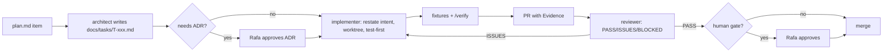

# Working as a team of agents

The project is large enough to need parallel agents. Parallel agents only help when each one's output can be verified quickly. The setup below puts verification first, then parallelism.

## Principles

1. **Verification before parallelism.** Run one agent through the full task loop until its output is reliably verifiable, then add parallel lanes. (pstack: "trust one agent's verifiable output" before swarming.)
2. **Make results observable.** `pnpm snap`, `pnpm demo` and `/verify` produce evidence a reviewer can read. Claims in PRs are labeled measured, inferred or guessed.
3. **Restate intent before code.** Each task starts with the agent restating its goal, inputs, outputs and non-goals in the task file.
4. **Small PRs, ordered commits, one task per branch and worktree.**
5. **Fix the environment, not just the bug.** When an agent repeats a mistake, add a type, lint rule, test or fixture that catches it, and record it in the Rules and checks table below.
6. **Humans decide the irreversible.** ADRs, schema changes, contract code, defense changes, key handling, deploys and force pushes wait for Rafa.

## Roles (`.claude/agents/`)

| Role | Does | Does not |
| --- | --- | --- |
| `architect` | Turns plan items into task files; drafts ADRs; sketches 2–3 alternative designs for contested interfaces (arena-style) and recommends one | Write production code |
| `implementer` | Executes one task in its lane, test first; updates fixtures and docs it touches | Change schemas, contracts or defenses without an approved ADR |
| `fixture-author` | Writes scenario fixtures and recordings from specs and bug reports; keeps `.expect.md` readable | Change production code |
| `red-teamer` | Designs `attack.` and `neutrality.` fixtures; tries to break defenses and control assumptions | Merge anything |
| `reviewer` | Reviews PRs against the spec, the litmus tests and the Rules and checks table; returns PASS, ISSUES or BLOCKED with evidence | Edit the PR |
| `verifier` | Runs `/verify` on a branch, collects evidence, and checks claims against measured output | Fix code |

For contracts, settlement and judgment code, a second review from a different model family is recommended: for example, run the reviewer prompt through another provider's CLI or MCP tool. This mirrors the adjudicator's own cross-family rule.

## Task lifecycle

- **Task file:** `docs/tasks/T-xxx-<slug>.md`, from `_template.md`. It has a lane, dependencies, the paths the task may touch, acceptance criteria, an evidence block and a handoff block.
- **Branch and worktree:** `git worktree add .worktrees/holdback-T-xxx -b t-xxx-<slug>`. `.worktrees/` sits inside the repo and is gitignored.
- **Commits:** imperative subject, with the task ID in the body.
- **PR template:** `.github/pull_request_template.md`, in pstack's opening-a-pr format: a Conventional Commits title, then Why, What changed, Scope, Tradeoffs, Blast Radius and Verification. Verification bullets come from `pnpm verify` and are labeled measured, inferred or guessed. Blast Radius names any human gate or litmus test the change touches. The task's acceptance checklist stays in the task file.
- **Handoff:** before stopping, write what is done, what is not, how to resume, and which open questions remain into the task file.
- **Decision log:** every non-trivial choice made inside a task goes into the task file's Decisions section. If the choice changes architecture, a contract or a defense, it becomes an ADR.

## Lanes and ownership

Parallel lanes own disjoint paths, which reduces merge conflicts.

| Lane | Paths | Phase 1 tasks |
| --- | --- | --- |
| infra | root config, `.github/`, `.claude/` | T-001, T-011 |
| research | `docs/research/` | T-002, T-003 |
| core | `packages/core/`, `spec/` (read-only without ADR) | T-004 |
| test | `packages/testkit/`, `fixtures/` | T-005, T-010 |
| settlement | `packages/settlement/` | T-006 |
| api | `apps/operator/`, `packages/sdk/` | T-007 |
| judgment | `packages/judgment/`, `apps/adjudicator/` | T-008, T-009 |
| demo | `apps/demo/` | T-012, T-013 |

**Parallelization map for Phase 1:**
1. T-001, T-002 and T-003 start together.
2. T-004 and T-005 follow T-001.
3. T-006, T-008 and T-012 follow T-004.
4. T-007 and T-009 follow T-006.
5. T-010 needs T-005, T-007, T-009 and T-012.
6. T-013 needs everything.

## Rules and checks

Every hard rule in `CLAUDE.md` is enforced by a check, not just by instruction. When a check is missing, adding it is a task.

| Rule | Check that enforces it | Status |
| --- | --- | --- |
| No floats in money | Branded `TokenAmount` type (string-backed); lint rule banning `number` in `packages/core/money` | T-004 |
| No real money | Startup guard rejecting non-`sk_test_` Stripe keys and mainnet chain IDs; unit test | T-007 |
| No admin keys | Reviewer applies the contract review checklist in `docs/neutrality.md`; Foundry test asserting no owner or pause selectors | Phase 2 |
| Signed messages only | Operator rejects unsigned mutations; `error.invalid-signature` fixture | T-007, T-010 |
| Idempotency | Middleware plus `error.idempotency-conflict` fixture plus property test | T-007 |
| Ledger invariants | fast-check properties in `packages/settlement` | T-006 |
| Deliverables untrusted | Prompt builder API accepts content only as `UntrustedData` (branded type); test that the system prompt has no data; `attack.*` fixtures | T-008 |
| No code execution from inputs | Check registry is a closed union; no `eval` or `Function` (lint) | T-008 |
| Pinned models | Registry loader rejects aliases; `error.unpinned-model-refused` fixture | T-009 |
| No re-roll | Panel seed derived from (commitment, attempt); test | T-009 |
| Schema contract | CI validates `spec/examples/` against schemas; CODEOWNERS-style gate on `spec/` | T-001 |
| Secrets stay out | `.claude/settings.json` denies reading `.env*`; gitleaks in CI | T-001 |
| Neutrality | `neutrality.*` fixtures for every actor in `docs/neutrality.md` | T-010, then ongoing |

## Cadence

- **Daily:** each active lane posts a three-line catch-up to `docs/log/YYYY-MM-DD.md` (done, next, blocked). The architect consolidates decisions needing Rafa at the top.
- **End of phase:** a demo of the phase's evidence, plan updates, and ADRs closed or deferred.
