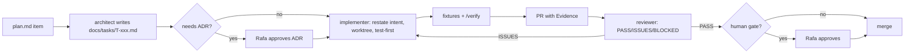

# Working as a team of agents

The project is large enough to need parallel agents. Parallel agents only help when each one's output can be verified quickly. The setup below puts verification first, then parallelism.

## Principles

1. **Verification before parallelism.** Run one agent through the full task loop until its output is reliably verifiable, then add parallel lanes. (pstack: "trust one agent's verifiable output" before swarming.)
2. **Make results observable.** `pnpm snap`, `pnpm demo` and `/verify` produce evidence a reviewer can read. Claims in PRs are labeled measured, inferred or guessed.
3. **Restate intent before code.** Each task starts with the agent restating its goal, inputs, outputs and non-goals in the task file.
4. **Small PRs, ordered commits, one task per branch and worktree.**
5. **Fix the environment, not just the bug.** When an agent repeats a mistake, add a type, lint rule, test or fixture that catches it, and record it in the Rules and checks table below.
6. **Autonomy inside the repo, gates outside it.** Work confined to this repository (ADRs, schema changes, contract code, defense changes, merges after green CI and fixed review findings) proceeds without waiting. Decisions are researched, then recorded in `docs/decisions-today.md` for Rafa to overrule. Deploys, remote force pushes or history rewrites, real keys or money, anything published or sent to others, and repository access or settings wait for Rafa.

## Roles (`.claude/agents/`)

| Role | Does | Does not |
| --- | --- | --- |
| `architect` | Turns plan items into task files; drafts ADRs; sketches 2–3 alternative designs for contested interfaces (arena-style) and recommends one | Write production code |
| `implementer` | Executes one task in its lane, test first; updates fixtures and docs it touches | Change schemas, contracts or defenses without an approved ADR |
| `fixture-author` | Writes scenario fixtures and recordings from specs and bug reports; keeps `.expect.md` readable | Change production code |
| `red-teamer` | Designs `attack.` and `neutrality.` fixtures; tries to break defenses and control assumptions | Merge anything |
| `reviewer` | Reviews PRs against the spec, the litmus tests and the Rules and checks table; returns PASS, ISSUES or BLOCKED with evidence | Edit the PR |
| `verifier` | Runs `/verify` on a branch, collects evidence, and checks claims against measured output | Fix code |

For contracts, settlement and judgment code, a second review from a different model family is recommended: for example, run the reviewer prompt through another provider's CLI or MCP tool. This mirrors the adjudicator's own cross-family rule.

## Task lifecycle

- **Task file:** `docs/tasks/T-xxx-<slug>.md`, from `_template.md`. It has a lane, dependencies, the paths the task may touch, acceptance criteria, an evidence block and a handoff block.
- **Branch and worktree:** `git worktree add .worktrees/holdback-T-xxx -b t-xxx-<slug>`. `.worktrees/` sits inside the repo and is gitignored.
- **Commits:** imperative subject, with the task ID in the body.
- **PR template:** `.github/pull_request_template.md`, in pstack's opening-a-pr format: a Conventional Commits title, then Why, What changed, Scope, Tradeoffs, Blast Radius and Verification. Verification bullets come from `pnpm verify` and are labeled measured, inferred or guessed. Blast Radius names any human gate or litmus test the change touches. The task's acceptance checklist stays in the task file.
- **Handoff:** before stopping, write what is done, what is not, how to resume, and which open questions remain into the task file.
- **Decision log:** every non-trivial choice made inside a task goes into the task file's Decisions section. If the choice changes architecture, a contract or a defense, it becomes an ADR.

## Lanes and ownership

Parallel lanes own disjoint paths, which reduces merge conflicts.

| Lane | Paths | Phase 1 tasks |
| --- | --- | --- |
| infra | root config, `.github/`, `.claude/` | T-001, T-011 |
| research | `docs/research/` | T-002, T-003 |
| core | `packages/core/`, `spec/` (read-only without ADR) | T-004, T-014 |
| test | `packages/testkit/`, `fixtures/` (except `fixtures/clubs/`, `fixtures/terms/`, `fixtures/data/`) | T-005, T-010 |
| settlement | `packages/settlement/` | T-006 |
| api | `apps/operator/`, `packages/sdk/` | T-007 |
| judgment | `packages/judgment/`, `apps/adjudicator/` | T-008, T-009 |
| demo | `apps/demo/`, `fixtures/clubs/`, `fixtures/terms/`, `fixtures/data/` | T-012, T-013 |

**Parallelization map for Phase 1:**
1. T-001, T-002 and T-003 start together.
2. T-004 and T-005 follow T-001.
3. T-014 and T-008 follow T-004; T-006 follows T-004 and T-014.
4. T-007 and T-009 follow T-006; T-012 follows T-007 and T-009.
5. T-010 needs T-005, T-007, T-009 and T-012.
6. T-013 needs everything.

Deferred work: when a finding or decision is not needed for the honest-party demo, add it to `docs/backlog.md` with its source and when it matters, instead of building it now.

## Rules and checks

Every hard rule in `CLAUDE.md` is enforced by a check, not just by instruction. When a check is missing, adding it is a task.

| Rule | Check that enforces it | Status |
| --- | --- | --- |
| No floats in money | Branded `TokenAmount` type (string-backed); lint rule banning `number` in `packages/core/money` | T-004 |
| Rates are integers (bps or fraction); no float in a hashed body | No-fraction lint widened to `packages/core/src` and `packages/judgment/src/aggregate.ts`; spec tests refuse fractional `Bps` values and thresholds at or below 1/2; `mulBps`/`splitBps` conservation property test (ADR-0022) | schema v0.5, T-006, T-008 |
| No real money | Startup guard rejecting non-`sk_test_` Stripe keys and mainnet chain IDs; unit test | T-007 |
| No admin keys | Reviewer applies the contract review checklist in `docs/neutrality.md`. `contracts/test/fuzz/NoAdmin.fuzz.t.sol` holds every deployed contract (HoldbackRules, HoldbackBonds, DrandQuicknetBeacon, SimBeacon, CPP AuthCaptureEscrow, both collectors, the TokenStore and its clone, and the Sepolia demo's test token tUSDC) to a reviewed signature allowlist, refuses 24 forbidden admin selectors, fuzzes unknown selectors and plain ether (all revert), and walks the bytecode for SELFDESTRUCT, CALLCODE and DELEGATECALL (only the fixed minimal-proxy clone delegates); `invariant_noAdminPath` (`contracts/test/invariant/RulesInvariants.t.sol`) checks that code never changes and the rules contract never holds funds under the fuzz campaign. Runs in the CI `contracts` job | T-202, T-203, T-209, T-213 |
| Signed messages only | Operator rejects unsigned mutations; `error.invalid-signature` fixture | T-007, T-010 |
| Idempotency | Middleware plus `idempotency.test.ts` and property test (`error.idempotency-conflict` fixture open, T-016b) | T-007 |
| Ledger invariants | fast-check properties in `packages/settlement` | T-006 |
| Every settlement guard is tested on its own | Mutation sweep over SimChain and the core guards it relies on: each mutant must fail a test (proposed after 2 of 16 T-006 mutants survived because an earlier guard in core masked the SimChain one) | Proposed (T-006); script to land under `scripts/` |
| Deliverables untrusted | Prompt builder API accepts content only as `UntrustedData` (branded type); test that the system prompt has no data; `attack.*` fixtures | T-008 |
| Deliverables untrusted, output surfaces | Text that can come from a deliverable or a party (check details, screen signal details, aggregate reasons, the seller's terms) reaches the terminal only as one plain line, reaches Markdown only escaped or in a fence it cannot close, and reaches HTML and JSON escaped (`apps/demo/src/transcript/untrusted.ts`). A hostile check detail is tested on all four surfaces in `apps/demo/src/transcript/untrusted.test.ts` (added after PR 46's review found `csv_columns_exact` header names reaching `beat-n.md` and the terminal raw). Scenario snapshots (`.expect.md`) are a surface too: `packages/testkit/src/untrusted.ts` (a copy of the demo's `plain`, `mdText`, `fenced`) escapes check details, screen signal details, aggregate and outcome reasons and refusal details, and fences run errors; a quoted multi-line CSV header is tested in `packages/testkit/src/render.test.ts` (added after PR 50's review found one producing a real `## Invariants` heading) | T-013, T-016 |
| No code execution from inputs | Check registry is a closed union; no `eval` or `Function` (lint) | T-008 |
| Pinned models | Registry loader rejects aliases (`panel.test.ts`, `pipeline.test.ts`, `registry-file.test.ts`; `error.unpinned-model-refused` fixture open) | T-009 |
| No re-roll | Panel seed derived from (commitment, attempt); test | T-009 |
| Schema contract | CI validates `spec/examples/` against schemas; CODEOWNERS-style gate on `spec/` | T-001 |
| Operator answers match the contract | `pnpm validate:spec` fails when `spec/openapi.json` is stale against `spec/schemas` and `spec/openapi/paths.json`; `tests/contract/openapi.contract.test.ts` runs the HTTP flows against a sim world and checks every operator response (status, headers, body) against the document, and that every documented operation is exercised (added after its first run found the sim club serving a rulebook `version` that `club.schema.json` refuses) | T-015 |
| Secrets stay out | `.claude/settings.json` denies reading `.env*`; gitleaks in CI | T-001 |
| Neutrality | `neutrality.*` fixtures for every actor in `docs/neutrality.md`; its control-point table marks the ones still planned, each a gap to close before any public-chain deployment | T-010, then ongoing |
| Generated fixtures are not hand-edited | Drift test in `tests/gen-demo-data.test.ts`; `node scripts/gen-demo-data.ts --check` | T-012 |
| Example hashes match their bodies | `tests/spec.test.ts` recomputes the club example's `rulebookHash` (added after it was found stale: it predated `payoutsTo`). Still to cover: the commitment example's `rulebookHash`, `id` and signature (core pins EIP-712 vectors over it) and the adjudicator example's `policyHash` and `poolTermsHash`, all stale today | Partial (T-012) |
| Tests do not assert on wall-clock time | Cost limits use `StepBudget` counts, not `performance.now()`; a lint or grep check over `*.test.ts` (proposed after `redteam.test.ts` K2 failed 3 of 3 full `pnpm test` runs on this machine and passed alone) | Proposed (T-012) |
| Authored verdicts survive a re-record | Hand-written fixture verdicts are `capturedFrom: authored`; `pnpm snap --judges fake --record` replays a matching authored (or live) recording and refuses with `RecordingOverwriteError`, naming the changed bindings, when one is stale; tests in `packages/testkit/src/recorded.test.ts` (added after a fake re-record silently overwrote T-010's authored verdicts) | T-016 |
| Operator proposes, agent verifies | An agent signs only typed data it rebuilt from its own intent, with its own pinned EIP-712 domain and types; a prepared message is a proposal. `examples/verify.test.ts` (`neutrality.operator-lies-in-prepare`) edits each field of prepared offers, agreements and settlements (buyer, price, fee, adjudicators, domain, types, primaryType, slots, keys, hashes, times), recomputes the digest, and expects a refusal; it also shows a seller never sealing to recipients or keys an operator substitutes (added after review found `sign.ts` signing an edited offer, PR 53) | T-020 |
| Examples run as written | `examples/tsconfig.json` sets `erasableSyntaxOnly`, because Node runs the examples by stripping types and rejects TypeScript-only syntax at run time (a parameter property broke `agent.ts` once) | T-020 |
| Schemas compile at import, never in a request | A Cloudflare Worker generates code only at startup, within a startup CPU limit. `packages/core/src/parse.startup.test.ts` runs every parser with `Function` disabled after import; core skips the meta-schema check (`validateSchema: false`; `pnpm validate:spec` does it) and Ajv's code optimizer to stay under the limit. Added after T-029's lazy compile passed every Node test and took the live demo down with 1101 for minutes, and the eager one first failed deploy on startup CPU | T-029 |
| A published script is the code CI ran | `site/try.mjs` is generated from `examples/try.ts`; the one command in `llms.txt` ("Try it") carries its sha256 and the lockfile's exact versions, filled in by `site/build.mjs`. `examples/try.test.ts` (in CI, which does not run `site/check.mjs`) fails on a stale bundle, page or command, and runs the bundle itself against the demo world; `site/check.mjs` and the publish build (`--out`) refuse a stale bundle. Added with T-037: a stale bundle published under a fresh sha256, or the reverse, fails every stranger's `shasum -c` | T-037 |
| Docs claim only fixtures that exist | A test that every fixture `docs/plan.md`'s scenario index marks "exists" or "todo" has a file in `fixtures/scenarios/`, every file there has a row, and every fixture name in `docs/neutrality.md` and `docs/feature-map.md` outside a "planned" mark exists (proposed on 2026-11-03, when 29 indexed fixtures had no file and 9 files had no row) | Proposed |
| Contract vectors are generated in the repository | `packages/core/src/eip712.vectors.test.ts` computes, from `spec/examples`, every value `contracts/test/unit/Vectors.t.sol` pins, so a change to the signed encoding moves both pins in one PR. Added in T-212 item 3, when T-202's generator had stayed outside the repository and ADR-0029 moved the domain | T-212 |
| A signed-encoding change re-seats recordings, never re-judges them | When the commitment ID moves (a schema or domain bump), every judge input and some panels move. Re-seat: a judge still seated keeps its verdict with its bound fields refreshed, a newly seated one takes an unseated judge's verdict (same family first), `capturedFrom` kept. `node scripts/reseat-recordings.mjs [fixture...]` does it and prints every verdict that changed seat; it never changes a verdict. Done by hand for D27d, with the script for T-212 item 3; still proposed: `pnpm snap --reseat` in the testkit, with a test | Script (T-212) |
| A test that needs Foundry runs somewhere in CI | A test in `tests/` that finds every test file whose suites skip without anvil (`describe.skipIf(!ready)` over `anvilAvailable()`) and fails unless `.github/workflows/ci.yml`'s "anvil tests (must not skip)" step names it, with an allowlist for files that also hold network-only tests. Proposed after the review of PR 202: T-221's anvil end to end moved to `apps/demo-cloud/` and left that step, so its on-chain proofs would have merged green; the same failure mode as PR 139's `snap:local` | Proposed (T-221 review; needs Rafa's `.github/` change first) |
| A Sepolia fork starts on a block its RPC holds | Every fork test spawns anvil with `--fork-block-number` a few blocks behind the head the RPC reports, then sets the next block's time to the wall clock when the fork lags it. `apps/demo-cloud/src/predeploy-fork.test.ts` does both (8 blocks, about 96 s). A test in `tests/` that greps every `*.test.ts` spawning `anvil --fork-url` for `--fork-block-number` would hold the rest to it. Proposed by T-220 after publicnode's load balancer answered "block not found" for its own head and anvil exited while building its genesis: twice in T-217's fork runs and once in T-220's (measured) | Proposed (T-220) |
| A mutation sweep never leaves a mutant behind | Both `mutants.mjs` scripts journal the original to `reports/mutant-inflight.json` before each mutation and restore it on the next start, since `finally` does not run when the agent is killed (two stopped T-009 sweeps left mutants committed in WIP checkpoints) | T-009 |
| A chain read after a transaction sees that transaction | A read, simulation or gas estimate that follows a transaction is pinned to that transaction's block or later. A load-balanced node's latest block can trail it, and a node without the block is asked again, never read past. In the round-1 driver: `RoundChain.fresh`, the deal's last block in `finish`, `openDeals` and `deliveryHashOf`, and `send`'s simulation and estimate. In the operators: a delivery relay that reverts reads `deliveryHashOf` at the revert's block, and the catch-up after it reads no head below that block (T-230). Another party's transaction is one the operator cannot pin to, so its relay of a step that party already sent may still revert, and the operator then reads at the revert's block. The check: a stand-in RPC whose latest block trails the writes (`laggingRpc` and `walletRpc` in `examples/e2e-chain.test.ts`; `lagging` in `packages/settlement/evm/sync.test.ts` and `faulty` in `attack-t230.test.ts` for the operators) for each new read after a write; a check that finds an unpinned read is still to build. Added on 2026-11-06 after the failure came back five times on Sepolia: T-226's lost delivery, 3d's and 10a's evidence, PR 210's starting balances, then 3b's bond deposit and the gate after 5a; a sixth time the same day, scenario 8's dropped delivery (T-230) (measured) | Partial (T-216, T-230): the stand-in tests |
| Each fetch before the one command costs the user an approval | The homepage's copied prompt carries the exact one command from `tryCommand()`, with its sha256, on a line of its own, and the visible page does not show it; `llms.txt` "Try it" asks for no fetch of `try.mjs` before the command and keeps the SHA-256 pin and the GitHub source. `examples/try.test.ts` (CI) and `site/check.mjs` fail otherwise. Added with T-229 after the failure repeated: 14 approvals per deal before T-037, and 4 on 2026-11-05 from a link-only prompt and an invitation to read `try.mjs` first (measured) | T-229 |

## Cadence

- **Daily:** each active lane posts a three-line catch-up to `docs/log/YYYY-MM-DD.md` (done, next, blocked). The architect consolidates decisions needing Rafa at the top.
- **End of phase:** a demo of the phase's evidence, plan updates, and ADRs closed or deferred.
- **At each milestone** (a merged task, decision or phase change): run `/map` to regenerate the design map and republish it to the same private link (the command holds it). The map is read-only; fix its sources (task files, plan, decisions, ADRs, API doc), never the page.
